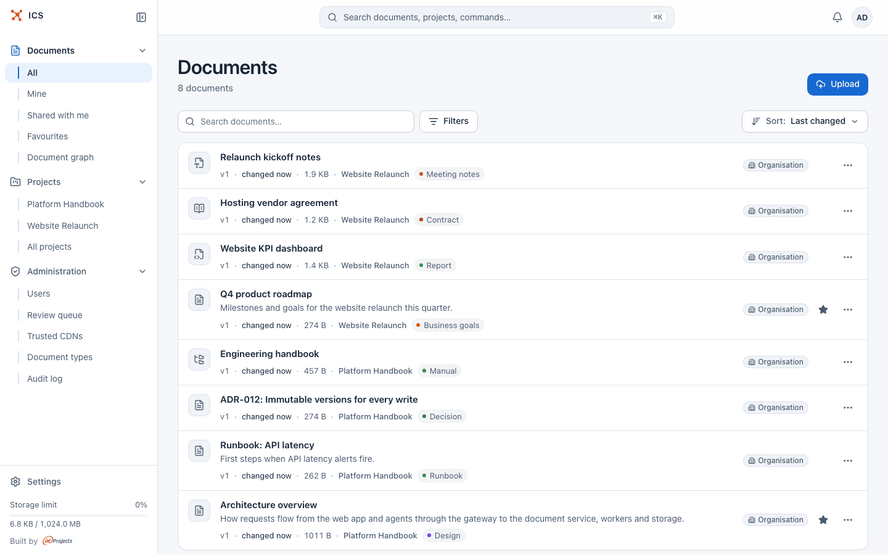
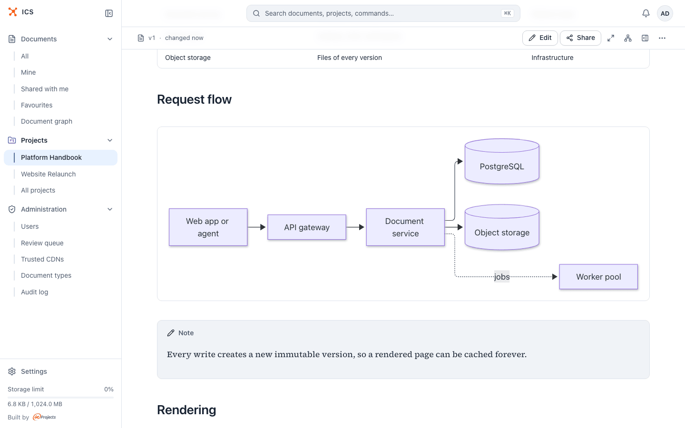
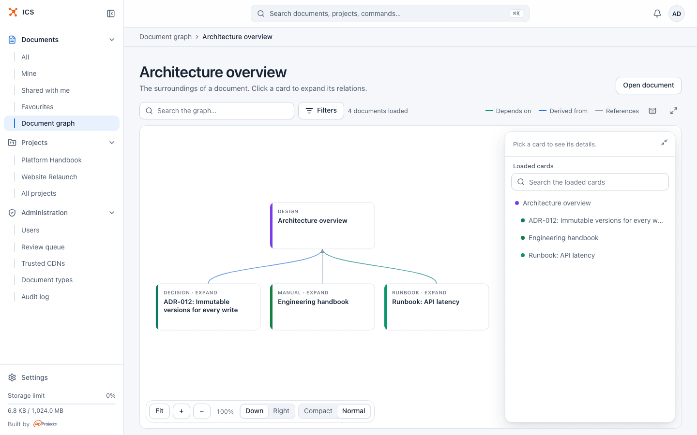
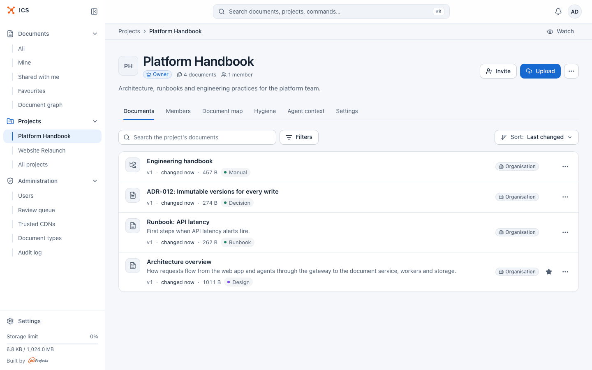
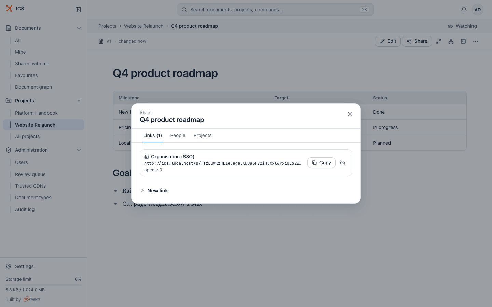
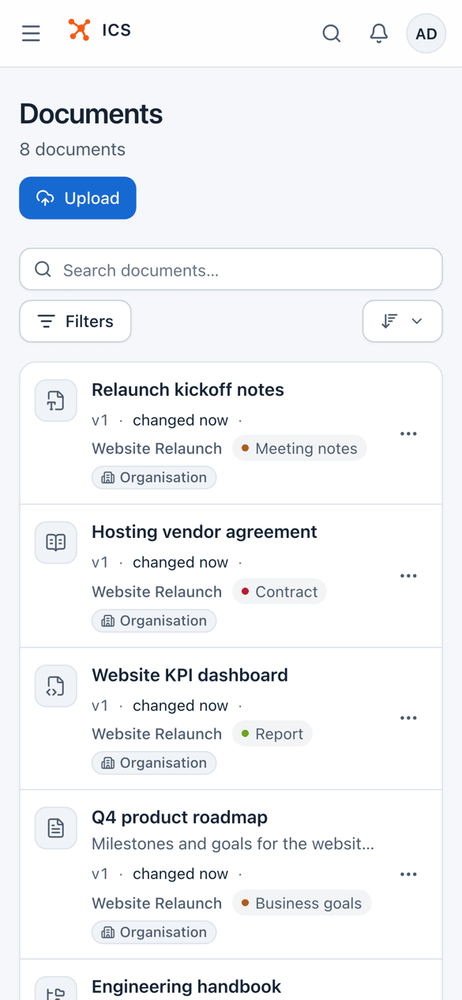
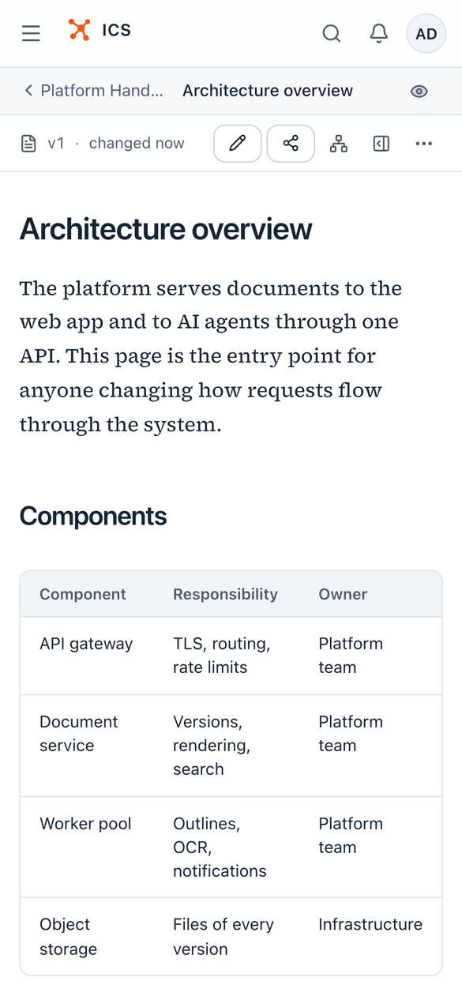
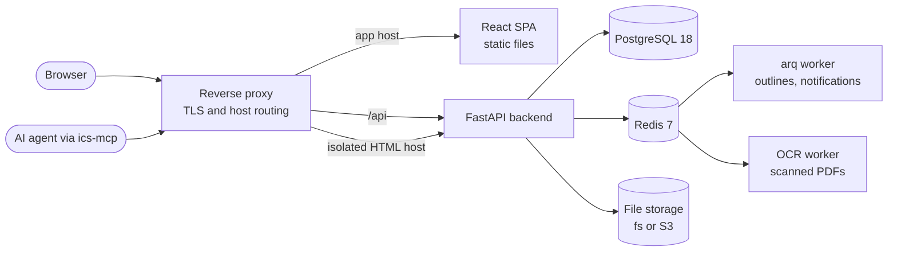

<div align="center">

<a href="https://github.com/inprojectspl/ics">
  <picture>
    <source media="(prefers-color-scheme: dark)" srcset="frontend/public/brand/logo-lockup-white.svg">
    
  </picture>
</a>

## Internal Content Sharing

### Self-hosted document sharing for teams and their AI agents

Publish Markdown, HTML bundles, PDFs and Word files in seconds, link them into a knowledge
graph, and share each one exactly as far as it needs to go.

[](./LICENSE)
[](./backend/pyproject.toml)
[](./backend)
[](./frontend)
[](./compose.yaml)
[](https://github.com/inprojectspl/ics-mcp)

[Features](#features) ·
[User guide](https://inprojectspl.github.io/ics/) ·
[Screenshots](#screenshots) ·
[Quick start](#quick-start) ·
[Deployment](#production-deployment) ·
[AI agents](#mcp-and-ai-agents) ·
[Documentation](#documentation) ·
[Contributing](#contributing)

<br>

<picture>
  <source media="(prefers-color-scheme: dark)" srcset="docs/images/home-dark.png">
  
</picture>

</div>

## Why ICS

ICS (Internal Content Sharing) is a self-hosted web app where a team publishes its documents
and decides, link by link, who may read them.

- **Drop a file, get a link.** A Markdown note, a folder of notes, a generated HTML dashboard, a
  PDF or a Word document becomes a versioned page with a stable URL in one upload.
- **Share precisely.** Every document can carry several links at once: organisation only,
  password protected, invite by e-mail, public, or a named person with a role. Links expire,
  count their opens and can be revoked.
- **Built for agents, too.** A token-efficient API, an OAuth 2.1 authorization server and the
  companion [`ics-mcp`](https://github.com/inprojectspl/ics-mcp) server let assistants such as
  Claude read, write and share documents with the signed-in user's own permissions.

## Features

<table>
<tr>
<td width="50%" valign="top">

#### 📝 Every document format your team writes

- **Markdown** with KaTeX math, Mermaid diagrams, Shiki syntax highlighting and
  Obsidian-style callouts, editable in the browser.
- **Markdown collections**: folders of notes linked with `[[wikilinks]]`, with a file tree and
  a link graph.
- **HTML bundles** served from an isolated origin and scanned for risky code at upload.
- **PDF** with a page-by-page reader, extracted text and **OCR** for scanned pages.
- **Word and OpenDocument** (`.docx`, `.odt`, `.doc`) converted to Markdown.

</td>
<td width="50%" valign="top">

#### 🔗 Sharing without surprises

- Link modes: `org_sso`, `password`, `magic_email`, `public`, plus per-user `editor` and
  `viewer` grants.
- Expiry dates, open limits and instant revocation.
- **Projects** with `owner`, `editor` and `viewer` members; a document can belong to several
  projects.
- Sign-in with e-mail and password (Argon2id, lockout) or Google OIDC.

</td>
</tr>
<tr>
<td valign="top">

#### 🕸️ A knowledge graph, not a file dump

- Eight typed relations (`depends_on`, `supersedes`, `derived_from`, ...) plus links extracted
  from the content.
- A **graph explorer** that walks from any document to everything around it.
- Document types, maintainers, review dates and freshness signals that tell readers when a page
  is out of date.

</td>
<td valign="top">

#### 🔎 Find and follow

- One accent-insensitive full-text search over titles, summaries, tags, Markdown, PDF and Word
  text.
- Version history with side-by-side diffs and one-click restore.
- **Notifications** in the app, by e-mail, in Google Chat and as Web Push, for the documents
  and projects you watch.

</td>
</tr>
<tr>
<td valign="top">

#### 🤖 Ready for AI agents

- OAuth 2.1 authorization server (PKCE, RFC 8707 resource indicators, dynamic client
  registration, rotating refresh tokens).
- Compact agent endpoints, an **agent context pack** that gathers the documents of a task
  within a token budget, and read-only personal access tokens for automation.
- GitLab repository bindings that publish a new version on every push, signed with Ed25519.

</td>
<td valign="top">

#### 🛡️ Operable and safe by default

- Untrusted HTML runs on a separate origin with a strict CSP; risky bundles and documents wait
  for administrator review.
- Append-only audit log, per-user storage quotas, rate limiting and soft delete.
- English and Polish interface, light and dark themes, a layout that works on a phone.

</td>
</tr>
</table>

## Screenshots

<table>
<tr>
<td width="50%">
<picture>
  <source media="(prefers-color-scheme: dark)" srcset="docs/images/reader-dark.png">
  
</picture>
<p align="center"><sub><b>Reader</b>: Markdown with diagrams, callouts and code</sub></p>
</td>
<td width="50%">
<picture>
  <source media="(prefers-color-scheme: dark)" srcset="docs/images/graph-dark.png">
  
</picture>
<p align="center"><sub><b>Graph explorer</b>: relations between documents</sub></p>
</td>
</tr>
<tr>
<td width="50%">
<picture>
  <source media="(prefers-color-scheme: dark)" srcset="docs/images/project-dark.png">
  
</picture>
<p align="center"><sub><b>Projects</b>: shared spaces with roles</sub></p>
</td>
<td width="50%">
<picture>
  <source media="(prefers-color-scheme: dark)" srcset="docs/images/share-dark.png">
  
</picture>
<p align="center"><sub><b>Sharing</b>: links, people and projects in one dialog</sub></p>
</td>
</tr>
</table>

<p align="center">
  <picture>
    <source media="(prefers-color-scheme: dark)" srcset="docs/images/phone-home-dark.png">
    
  </picture>
  &nbsp;&nbsp;
  <picture>
    <source media="(prefers-color-scheme: dark)" srcset="docs/images/phone-reader-dark.png">
    
  </picture>
</p>

<p align="center"><sub>The screenshots follow your GitHub theme: switch between light and dark to see both.</sub></p>

## Architecture



| Component | Role |
|---|---|
| [`backend/`](./backend) | FastAPI app: HTTP API, OAuth authorization server, Markdown rendering, document conversion, HTML bundle scanning, audit log. Alembic migrations in `backend/migrations/`. |
| [`frontend/`](./frontend) | React 19 + TypeScript + Vite SPA with Tailwind CSS 4. In production a one-shot container copies the build into the `ics_static` volume served by the proxy. |
| `arq-worker` | Background jobs on Redis: outline rebuilds, notification delivery, OAuth cleanup, the OCR sweeper. Same image as the backend. |
| `ocr-worker` | OCR of scanned PDF pages (pdfium and RapidOCR on CPU, or Mistral) on its own queue. Same image as the backend. |
| PostgreSQL | Documents, relations, full-text search, audit log. |
| Redis | Sessions, rate limits, job queues, notification inboxes. |
| Storage | Files of every version, on a local volume (`fs://`) or any S3-compatible service (`s3://`). |

## Quick start

You need Docker Engine with the Compose v2 plugin and `make`. The development stack binds
ports `5173`, `8025`, `127.0.0.1:5432` and `127.0.0.1:6379`; no `.env` file is needed.

```bash
git clone https://github.com/inprojectspl/ics.git && cd ics
make dev-init   # build the dev images, start Postgres and Redis, run migrations
make dev        # start the whole stack with hot reload
```

| | |
|---|---|
| **App** | <http://localhost:5173> |
| **MailPit** (every outgoing e-mail) | <http://localhost:8025> |
| **Sign in** | `admin@example.com` / `AdminAdmin1!` (created on first start, see `compose.dev.yaml`) |

<details>
<summary><b>More development commands</b></summary>

<br>

Without `make`, the same stack runs with plain Compose:

```bash
docker compose -f compose.yaml -f compose.dev.yaml build
docker compose -f compose.yaml -f compose.dev.yaml up -d postgres redis
docker compose -f compose.yaml -f compose.dev.yaml run --rm backend alembic upgrade head
docker compose -f compose.yaml -f compose.dev.yaml up
```

```bash
make dev-down        # stop the stack
make dev-clean       # stop and delete volumes (destroys data)
make dev-logs        # follow backend and frontend logs
make shell-backend   # shell in the backend container
make psql            # psql into the dev database
make redis-cli       # redis-cli into the dev Redis
make migrate         # alembic upgrade head
make makemigration MSG="add foo"                  # autogenerate a migration
make seed-admin EMAIL=a@example.com PASS='...'    # create an admin by hand
make outbox          # show recent outgoing e-mails
make test            # backend tests in the dev container
make lint            # ruff and tsc in the dev containers
```

**HTML bundles in development.** Bundles open on their own origin, `ICS_HTML_VIEWER_BASE`,
which the dev stack sets to `http://html.ics.localhost:5173`. Browsers resolve `*.localhost`
to your machine, so no hosts file entry is needed.

**Google sign-in in development.** Create an OAuth 2.0 Client ID of type "Web application"
with the redirect URI `http://localhost:5173/api/auth/google/callback`, put
`ICS_BASE_URL=http://localhost:5173`, `ICS_GOOGLE_OIDC_CLIENT_ID` and
`ICS_GOOGLE_OIDC_CLIENT_SECRET` in `.env`, and recreate the backend with
`docker compose -f compose.yaml -f compose.dev.yaml up -d backend`.

</details>

## Configuration

Every setting is an environment variable with the `ICS_` prefix, read by
[`backend/app/config.py`](./backend/app/config.py). [`.env.example`](./.env.example) documents
each one; copy it to `.env` for a production-style run.

<details>
<summary><b>The most important variables</b></summary>

<br>

| Variable | Purpose |
|---|---|
| `ICS_SECRET_KEY` | Signs tokens, session cookies and audit IP hashes. Generate with `openssl rand -hex 32`. The backend refuses to start with the default value unless `ICS_DEBUG=1`. |
| `ICS_PG_PASSWORD` / `ICS_DATABASE_URL` | Database password, or a full asyncpg connection string. |
| `ICS_REDIS_URL` | Redis connection string (default `redis://redis:6379/0`). |
| `ICS_BASE_URL` | Public URL of the app. |
| `ICS_HTML_VIEWER_BASE` | Separate origin that serves HTML bundles. Must differ from `ICS_BASE_URL`. |
| `ICS_CORS_ORIGINS` | Allowed browser origins (CSV), also trusted by the cross-site request check. |
| `ICS_ALLOWED_DOMAINS` | E-mail domains of your organisation (CSV): who can sign in with Google, receive invites and open `org_sso` links. Empty by default, so every deployment must set it. |
| `ICS_STORAGE_URL` | `fs:///data/storage` or `s3://bucket`; S3 also needs `ICS_S3_ENDPOINT_URL`, `ICS_S3_ACCESS_KEY_ID`, `ICS_S3_SECRET_ACCESS_KEY` and `ICS_S3_REGION`. |
| `ICS_BOOTSTRAP_ADMIN_EMAIL` / `ICS_BOOTSTRAP_ADMIN_PASSWORD` | Create the first administrator at startup if none exists. |
| `ICS_GOOGLE_OIDC_CLIENT_ID` / `ICS_GOOGLE_OIDC_CLIENT_SECRET` | Optional Google sign-in. |
| `ICS_SMTP_*` | Outgoing mail. Without `ICS_SMTP_HOST`, e-mails stay in the database outbox. |
| `ICS_OAUTH_PRIVATE_KEY_PEM` (or `_PATH`), `ICS_OAUTH_ISSUER`, `ICS_MCP_RESOURCE_URI` | OAuth authorization server for MCP clients. Generate a key with `openssl genrsa -out priv.pem 2048`. |
| `ICS_OCR_*` | OCR of scanned PDFs: on or off, provider (`local` or `mistral`), page limits and timeouts. |
| `ICS_VAPID_*`, `ICS_NOTIFICATIONS_*` | Web Push keys, notification batching, digest hour and time zone, see [ADR-0023](./docs/decisions/0023-notifications.md). |
| `ICS_SECURITY_POLICY`, `ICS_TRUSTED_CDN_HOSTS` | HTML bundle scan policy (`permissive` or `strict`) and the base list of trusted script hosts. |
| `ICS_MAX_ASSET_BYTES`, `ICS_MAX_FILES_PER_BUNDLE` | Size limits. Per-user storage quotas are set by an admin in the UI. |
| `ICS_LOCKOUT_THRESHOLD`, `ICS_LOCKOUT_MINUTES` | Account lockout after failed sign-ins. |
| `ICS_SYNC_IMAGE` | Container image of the `ics-sync` CLI shown in the GitLab CI snippet of a binding. |
| `ICS_EDGE_NETWORK` | External Docker network shared with the reverse proxy (default `edge`). |
| `ICS_DEBUG`, `ICS_DEV_STUB_SSO`, `ICS_ALLOW_SELF_REGISTER` | Development switches. Keep them off in production. |

</details>

## Production deployment

[`docs/DEPLOY.md`](./docs/DEPLOY.md) is the step-by-step guide. The reference setup runs on a
single Linux host with Docker Compose:

```bash
docker compose -f compose.yaml -f compose.prod.yaml up -d --pull always
```

It expects PostgreSQL 18 on the host (or any database through `ICS_DATABASE_URL`), an external
reverse proxy on the network named by `ICS_EDGE_NETWORK`
([`docs/deploy/nginx.example.conf`](./docs/deploy/nginx.example.conf) is a working example),
and backend and frontend images in a registry (`ICS_IMAGE_REGISTRY`, `IMAGE_TAG`). The backend
image applies Alembic migrations on start.

## GitLab repository bindings

A binding connects a document to a GitLab repository, so every push to the default branch
publishes a new version. ICS generates an Ed25519 key pair, keeps the public key and shows the
private key once, together with a YAML config for the repository root and a ready-to-paste CI
job.

The job runs **[`ics-sync`](https://github.com/inprojectspl/ics-sync)**, a small CLI published
as the container image `ghcr.io/inprojectspl/ics-sync:1`. It packs the files, signs a manifest
and posts it to `POST /api/bindings/{id}/sync`; ICS verifies the signature against the stored
key, checks the bundle hash, rejects replays and stores a new version. Set `ICS_SYNC_IMAGE` to
that image (or your own build) so the snippet is ready to paste; when it is empty, the snippet
shows a `<registry>/ics-sync:<tag>` placeholder.

## MCP and AI agents

ICS ships an OAuth 2.1 authorization server so that MCP clients act on behalf of a user, with
that user's permissions. The MCP server itself lives in
**[inprojectspl/ics-mcp](https://github.com/inprojectspl/ics-mcp)** and also installs as a plugin for
Claude Code and Codex CLI.

| | Endpoint |
|---|---|
| Protected resource metadata (RFC 9728) | `/.well-known/oauth-protected-resource` |
| Authorization server metadata (RFC 8414) | `/api/auth/oauth/.well-known/oauth-authorization-server` |
| OAuth endpoints | `/api/auth/oauth/{authorize,token,revoke,register,jwks.json}` |
| Agent API | `/api/assets/index`, `search-mcp`, `by-slug/{slug}/meta`, `outline`, `files-mcp`, `file-mcp` |
| Task context pack | `GET /api/context`, see [ADR-0019](./docs/decisions/0019-agent-context-pack.md) |

Set `ICS_OAUTH_PRIVATE_KEY_PEM` and `ICS_MCP_RESOURCE_URI` to enable it. Owners and editors
can open `/v/<slug>/agent` in the web app to see exactly what an agent reads for a document.

## Development

<details>
<summary><b>Backend tests and linters</b></summary>

<br>

Pytest runs against a real PostgreSQL and Redis, in parallel through pytest-xdist. The script
starts throwaway containers when `ICS_DATABASE_URL` and `ICS_REDIS_URL` are not set; it needs
Docker and [`uv`](https://docs.astral.sh/uv/).

```bash
scripts/test-backend.sh                        # all tests
scripts/test-backend.sh tests/test_tokens.py   # one file; extra arguments go to pytest
scripts/lint-backend.sh                        # ruff and mypy, as CI runs them
```

</details>

<details>
<summary><b>Frontend tests and linters</b></summary>

<br>

Node 22.12 or newer.

```bash
cd frontend
npm ci
npm test               # Vitest unit tests
npm run test:coverage  # with the coverage thresholds
npm run typecheck      # tsc --noEmit
npm run lint           # oxlint
npm run e2e            # Playwright, needs the dev stack on :5173
```

`scripts/check-frontend.sh` runs the typecheck, lint and coverage gates the way CI does.

</details>

CI enforces a backend coverage gate of 90%, the frontend thresholds in
[`frontend/vitest.config.ts`](./frontend/vitest.config.ts) and a 500-line budget per source
file ([ADR-0002](./docs/decisions/0002-quality-bar.md)).

## Documentation

The documentation is published at <https://inprojectspl.github.io/ics/>; its sources are in
[`docs/`](./docs/).

| Document | What it covers |
|---|---|
| [`docs/guide/`](./docs/guide/README.md) | User guide: documents, sharing, projects, the graph, AI agents and administration |
| [`docs/DEPLOY.md`](./docs/DEPLOY.md) | Production deployment, step by step |
| [`docs/DESIGN.md`](./docs/DESIGN.md) | The design and UX contract of the frontend |
| [`docs/api-errors.md`](./docs/api-errors.md) | API error codes; responses look like `{"detail": "...", "code": "..."}` |
| [`docs/notifications-api.md`](./docs/notifications-api.md) | The notifications API |
| [`docs/decisions/`](./docs/decisions/) | Architectural Decision Records, the reasoning behind the design |

## Contributing

Contributions are welcome. Read [CONTRIBUTING.md](./CONTRIBUTING.md) for the setup and the
conventions, and follow the [Code of Conduct](./CODE_OF_CONDUCT.md). Please report security
issues privately as described in [SECURITY.md](./SECURITY.md), not in public issues.

## License

ICS is released under the [MIT License](./LICENSE). The inProjects.ai name and logo are not
covered by it, see [NOTICE](./NOTICE), which also lists third-party notices.

<br>

<div align="center">
  <sub>Built by</sub>
  <br>
  <a href="https://inprojects.ai">
    <picture>
      <source media="(prefers-color-scheme: dark)" srcset="docs/images/inprojects-logo-white.svg">
      
    </picture>
  </a>
</div>
