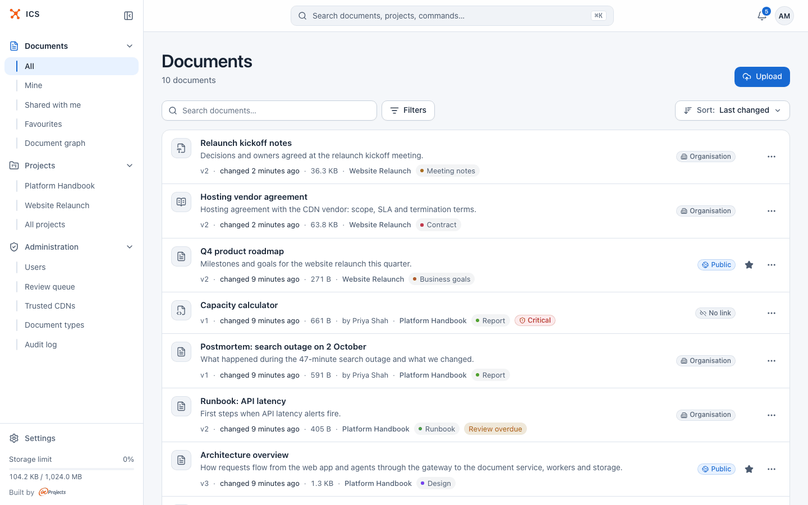

# ICS user guide

ICS (Internal Content Sharing) is a self-hosted web app where a team publishes its documents and decides, document by document, who may read them. You upload a Markdown note, a folder of notes, a generated HTML dashboard, a PDF or a Word file, and get a versioned page with a stable address that you can share with your colleagues, a client or the whole world. AI assistants can read and write the same documents with your permissions.

This guide is for people who use ICS: authors, readers, project owners and administrators. Installing and running ICS is covered separately in the [README](https://github.com/inprojectspl/ics/blob/main/README.md) and the [deployment guide](../DEPLOY.md).

## The main ideas

- **Documents.** Everything you publish is a document: Markdown, a collection of linked notes, an HTML bundle, a PDF, or a Word or OpenDocument file. Each has a title, an owner, a description and metadata that say what it is and whether it is still current.
- **Versions.** ICS never overwrites a document. Each change creates a new version, older versions stay readable, and you can compare and restore them.
- **Sharing.** A document can have several links at once, each for its own audience: your organisation, named people by e-mail, anyone with a password, or the public. Links can expire, be one-time and be revoked. You can also give a named person a role on a document.
- **Projects.** A project is a shared space with members who are owners, editors or viewers. A document in a project is open to its members according to their role.
- **The graph.** Documents relate to each other: one depends on another, is derived from it, replaces it. ICS records these relations, also from the links in the content, and shows them as a graph you can explore.

## Where to start

New to ICS? Read [Getting started](getting-started.md) to sign in and find your way around, then [Documents](documents.md) to upload and organise your first document, and [Sharing](sharing.md) to send it to someone.

## Pages

### Using ICS

- [Getting started](getting-started.md): signing in, the interface, the command palette, language and theme, ICS on a phone
- [Documents](documents.md): uploading, the document list, reading, editing, metadata, favourites, moving and deleting
- [Document formats](formats.md): Markdown, collections, HTML bundles, PDF with OCR, Word and OpenDocument
- [Versions](versions.md): version history, change notes, comparing, viewing and restoring versions
- [Search](search.md): what the search finds, how matching works, the command palette as a launcher
- [Sharing](sharing.md): share links and their modes, personal grants, project shares, what a visitor sees

### Working together

- [Projects](projects.md): shared spaces with members and roles, the document map, hygiene and key documents
- [Relations and the document graph](graph.md): relation types, adding relations and exploring the graph
- [Notifications](notifications.md): watching documents and projects, and where notifications reach you

### Your account and integrations

- [Account settings](account.md): notification settings, personal access tokens, language and theme
- [AI agents](ai-agents.md): letting assistants work with ICS through ics-mcp, and what an agent reads
- [GitLab](gitlab.md): publishing a repository to ICS on every push

### For administrators

- [Administration](administration.md): users, the review queue, trusted CDN hosts, document types and the audit log
