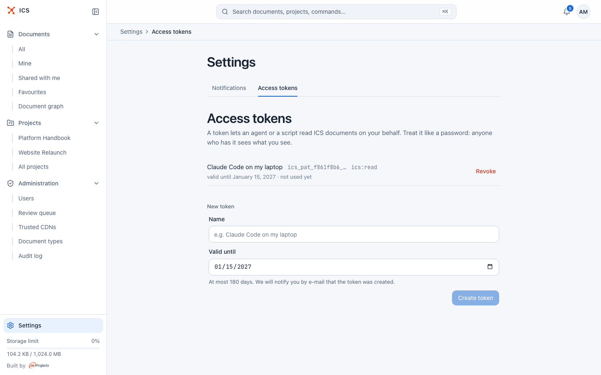
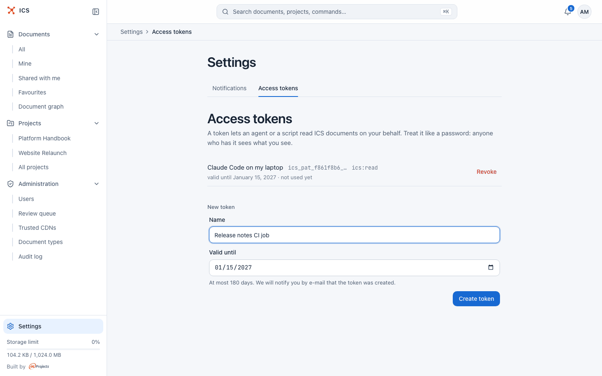
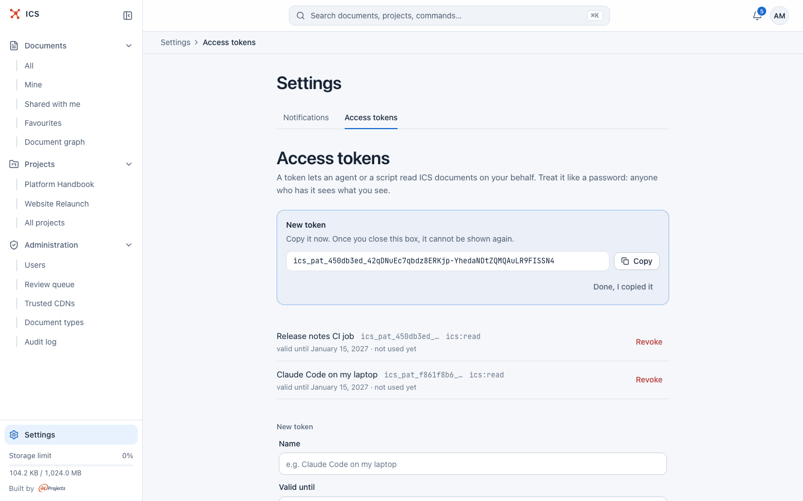

# Account settings and access tokens

Your settings have two pages: **Notifications**, where you choose what you hear about and where, and **Access tokens**, where you create read-only keys for scripts and AI agents that read ICS as you. Language and theme are in the account menu.

## Open your settings

You can reach the settings in several ways:

- click **Settings** at the bottom of the sidebar;
- click your avatar in the top bar and pick **Settings** or **Access tokens**;
- open the command palette (Ctrl+K or Cmd+K) and pick **Settings** under **Go to**.

The page has two tabs, **Notifications** and **Access tokens**.


## Notification settings

The **Notifications** tab holds the master switch, the delivery channels (in the app, browser, e-mail, Google Chat), the table of events per channel, the switch for changes to your own documents and the list of what you watch. Everything on it is described in [Notifications](notifications.md).

## What an access token is for

A personal access token lets a script or an AI agent read ICS documents on your behalf, without a browser. Typical uses are a local tool that pulls project documents into an agent's context, or a CI job that reads a document.

A token is:

- **personal**: it acts as you and sees exactly the documents you can see, no more;
- **read only**: it carries the scope `ics:read`, and ICS refuses any request with it that would change something (create, edit, share, delete);
- **limited in time**: every token has an expiry date, at most 180 days ahead;
- **revocable**: you can revoke it at any time, and it stops working immediately.

> [!WARNING]
> Treat a token like a password: anyone who has it sees what you see. Do not commit it to a repository or paste it into a chat. Store it in a secret store or a CI variable.

If you are an administrator, a token does not carry your administrator rights. Requests made with it see only what you would see as an ordinary user, and the administration pages refuse it. Use the browser for administration.

> [!NOTE]
> Access tokens are separate from signing in to AI assistants through ics-mcp, which uses its own sign-in (see [AI agents](ai-agents.md)). Revoking a token here does not sign out ics-mcp.

## Create an access token



1. Open **Settings** and the **Access tokens** tab.
2. Under **New token**, type a **Name** that tells you later where the token is used, for example "Release notes CI job".

   

3. Pick the **Valid until** date. It starts 90 days ahead and can be at most 180 days ahead.
4. Click **Create token**.
5. A box **New token** shows the full token. Click **Copy** and store it where the script or agent will read it.
6. Click **Done, I copied it**.



> [!WARNING]
> The token is shown only once. Once you close the box, it cannot be shown again. If you lose it, revoke it and create a new one.

ICS sends you an e-mail every time a token is created on your account, so a token created by someone else with access to your session does not go unnoticed. You can have at most 5 active tokens at a time.

## Use an access token

Send the token in the `Authorization` header of each request to the ICS API:

```
Authorization: Bearer ics_pat_...
```

Tokens start with `ics_pat_` followed by a short prefix. The prefix is what the list shows (for example `ics_pat_f861f8b6_…`), so you can tell your tokens apart without exposing them. Requests with a token are rate-limited to 600 per minute.

## Check and revoke your tokens

The list on the **Access tokens** page shows, for each token, its name, prefix, scope, expiry date ("valid until ...") and when it was last used ("last used ..." or "not used yet"). Expired tokens stay in the list until you revoke them.

To revoke a token:

1. Click **Revoke** next to it.
2. Confirm in the dialog "Revoke token ...?". Agents and scripts using this token lose access right away.

Revoke a token when you no longer use it, when a laptop or CI project that held it is retired, or when you suspect it leaked. Tokens also stop working when an administrator locks your account (locking revokes all your tokens) or revokes them for you.

## Change the language and the theme

Click your avatar in the top bar. The menu has a **Theme** switch (Light, Dark, System) and a **Language** switch (Polski, English). The language you pick is also saved to your account. See [Getting started](getting-started.md) for details.

## Related

- [Notifications](notifications.md): every option on the Notifications tab
- [AI agents](ai-agents.md): how assistants use ICS through ics-mcp
- [Getting started](getting-started.md): the account menu, language and theme
- [Administration](administration.md): locking accounts and managing users
