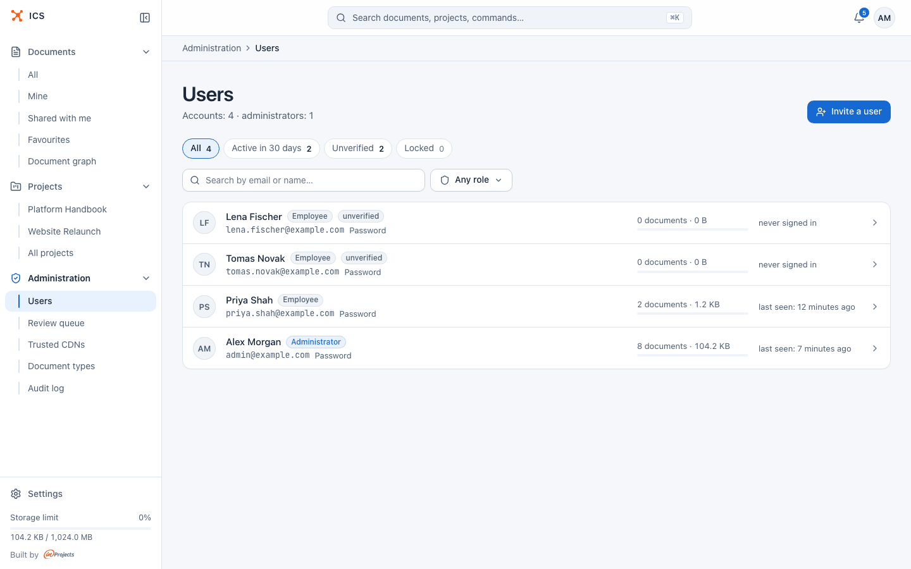
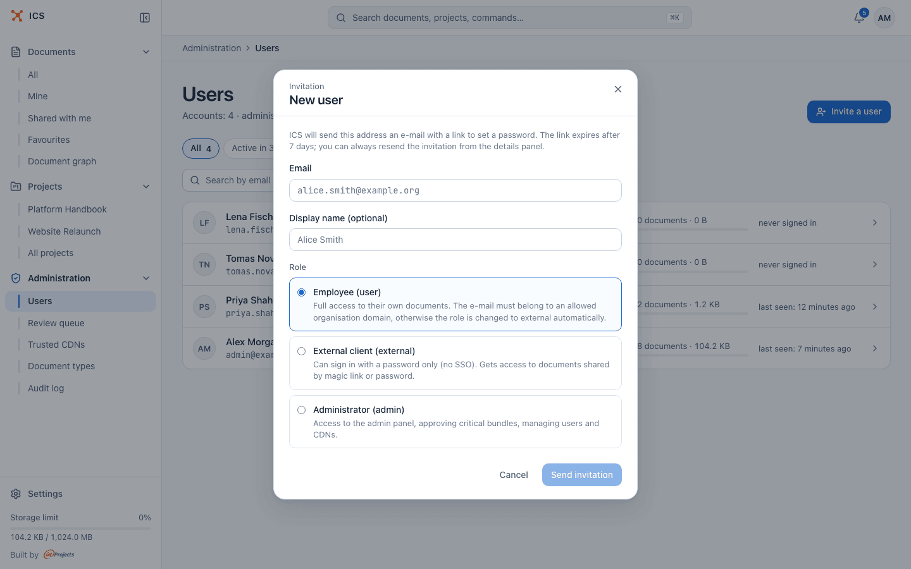
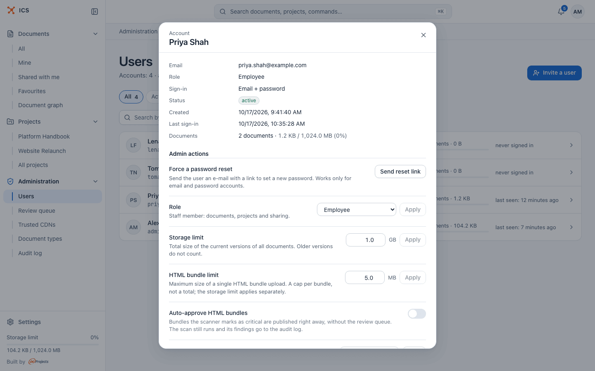
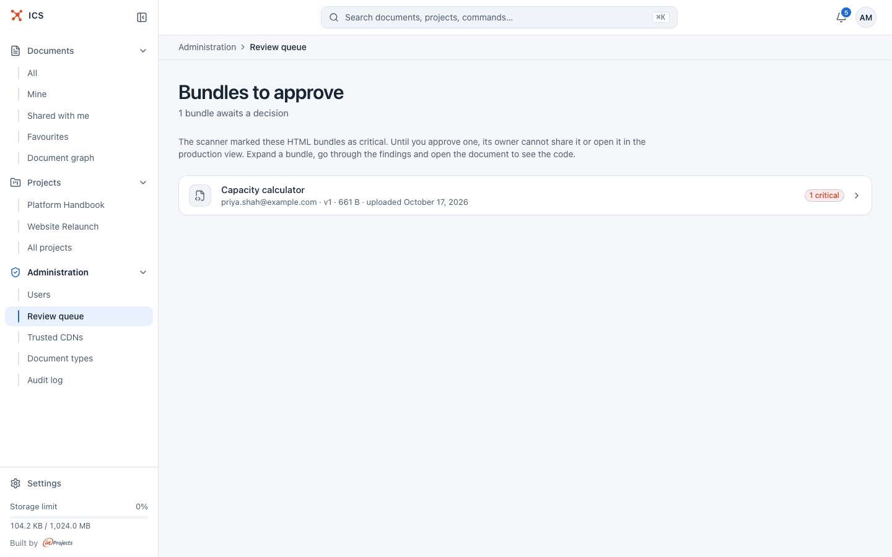
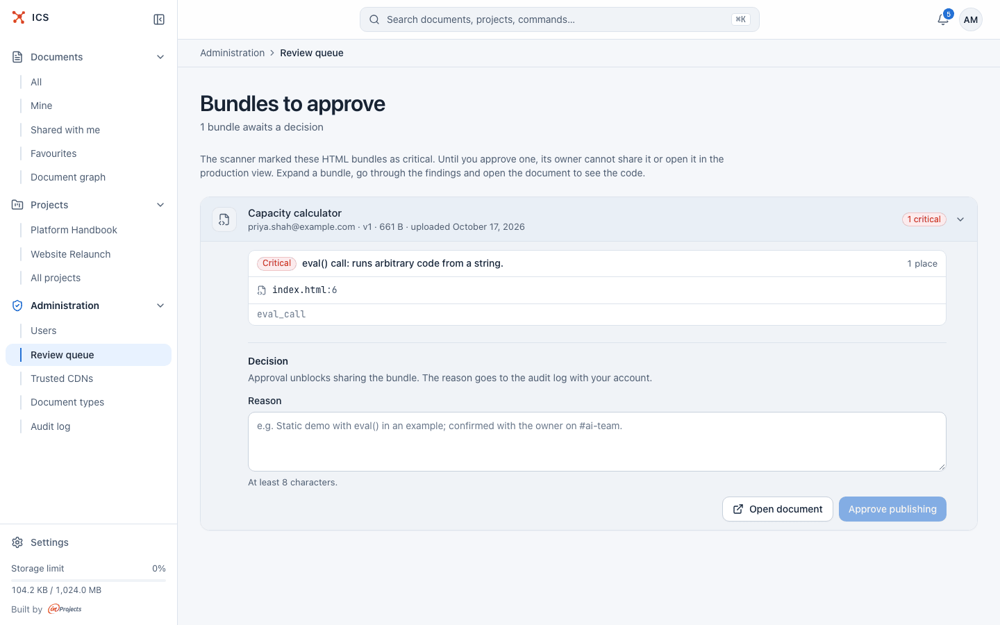
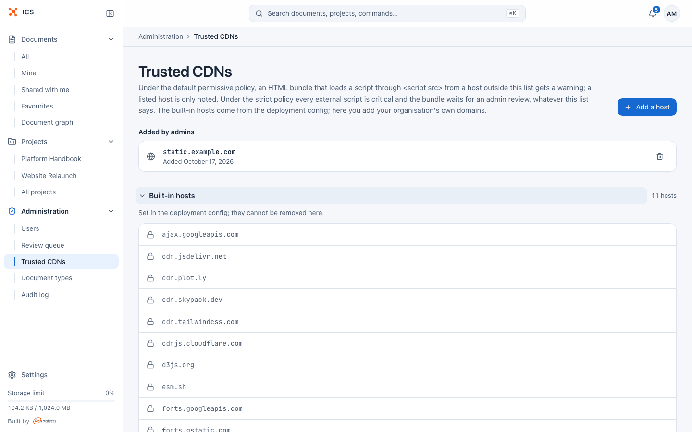
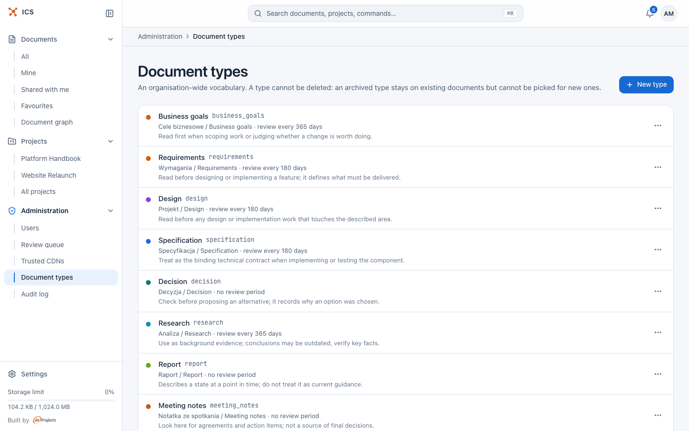
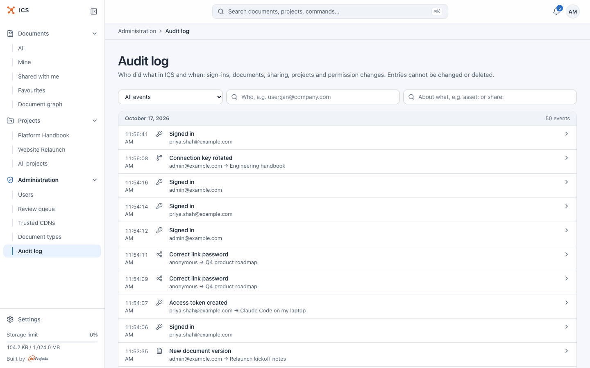

# Administration

This page is for ICS administrators. It covers the **Administration** pages in the sidebar: users, the review queue for HTML bundles, trusted CDNs, document types and the audit log.

The **Administration** group appears in the sidebar only for accounts with the **Administrator** role. Installing and configuring the server is described in the [deployment guide](../DEPLOY.md).

## What an administrator can do

An administrator has the rights of an owner on every document and every project, including the ones they are not a member of. In the project list such projects show the badge **Not a member**.

On top of that, only administrators can:

- invite, lock and delete accounts, change roles and limits ([Users](#manage-users));
- approve HTML bundles held for review ([Review queue](#approve-html-bundles-in-the-review-queue));
- extend the list of trusted script hosts ([Trusted CDNs](#manage-trusted-cdns));
- manage the organisation's document types ([Document types](#manage-document-types));
- read the audit log ([Audit log](#read-the-audit-log)).

> [!NOTE]
> A request made with a personal access token never gets administrator rights, even when the token belongs to an administrator. See [Account settings](account.md).

## Manage users

Open **Administration > Users**.

The page header shows the number of accounts and administrators. Below it:

| Control | What it does |
| --- | --- |
| **All** | Every account. |
| **Active in 30 days** | Accounts that signed in during the last 30 days. |
| **Unverified** | Accounts that have not finished setting up (for example invited people who have not set a password yet). |
| **Locked** | Accounts with an active sign-in lock. |
| **Search by email or name…** | Filters by e-mail address or display name. |
| **Any role** | Filters by role. |

The counts on the chips always cover all accounts, not only the filtered view. Each row shows the name and e-mail, the role, badges such as **unverified** or **locked**, the sign-in method (**Password**, **Google** or **Invitation pending**), the number and size of the person's documents and when they last signed in. Click a row to open the account details.

**Invitation pending** marks an account created by an invitation (**Invite a user**, a project invitation or sharing a document with a new address) whose owner has not set a password yet. It changes to **Password** once they do.

### User roles

| Role | Label in the UI | Meaning |
| --- | --- | --- |
| `user` | **Employee** | A member of the organisation: documents, projects and sharing. |
| `external` | **External client** | Someone outside the organisation. The permissions are the same as an employee's: what was shared with them and their projects. |
| `admin` | **Administrator** | Everything an employee can do, plus the administration pages. |

ICS assigns the **External client** role automatically to addresses outside the organisation's allowed domains (`ICS_ALLOWED_DOMAINS`), both when you invite someone with the **Employee** role and when a project owner invites a new address. Google sign-in depends on the e-mail domain, not on the role: it accepts only addresses from the allowed domains, so an external client with an address outside them signs in with a password.

### Invite a user

1. Click **Invite a user**.
2. Enter the **Email** and, optionally, a **Display name (optional)**.
3. Pick a role: **Employee (user)**, **External client (external)** or **Administrator (admin)**.
4. Click **Send invitation**.

ICS sends an e-mail with a link to set a password. The link expires after 7 days. An address that already has an account cannot be invited again.

### Open the account details

Click a user row to open the **Account** panel.

The top shows the **Email**, **Role**, **Sign-in** method (**Email + password**, **Google** or **Invitation pending, no password set yet**), **Status** (**active**, **unverified** or **locked**), when the account was **Created**, the **Last sign-in** and the **Documents** with the storage used. Under **Admin actions**:

| Action | What it does |
| --- | --- |
| **Force a password reset** > **Send reset link** | Sends the user an e-mail with a link to set a new password. You never see or set the password yourself. Works only for e-mail and password accounts. |
| **Resend the invitation** > **Resend** | Shown for accounts that never finished setup. Sends a new invitation with a fresh link. The old link stays valid until its seven days run out; whichever is used first wins. |
| **Role** > **Apply** | Changes the role. The last administrator cannot lose the role. |
| **Storage limit** > **Apply** | The total size of the current versions of all the user's documents, in GB. Older versions do not count. The default is 1 GB. |
| **HTML bundle limit** > **Apply** | The maximum size of a single HTML bundle upload, in MB. It is a cap per bundle, not a total. The default is 5 MB. |
| **Auto-approve HTML bundles** | When on, bundles the scanner marks as critical are published right away, without the review queue. The scan still runs and its findings go to the audit log. |
| **Lock account** > **Lock** | A temporary sign-in lock for **15 minutes**, **1 hour** or **24 hours**, with an optional reason for the audit log. |
| **Unlock account** > **Unlock** | Shown instead of the lock while the account is locked. Lifts the lock right away. |
| **Access tokens** > **Revoke all tokens** | Revokes all personal access tokens of the person. Agents and scripts lose access right away. |
| **Danger zone** > **Delete account** | Deletes the account together with all its documents and share links. This cannot be undone. The audit log keeps an entry with the number of deleted documents. |

### Lock an account

Locking is for situations like a lost laptop or suspicious activity.

1. Open the account details.
2. Under **Lock account**, pick the duration and optionally enter a reason.
3. Click **Lock**.

While the lock lasts, the person cannot sign in, their open sessions end on their next request, and all their personal access tokens are revoked. The account comes back on its own when the lock expires. Neither signing in with Google nor resetting the password gets around your lock. ICS also locks an account on its own after repeated failed password sign-ins; a successful Google sign-in or a password reset lifts that kind of lock.

You cannot lock or delete your own account, and the last administrator cannot be deleted.

### Change storage and bundle limits

1. Open the account details.
2. Enter the new value next to **Storage limit** (GB) or **HTML bundle limit** (MB).
3. Click **Apply** next to it.

The storage limit is the bar people see at the bottom of their sidebar. Independently of these limits, the server has a size limit for a single upload set in its configuration.

## Approve HTML bundles in the review queue

When someone uploads an HTML bundle, ICS scans its HTML and JavaScript. Findings have three levels: critical, warning and note. A bundle with a **critical** finding, such as an `eval()` call, `new Function`, a `javascript:` URL, an active `data:` URL, access to `document.cookie` or a script inside an SVG, lands in the review queue.

Until an administrator approves it, the bundle's owner cannot share it or open it in the production view, and people who can only read it cannot open it. The owner sees a **Critical warning** panel with the findings on the document page.

Open **Administration > Review queue**.

Each row shows the bundle, its owner's e-mail, the version, size and upload date, and the number of critical findings, warnings and notes.

To decide:

1. Click the row to expand it and go through the findings. Each finding names the file and line and the rule that matched.
2. Click **Open document** to look at the bundle and its code.
3. If the bundle is safe, write a **Reason** (at least 8 characters). It goes to the audit log with your account.
4. Click **Approve publishing**.

There is no reject button. A bundle you do not approve stays blocked; ask the owner to remove the flagged code and upload a new version.

An approval applies to one version only. A new version (an upload or a GitLab sync) is scanned again and, if it is still critical, returns to the queue.

> [!TIP]
> If one person regularly publishes generated reports that the scanner flags, for example because a charting library uses `eval()`, consider turning on **Auto-approve HTML bundles** in their account details instead of approving every version.

## Manage trusted CDNs

HTML bundles often load scripts from public CDNs. The trusted CDN list tells the scanner which script hosts your organisation trusts.

Open **Administration > Trusted CDNs**.

The page has two lists:

- **Added by admins**: hosts added here, with the date they were added and a remove button.
- **Built-in hosts**: "Set in the deployment config; they cannot be removed here." The default list is in `ICS_TRUSTED_CDN_HOSTS` (see the [deployment guide](../DEPLOY.md)).

To add a host:

1. Click **Add a host**.
2. Enter the **Host**: the domain alone, without `https://` or a path, for example `cdn.mycompany.com`.
3. Optionally add a **Note (optional)**: why you trust the domain.
4. Click **Add to list**.

To remove a host you added, click its trash icon and confirm.

What the list changes depends on the server's bundle policy (`ICS_SECURITY_POLICY`):

| Policy | Script from a trusted host | Script from another host |
| --- | --- | --- |
| `permissive` (default) | a note | a warning |
| `strict` | critical | critical |

In the default policy a script from an unknown host gives a warning, which does not block the bundle; a trusted host turns it into a note. In the strict policy every external script is critical and the list makes no difference.

## Manage document types

Document types are an organisation-wide vocabulary, such as Design, Decision, Runbook or Meeting notes. People pick a type in a document's metadata; the type sets the card colour on the [document map](projects.md#document-map-tab), the default review cycle, and a hint for AI agents.

Open **Administration > Document types**.

Each row shows the type's names, its key, the review period and the agent hint. The **…** menu of a row has **Edit** and **Archive** (or **Restore** for an archived type).

### Create a document type

1. Click **New type**.
2. Fill in the fields:

   | Field | What to enter |
   | --- | --- |
   | **Key** | Lowercase letters, digits and underscores, starting with a letter, for example `runbook` (up to 32 characters). It cannot be changed later. |
   | **Polish name** and **English name** | The label in each interface language. Both are required. |
   | **Agent hint** | One English sentence: when an agent should read a document of this type. |
   | **Review period (days)** | How often documents of this type should be reviewed. Leave empty for no review date. |
   | **Position** | A lower number puts the type higher in pickers. |
   | **Document properties (advanced)** > **JSON Schema** | Describes extra fields of documents of this type. Leave empty for none. |

3. Click **Create**.

The review period sets a document's review date when the type is first given to it and the document has no review date yet, and again each time someone confirms the document with **Still current**. Documents past their review date show **Review overdue** and appear on the project's [Hygiene tab](projects.md#hygiene-tab).

### Archive a document type

A type cannot be deleted. An archived type stays on the documents that already have it, but nobody can pick it for other documents. Use **Restore** in the **…** menu to make it available again.

## Read the audit log

The audit log records "Who did what in ICS and when: sign-ins, documents, sharing, projects and permission changes. Entries cannot be changed or deleted."

Open **Administration > Audit log**.

Entries are grouped by day, newest first. Each row shows the time, the event, who did it and what it was about. Documents and projects are shown by name; share links and repository connections by the name of the document they belong to. Narrow the list with:

| Filter | How it matches |
| --- | --- |
| **All events** | Pick one event type. Events are grouped into Account and sign-in, Documents, Sharing, Projects, Integrations and Administration. |
| **Who, e.g. user:jan@company.com** | The exact identifier of the actor, for example `user:jan@company.com`. |
| **About what, e.g. asset: or share:** | The start of the target's identifier, for example `asset:` for all documents or `share:` for all share links. |

Click **Show older** at the bottom to load earlier entries.

Click a row to see its details: **Who**, **About**, **When**, the event's own fields (such as a reason, the old and new value, or the **New key tail** and **Old key tail** of a rotated connection key), and under **Identifiers** the **Event code**, the raw identifiers and the **Entry number**.

> [!TIP]
> To see everything that happened to one document, copy its identifier from an entry's **Identifiers** section into the **About what** field.

## Related

- [Getting started](getting-started.md)
- [Projects](projects.md)
- [Sharing documents](sharing.md)
- [Document formats](formats.md)
- [Account settings](account.md)
- [Connect a GitLab repository](gitlab.md)
- [Deployment guide](../DEPLOY.md)
