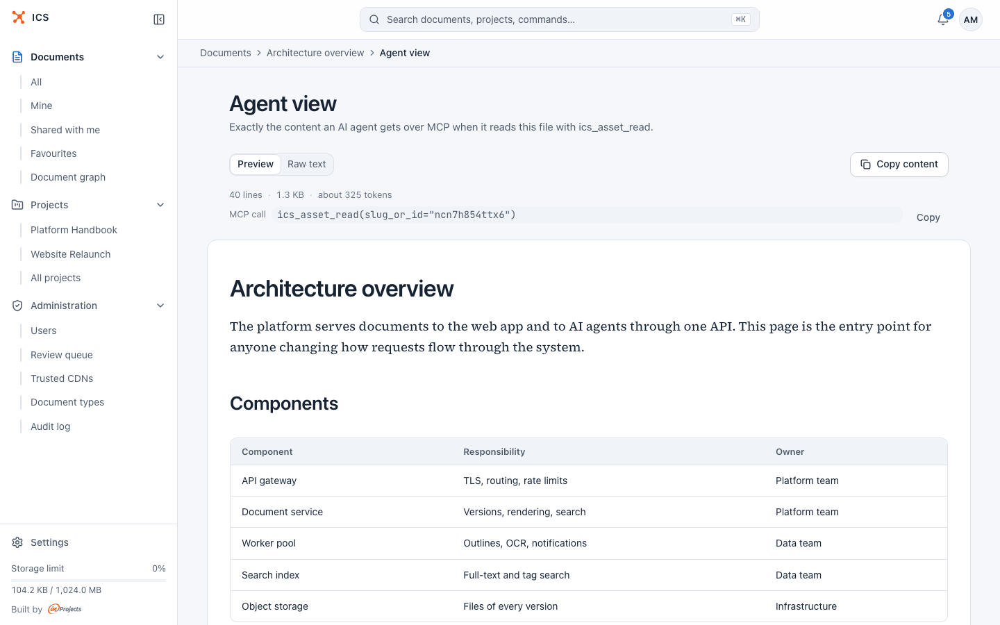
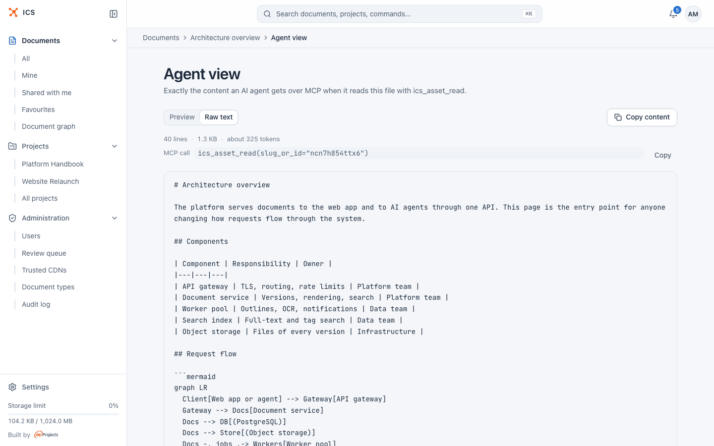
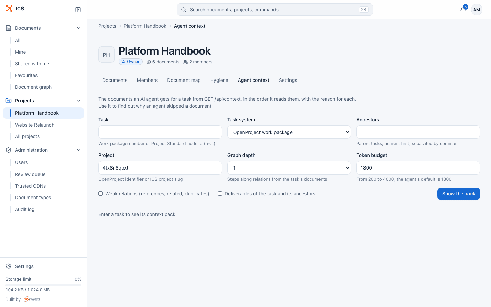

# AI agents

AI assistants such as Claude, Cursor or any other MCP client can work with ICS through [ics-mcp](https://github.com/inprojectspl/ics-mcp), always as the signed-in person and with that person's permissions. This page explains what an agent can do, how you approve its access, and two ICS screens that show what an agent gets: the agent view of a document and a project's Agent context tab.

## What an agent can do

ics-mcp is a separate program that connects an assistant to the ICS API. Once you sign in, the assistant can, on your behalf:

- list, search and read documents, including one section by heading, older versions and diffs between versions;
- create and update Markdown documents and collections, upload HTML bundles, PDF and Word or ODF files;
- set descriptions, document types, tags and other metadata;
- create share links and share documents with people;
- read and edit relations between documents and walk the [document graph](graph.md);
- gather the documents of one task in a single call (the context pack, described below) and link documents to tasks.
- build, publish and run [micro-applications](micro-applications.md), give people roles in them and read an app with its records filled in.

Every request is checked by ICS exactly as if you made it in the browser: the agent sees what you see and can change what you can change, nothing more. Deleting, overwriting and creating a public link (also together with a new document) go through a confirmation step in ics-mcp.

How to install ics-mcp, connect your client and what to ask is covered in the [ics-mcp user guide](https://github.com/inprojectspl/ics-mcp/tree/main/docs/guide). The full list of tools is in the [ics-mcp README](https://github.com/inprojectspl/ics-mcp).

> [!NOTE]
> ics-mcp needs the ICS administrator to enable MCP clients on the server (see [Deploying ICS, step 6](../DEPLOY.md#step-6-mcp-clients-optional)). If your assistant reports that the client is not authorised, ask your administrator.

## Approve an agent's access

The first time an assistant uses ics-mcp, a browser window opens on ICS.

1. If you are not signed in, ICS asks you to sign in first and then returns to the same request.
2. ICS shows a consent page titled **Allow {client} to access ICS?**, where {client} is the name of the application asking, for example "MCP stdio (Claude Desktop / Claude Code)" for a local assistant or "MCP HTTP transport (claude.ai et al.)" for a remote connector.
3. Under it: **Signed in as {email}.**, so you can check which account you are about to connect.
4. **The application asks for access on your behalf to:** lists what is requested. For ics-mcp this is "Read, create and change your documents and projects, within your permissions".
5. **Target resource:** shows the address of the MCP server that will use the access.
6. Click **Allow** to connect, or **Cancel** to refuse. If you do not recognise the application, choose **Cancel**: nothing is shared.

After **Allow**, the browser returns to the assistant, which receives its tokens and repeats your original request. The consent is recorded in the audit log. The access an agent gets is short lived (one hour by default) and is renewed automatically, so you do not approve it every time.

A locked account cannot approve access.

> [!TIP]
> Signing an assistant out happens on the ics-mcp side, by removing its stored tokens; see [Getting started in the ics-mcp guide](https://github.com/inprojectspl/ics-mcp/blob/main/docs/guide/getting-started.md). Personal access tokens in your ICS settings are a separate mechanism, and revoking one does not sign out ics-mcp.

The assistant works with your permissions as an ordinary user: even when you are an administrator, it does not see other people's documents through your administrator rights and cannot use the administration pages.

### Personal access tokens

For a script or an agent that only needs to read, you can create a personal access token instead. Such a token reads what you can read and cannot change anything. A token never carries administrator powers, even when you are an administrator. See [Account and settings](account.md) for how to create and revoke one.

## See what an agent reads from a document

The agent view shows exactly the content an agent gets when it reads a document with `ics_asset_read`. Use it to check how a document looks to an agent: whether a PDF's text came through, how an HTML page converts to Markdown, or how many tokens a long document costs.

It is available to the owner and editors of a document.

1. Open the document.
2. Open the "…" menu (Document actions) and choose **Agent view**.

The page shows:

- **Preview** or **Raw text**: the content rendered, or exactly the characters the agent receives;
- **Copy content**, which copies the text;
- the size: number of lines, bytes and an estimate of tokens ("about 325 tokens");
- **MCP call**: the call that returns this content, for example `ics_asset_read(slug_or_id="ncn7h854ttx6")`, with **Copy**, handy for a prompt or a bug report.

Depending on the document:

- For a collection or an HTML bundle, a **File** selector picks the file. Images and other binary files are left out, because an agent does not get them as text.
- For an HTML page, **HTML read format** switches between **Markdown** (the agent's default: the page converted to Markdown, without scripts and styles) and **Raw HTML**.
- For a scanned PDF, the OCR state of the document is shown.
- When a file is long, the page says that the agent reads it in parts, and the preview may show only the start of the file.
- When you open the agent view from an archived version, it shows that version.

## See the documents an agent gets for a task

When an agent starts work on a task (an OpenProject work package or a Project Standard node), it can ask ICS for a context pack: the documents linked to that task, ordered by importance and cut to a token budget, with a reason for each one. The project's **Agent context** tab shows the same pack, so you can find out why an agent read or skipped a document.

Every project member can open the tab.

1. Open the project and the **Agent context** tab.
2. Fill in the form:

   | Field | What to enter |
   |---|---|
   | **Task** | The work package number, or a Project Standard node id (`n-...`). |
   | **Task system** | **OpenProject work package** or **Project Standard node**. |
   | **Ancestors** | Parent tasks, nearest first, separated by commas. Documents linked to them are inherited. |
   | **Project** | The OpenProject identifier or the ICS project slug. The project in view is filled in. |
   | **Graph depth** | 0, 1 or 2: how many steps along relations from the task's documents. |
   | **Token budget** | From 200 to 4000; the agent's default is 1800. |
   | **Also include** | **Weak relations (references, related, duplicates)** and **Deliverables of the task and its ancestors**. |

3. Click **Show the pack**.

The page shows the request it made (`GET /api/context?...`) and the result:

- **Documents**, the pack size against the budget, and what reading every document would cost;
- **Warnings for the agent**, for example a superseded document and its replacement, a document whose basis changed, two documents that contradict each other, or a task with no linked documents;
- the documents in the order the agent reads them, each with **Why it is in the pack**: linked to the task as context, deliverable or reference, inherited from a parent task, a project key document, a neighbour through a relation, or the replacement of a superseded document;
- **Relations between the documents**;
- when the budget cut documents, how many were cut and what to change.

The pack is built for you: documents you cannot see are left out, and the page tells you how many of the task's documents are hidden from you.

### Make the pack useful

The pack is only as good as the links behind it:

- **Link documents to tasks.** In a document's **Relations** tab, under **Used in tasks**, click **Link to a task**. Choose the task type and number, the **Role of the document** (**context**, **deliverable** or **reference**), and tick **Required to complete the task** for documents an agent must read. Required documents are never cut from the pack. A **Pinned version (optional)** makes ICS warn when the document changes after that version.
- **Set key documents** in the project's **Settings** tab. They fill the pack when a task has fewer than 3 context documents of its own.
- **Link the OpenProject project** in **Settings** > **External links**, so tasks from that OpenProject project find this ICS project.
- **Add relations** between documents, so the graph neighbours are the right ones. See [Relations and the document graph](graph.md).
- **Write descriptions.** Agents get each document's description and decide from it whether to open the document. The project's **Hygiene** tab lists documents without one.

See [Projects](projects.md) for the Settings and Hygiene tabs.

## Build and publish a micro-application

There is no upload form for [micro-applications](micro-applications.md): you ask an agent, for example "build a register where staff file requests and a reviewer approves them, and give Priya the employee role". The agent then works through ics-mcp:

1. It reads the build standard (`ics_microapp_contract`): the manifest format, the SDK, a working template and the limits.
2. It sends the whole package for a **plan** (`ics_microapp_plan`). ICS checks it without touching the running app and answers with problems to fix, each naming the file and the place in it, or with what the release would change: roles, permissions, endpoints, the database migration and the starting records. Plans count against your storage limit like uploads.
3. It **applies** the plan (`ics_microapp_apply`). ics-mcp asks for your confirmation first. Applying publishes exactly the planned package as a new version; a publication runs in the background and ends active or failed, never half done.
4. It gives people roles (`ics_microapp_access_set`) and, if you want, creates a share link that names the app roles it gives.

Planning needs an OAuth sign-in as described above: personal access tokens are read-only and cannot plan or apply. Who may apply: the owner of the app or of its project, or someone given the right to publish. An editor may prepare a plan but not apply it. The same rules let an agent run the app (sleep, restart, suspend) and read its logs.

When an agent reads an app (`ics_asset_read`), it gets the app's own view with your records filled in, as on the **Data** tab, and then the records of each collection you may read. The app's code is shown only to its publishers.

## Build an app on a Google spreadsheet

An agent can build a micro-application on a spreadsheet you already keep in Google and link the two, so your team goes on typing in the sheet while the app adds forms, roles and rules. Give it the file's address and say how people work, for example:

> Build an app on https://docs.google.com/spreadsheets/d/.../edit. Orders are in one tab per month; staff take orders and change their status in the app; accounting keeps the Customers tab in the sheet; the Summary tab is a report.

The agent reads the file with your Google account (`ics_sheets_inspect`): every tab, its headers, what kind of data each column holds, which tabs look alike and which columns are formulas. The first time it gives you a link to Google's consent screen: open it, accept, and tell the agent. Then it decides what each tab is, asks about what the data cannot tell (where new orders go, whether a column people type in matters), builds and publishes the app, gives people roles and links the file (`ics_sheets_link`). The first sync starts with a preview (`ics_sheets_preview`) you see before anything changes; applying it (`ics_sheets_apply`) asks for your confirmation.

The agent never asks you to change the sheet: no id column, no renamed headers. If a tab cannot be linked (merged headers, several tables in one tab), it says so and links the rest. Later you can ask it to add a tab (a new month), link another collection or turn automatic sync on or off; it sends the whole link again and nothing already agreed is lost. What the link does and how syncs work is on the [Google Sheets](google-sheets.md) page.

## Retry a write safely

Writes through ics-mcp can be made safe to repeat when a response gets lost:

- **A publication key.** An agent that creates an HTML bundle or replaces a whole document can send a key it keeps (`publication`). ICS stores the result with that key, so asking again returns the original document and version instead of creating a second one, and an agent can look the result up later (`ics_publication_get`).
- **The expected version.** A write can name the version it was based on (`expected_version`). If someone published a newer version in the meantime, ICS refuses the write with `version_conflict` instead of overwriting their change; the agent reads the new version and tries again.

Both are optional, and the details for developers are in the [publication receipts](../publication-receipts-api.md) and [expected version](../expected-version-api.md) references.

## Related

- [ics-mcp user guide](https://github.com/inprojectspl/ics-mcp/tree/main/docs/guide): connect an assistant and use it.
- [Relations and the document graph](graph.md): the relations agents follow.
- [Projects](projects.md): key documents, external links and the Hygiene tab.
- [Account and settings](account.md): personal access tokens.
- [Formats](formats.md): how PDF, Word and HTML documents are converted to text.
- [Administration](administration.md): the audit log.
- [Micro-applications](micro-applications.md): what agents build and publish.
- [Google Sheets](google-sheets.md): apps on a Google spreadsheet and their syncs.
