# Documents

A document is anything you publish to ICS: a Markdown note, a folder of notes, an HTML page, a PDF or a Word file. This page covers the everyday work with documents: uploading, finding them in the list, reading, editing, describing them with metadata, and tidying up.

What each format can do, and what ICS does with it on upload, is described in [Document formats](formats.md).

## Upload documents

1. Click **Upload** at the top right of the document list (or pick **Upload a document** in the [command palette](getting-started.md#the-command-palette)).
2. Under **Who will see the new documents**, pick:
   - **Organisation**: "Only people signed in with the organisation's SSO";
   - **Public**: "Anyone with the link, no sign-in".
3. Drag files or a folder onto the dashed area, or use **Choose files** or **Choose a folder**.

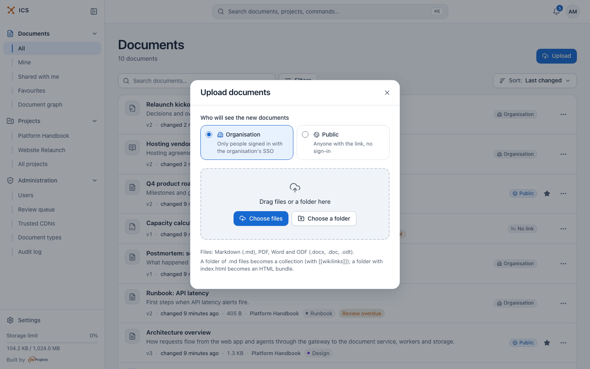

The audience you pick becomes the document's first share link (an **Organisation (SSO)** or a **Public** link). ICS remembers your choice in this browser for the next upload. You can add, change and revoke links at any time, see [Sharing](sharing.md).

You can also drag files straight onto the document list, without opening the dialog: the page shows where the files go and who will see them.

### What becomes what

ICS looks at what you dropped and picks the document type:

| You upload | You get |
|---|---|
| One `.md` file | A **Markdown** document |
| A folder of `.md` files, or two or more `.md` files at once | A **collection**: one document with a file tree and `[[wikilinks]]` |
| A folder (or a set of files) that contains an `.html` page | An **HTML bundle**: an interactive page that opens on an isolated origin |
| A `.pdf` file | A **PDF** document |
| A `.docx`, `.odt` or `.doc` file | A **Word or OpenDocument** document, converted to text for reading |

> [!WARNING]
> Picking several `.md` files at once creates one collection, not separate documents. To get separate documents, upload the files one at a time. And when a folder contains both `.md` files and an `.html` page, the HTML wins: the whole folder becomes an HTML bundle.

Files ICS does not support are skipped, each with a message such as "Skipped *notes.txt*: supported files are .md, .pdf, .docx, .odt and .doc".

### Upload limits

These are the defaults. Your administrator can change them, and also sets your personal storage limit.

| Limit | Default |
|---|---|
| A Markdown document, a collection or an HTML bundle (all files of one upload together) | 100 MB |
| Files in one collection or HTML bundle, also for each new version and each GitLab sync | 500 |
| One HTML bundle | 5 MB per bundle (set per person by an administrator) |
| One PDF | 50 MB |
| One Word or OpenDocument file | 50 MB |
| Your storage | 1 GB per person |

Your storage use is the total size of the current version of every document you own. Older versions do not count. The bar at the bottom of the sidebar shows how much you use.

## Find your way in the document list

The sidebar's **Documents** group chooses which documents the list shows:

| Entry | Shows |
|---|---|
| **All** | Every document you can open: your own and those shared with you. |
| **Mine** | Documents you own. |
| **Shared with me** | Documents other people shared with you, directly or through a project you are a member of. |
| **Favourites** | Documents you starred. |

Each row shows the type icon, the title and the description, then a line of facts: the version (**v3**), when the content last changed, the size, "by *name*" for documents owned by someone else (with your role, such as Editor, when you are not the owner), the project, a GitLab mark when the document is synced from a repository, and coloured chips for the document type and freshness, for example **Review overdue**. A red **Critical** chip means the security scan holds the document for review.

On the right, a badge tells you who can open the document through a link: **Public**, **Password**, **Organisation** or **No link**. The badge shows the widest audience among the active links.

The list shows 25 documents per page.

### Filter the list

Click **Filters**. The popover offers groups, each with a count of how many documents a value would show next to the other active filters:

- **Types**: Markdown, Collections, HTML bundles, PDF files, Documents (Word and OpenDocument);
- **Status**: Public, Password protected, No link;
- **Source**: Synced from GitLab, Manual;
- **Projects**, **Document type**, **Freshness** (Current, Review overdue, Superseded) and **Tags**.

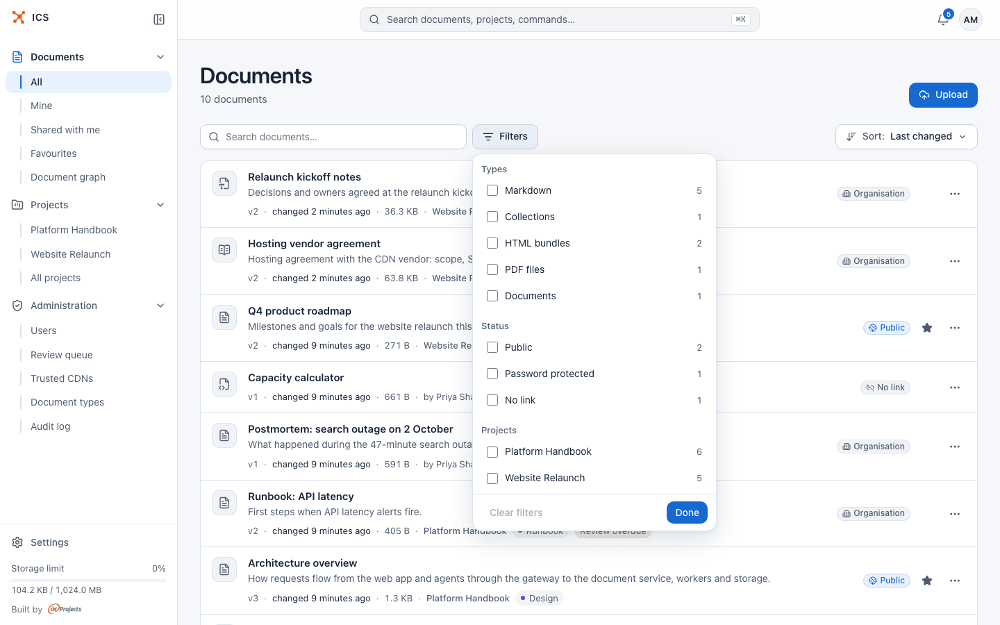

Values in one group are alternatives (Markdown *or* PDF). Different groups narrow each other (PDF *and* Public). A group appears only when it offers a real choice. Active filters show as chips under the toolbar; remove one with its ×, or all with **Clear filters**. Click **Done** to close the popover.

Filters are part of the page address, so you can bookmark a filtered list or send it to a colleague.

### Sort the list

Click **Sort: Last changed** on the right and pick a key: **Last changed**, **Date created**, **Title**, **Number of versions** or **Type**. Under **Direction** pick the order, for example **Newest first** or **Oldest first** (**A to Z** and **Z to A** for titles). While you search, the menu also offers **Relevance**, which is the default for search results.

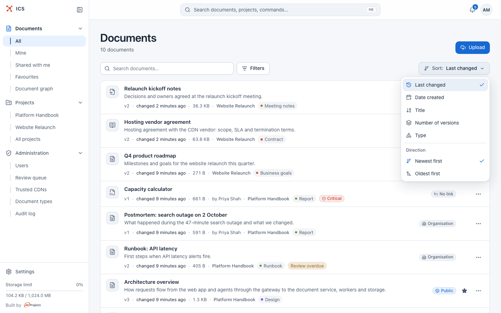

"Last changed" means the content: renaming a document or changing its tags does not move it to the top. Your sort choice is remembered in this browser.

### Search the list

Type in **Search documents…**. The search covers titles, descriptions, tags and the text of your documents, and works together with the scope and the filters. See [Search](search.md) for how matching works.

### Act on a row

Click **…** at the end of a row. What you see depends on your role on the document:

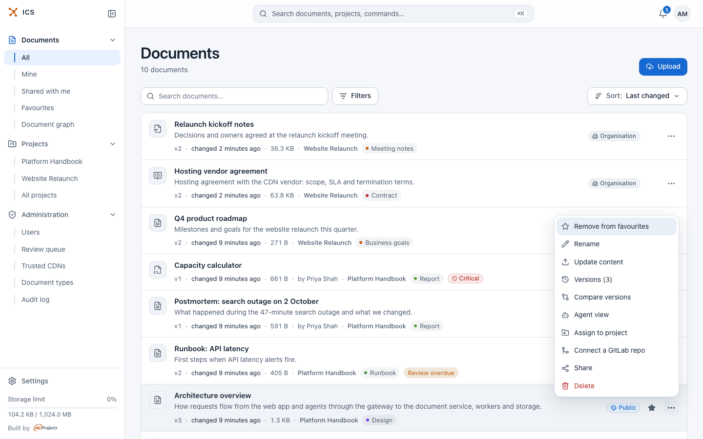

| Action | Who sees it | What it does |
|---|---|---|
| **Add to favourites** / **Remove from favourites** | Everyone | Stars the document for you only. |
| **Rename** | Editors and owners | Turns the title into a field; Enter saves, Esc cancels. |
| **Update content** | Editors and owners | Uploads a new version of the file or folder. |
| **Versions (N)** | Everyone, when there is more than one version | The version history, see [Versions](versions.md). |
| **Compare versions** | Everyone, when there is more than one version | The changes between the last two versions. |
| **Agent view** | Editors and owners | What an AI agent reads from the document, see [AI agents](ai-agents.md). |
| **Assign to project** | Owners | Moves the document to a project (see [below](#move-a-document-to-a-project)). |
| **Connect a GitLab repo** | Owners | Publishes a new version on every push, see [GitLab](gitlab.md). |
| **Share** | Owners | The share dialog, see [Sharing](sharing.md). |
| **Delete** | Owners | Deletes the document. |

"Owners" here means the document's owner, the owner of its project, and administrators.

## Read a document

Click a row to open the reader. The breadcrumb bar shows where the document lives (**Projects > Platform Handbook > Architecture overview**) and, on the right, the **Watching** switch that decides whether you get [notifications](notifications.md) about it.

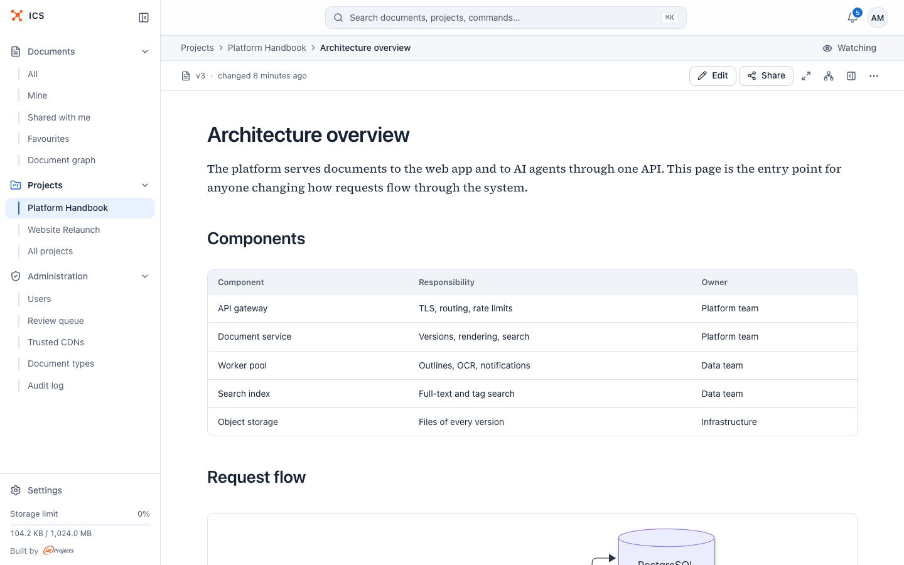

The toolbar below shows the version and when it changed. On the right:

- **Edit** (Markdown documents and collections, for editors and owners);
- **Share** (for owners);
- **Focus mode**: hides the sidebar and the panel so only the text remains (on wider screens);
- **Open document graph**: the document and everything related to it, see [Relations and the document graph](graph.md);
- **Show the document panel** / **Hide the document panel**;
- **…**: the other actions.

The **…** menu holds **Add to favourites**, **Download**, **Relations** and, under **Manage**, the same management actions as the row menu. Readers with the viewer role get **Download** and **Relations**.

### The document panel

The panel opens beside the text on wide screens (from 1280 px) and as a drawer on smaller ones. Drag its left edge to make it wider; double-click the edge to go back to the narrowest width. ICS remembers in this browser whether you keep the panel open.

| Tab | What it holds | Who sees it |
|---|---|---|
| **Files** | The file tree of a collection | Everyone, collections only |
| **Contents** | The headings of the document; click one to jump to it | Everyone |
| **Details** | Description, metadata, project and facts | Editors and owners |
| **Relations** | Links to other documents, as a list or a small graph | Editors and owners |
| **History** | The versions, with a link to view each one | Everyone |

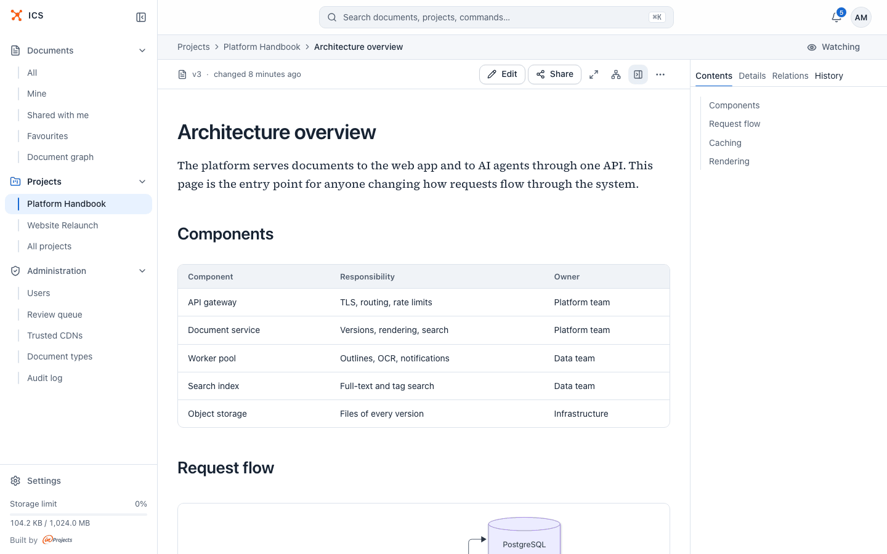

The **Details** tab has three sections:

- **Description**: the summary, the document type and freshness chips, the **Maintainer**, when the content changed (**Content changed**) and the **Review due** date, with the buttons **Edit description** (or **Add description**) and **Edit metadata**.
- **Project**: the home project, "Also in projects:" when the document is shown in other projects too, and, for owners, **Change project** (or **Assign to project**).
- **About**: **Kind**, **Version**, **Size**, **Owner** (when it is not you), **Created** and **Sharing**.

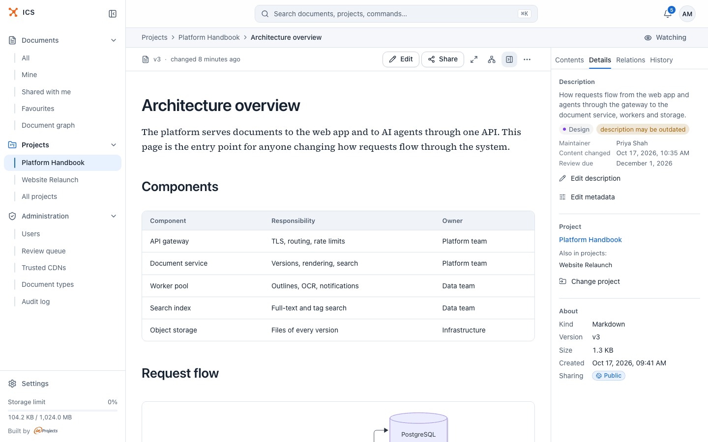

The **Relations** tab lists the documents this one depends on, is derived from, references and so on, and lets you add a relation or link the document to a task. Everything about relations is in [Relations and the document graph](graph.md).

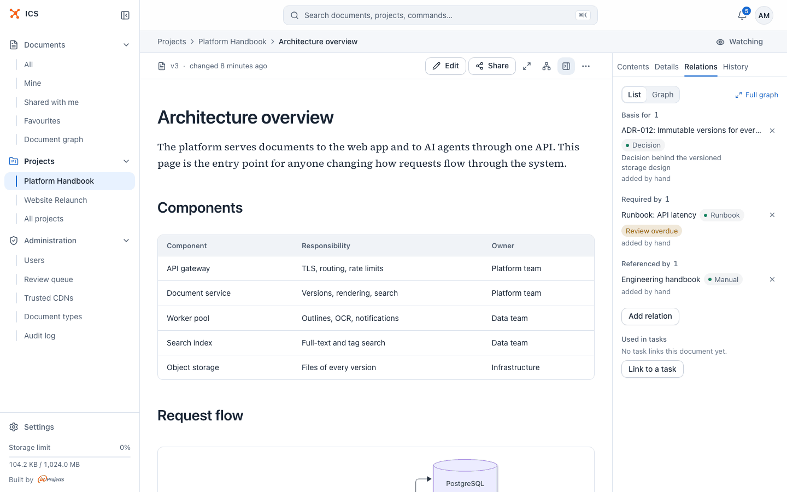

## Edit Markdown in the browser

Markdown documents and the files of a collection can be edited right in ICS. HTML bundles, PDFs and Word files cannot: upload a new version with **Update content** instead.

1. Open the document and click **Edit** in the toolbar. In a collection, the editor opens the file you are reading.
2. Change the Markdown source.
3. Optionally describe the change in **Change note** ("What changed? (optional)"). The note shows up in the version history.
4. Click **Save (Ctrl+Enter)**, or press Ctrl+Enter (Cmd+Enter on a Mac).

| Editor before a change | With a change and a change note |
|---|---|
| 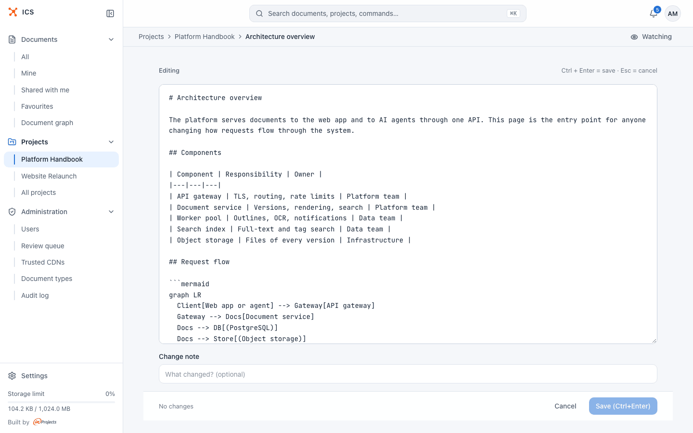 | 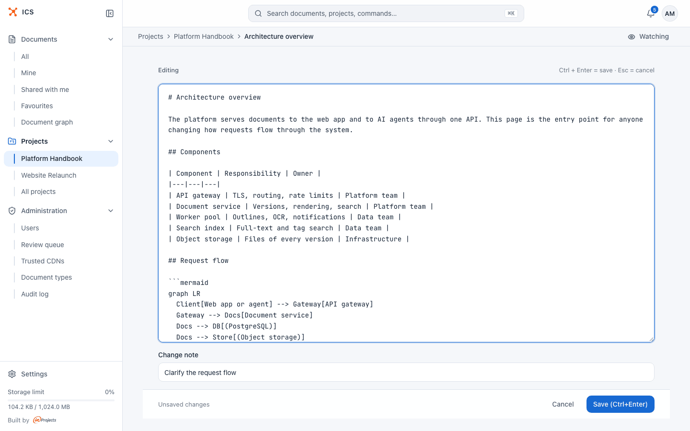 |

The bar under the editor says "No changes" or "Unsaved changes". Press Esc or click **Cancel** to leave; with unsaved changes ICS asks "Discard unsaved changes?" first.

Every save creates a new version. The old content stays in the history, and share links show the new version straight away. Saving the same content again is refused with "The content has not changed."

> [!NOTE]
> **Edit** is not available while you look at an archived version: the editor always writes to the current one. To bring old content back, restore the version (see [Versions](versions.md#restore-an-older-version)).

## Replace the content with a new file

**Update content** (in the row menu and the reader's **…** menu, for editors and owners) uploads a new version:

1. Pick **Update content**.
2. Optionally write a **Change note**.
3. Drag the new file or folder onto the dashed area ("Drag files here or choose them"), or pick it from your disk: **Choose a file** for a single-file document, **Choose files** or **Choose a folder** for a collection or an HTML bundle. The line under the prompt shows the document's type and which version the upload becomes, for example "Type: Collection · the version becomes v2".

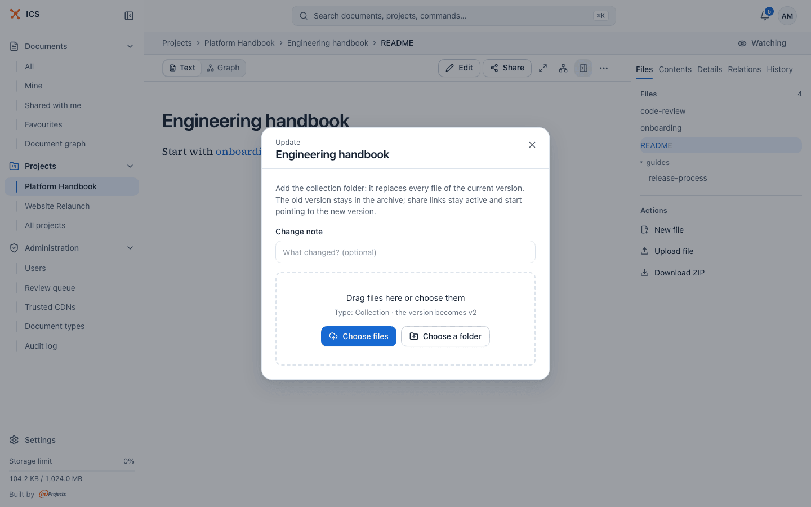

What you add depends on the type: a new `.md` file for a Markdown document, the whole folder for a collection (it replaces every file), a folder with `index.html` for an HTML bundle, a new `.pdf` or a new `.docx`, `.odt` or `.doc` file. "The old version stays in the archive; share links stay active and start pointing to the new version."

## Describe a document: metadata

Metadata tells people (and AI agents) what a document is, who looks after it and whether it is still up to date. Editors and owners set it on the **Details** tab.

### Write a description

Click **Add description** (or **Edit description**), type a few sentences (up to 1000 characters) and click **Save**. The description appears under the title in the document list and in search results, and helps people decide whether to open the document.

When the content changes after the description was written, the chip "description may be outdated" appears next to it. A description written by an AI agent carries the chip "description by agent".

### Set the type, maintainer, review date and tags

Click **Edit metadata**:

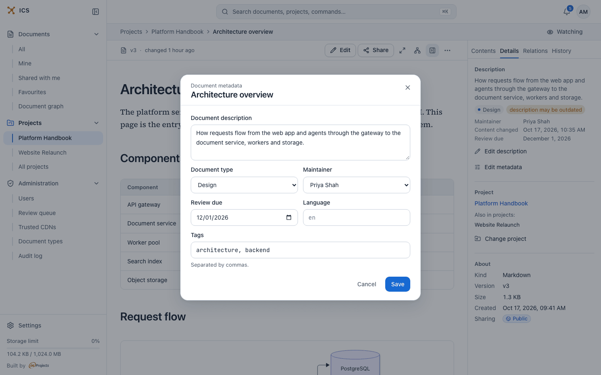

| Field | What it is for |
|---|---|
| **Document description** | The same description as above. |
| **Document type** | What kind of document it is, from a list your administrator maintains (for example Requirements, Design, Decision, Runbook, Meeting notes). Pick **No type** to clear it. |
| **Maintainer** | The person responsible for keeping the document current. **Owner (default)** means the owner. |
| **Review due** | The date by which someone should check that the content still holds. |
| **Language** | The language tag of the content, such as `pl` or `en-GB`. |
| **Tags** | Short labels, separated by commas. |
| **Type properties** | Extra fields, when the chosen document type defines them. |

Click **Save**.

Each document type can carry a review period. When you give a document a type and it has no review date yet, ICS sets the review date from that period. The types themselves are managed by administrators, see [Administration](administration.md).

Tags are lowercase: letters, digits, hyphens and underscores, from 2 to 32 characters, at most 20 per document. You can filter the list by tag.

### Keep documents fresh

A document's freshness is one of:

- **Current**: nothing to do;
- **Review overdue**: the review date has passed, "the content may be out of date";
- **Superseded**: "A newer document replaces this one" (set through a *supersedes* relation, see [Relations and the document graph](graph.md#mark-a-document-as-superseded)).

When a document is overdue and still correct, open **Details** and click **Still current**. ICS records the review and moves the review date forward by the document type's review period (or clears it when the type has none), without creating a new version.

The project's **Hygiene** tab collects documents without a description, with an outdated description, without a type or overdue for review, see [Projects](projects.md#hygiene-tab).

## Add a document to favourites

Hover over a row and click the star, or pick **Add to favourites** in the **…** menu. On touch screens the star is always visible. Favourites are personal: nobody else sees your stars. Find them under **Favourites** in the sidebar.

## Rename a document

- In the list: **…** > **Rename**, type the new title, press Enter.
- In the reader: **…** > **Rename**, then save in the dialog.

Renaming changes only the title. The document's addresses and links stay the same, and no new version is created.

## Move a document to a project

A document belongs to at most one project, its home project. Project members get access according to their role: "an editor can change the file, a viewer can only read it. A file without a project is visible only to you and the people you share it with."

1. Pick **Assign to project** in the **…** menu, or **Change project** on the **Details** tab.
2. Choose the project, or **No project** to take it out of its project.
3. Click **Save**.

Only projects where you are an owner or an editor are offered. Moving a document is reserved for its owner, the owner of its current project and administrators. To show one document in several projects, use the **Projects** tab of the share dialog, see [Sharing](sharing.md#show-a-document-in-other-projects).

## Delete a document

1. Pick **Delete** in the **…** menu.
2. Confirm. "All active links will stop working (HTTP 410)."

Deleting is reserved for the document's owner, the owner of its project and administrators. Deletion revokes every share link and removes every personal grant. The document disappears from all lists and from search.

### Restore a deleted document

Deletion is soft: the document and its versions are kept. The web app has no restore button, but the owner can restore a deleted document through the ICS API, for example by asking an AI assistant connected through ics-mcp, see [AI agents](ai-agents.md).

A restored document comes back with its content and history, but without its old links and grants: they stay revoked. Create new links and grants after restoring.

## Related

- [Document formats](formats.md): what each format offers and how it is processed
- [Versions](versions.md): history, comparison and restoring
- [Sharing](sharing.md): links, people and projects
- [Search](search.md): how the search box finds documents
- [Relations and the document graph](graph.md): connecting documents
- [Projects](projects.md): shared spaces with roles
