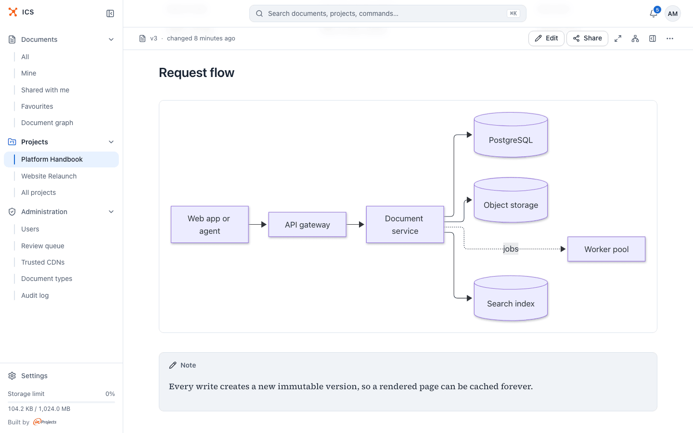
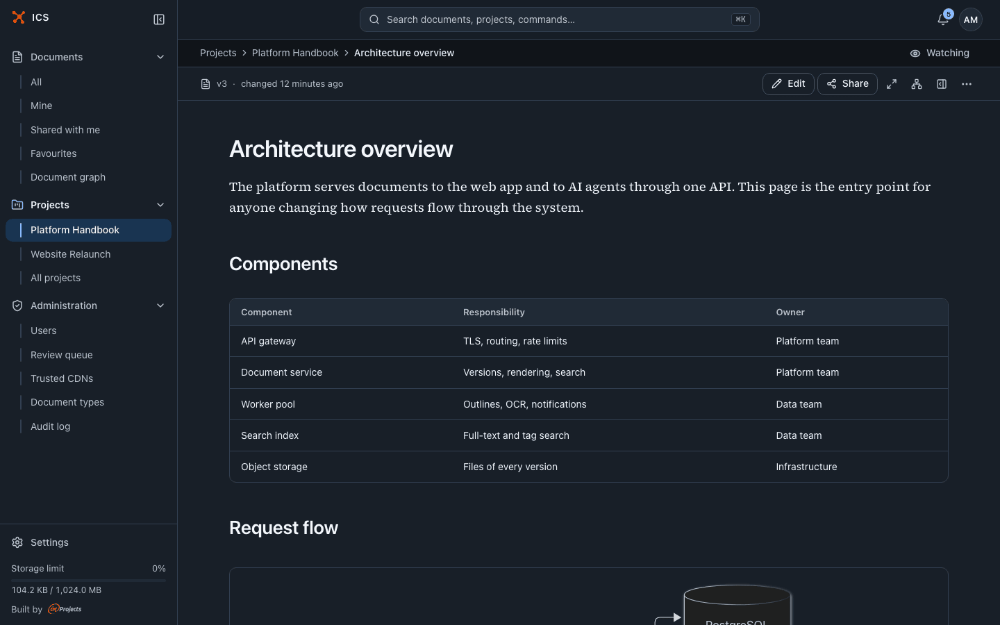
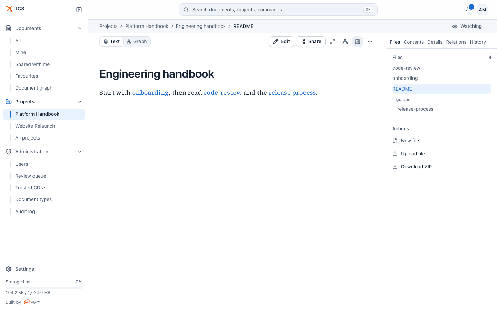
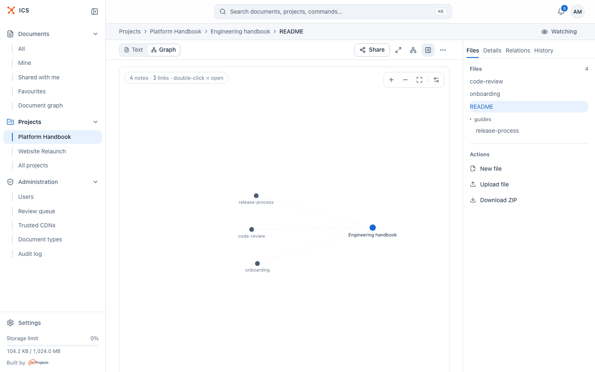
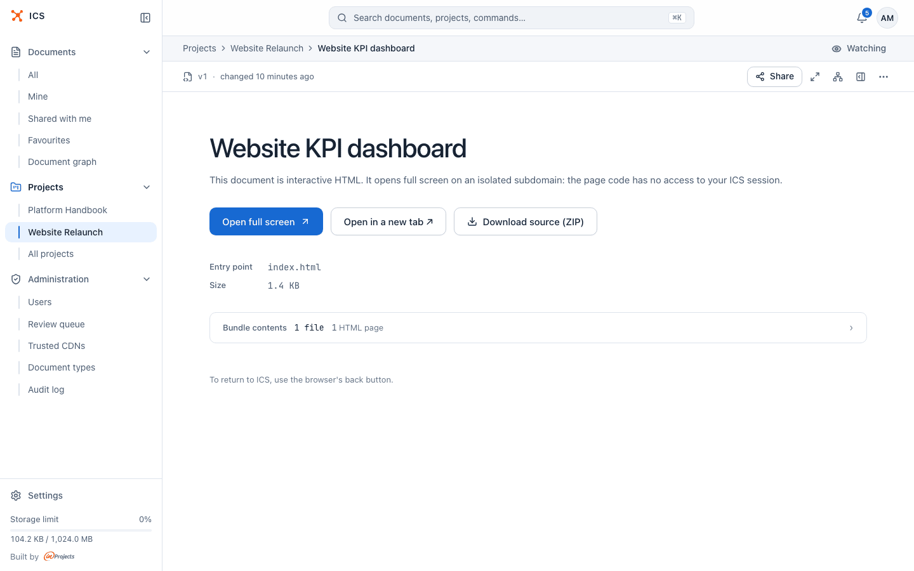
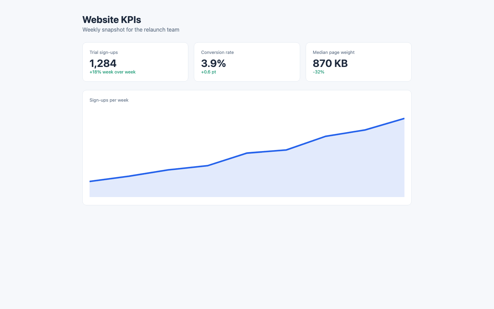
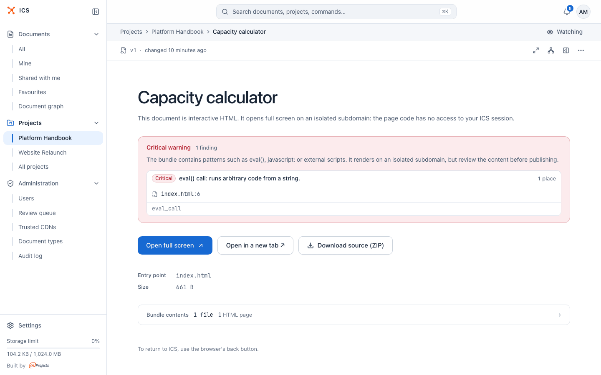
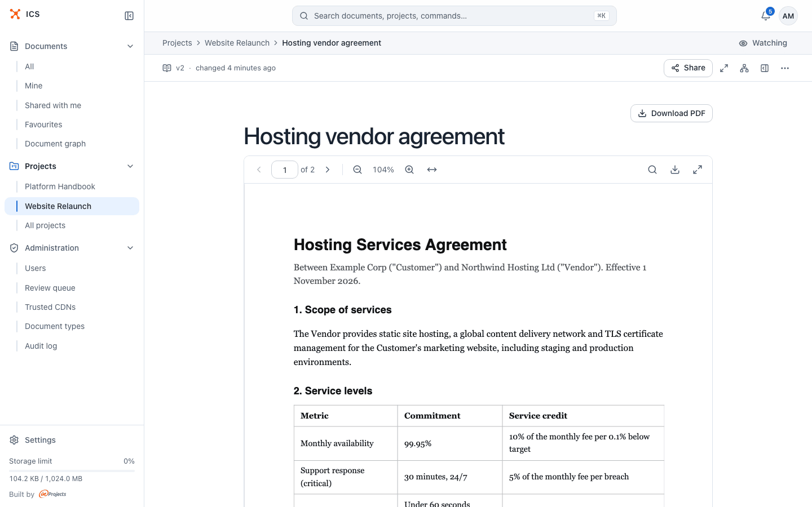
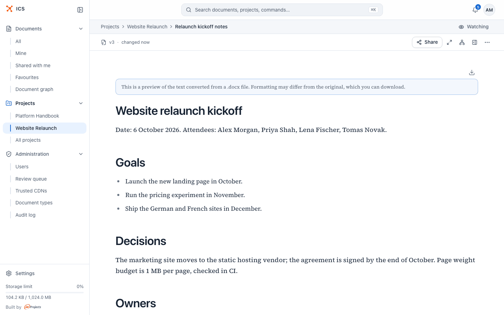

# Document formats

ICS handles five kinds of documents: Markdown notes, collections of notes, HTML bundles, PDFs, and Word or OpenDocument files. This page explains what each one is good for, what ICS does with it when you upload it, and what to watch out for.

| Kind | Good for | Edit in the browser |
|---|---|---|
| **Markdown** | Notes, specifications, runbooks, decisions: text you write and keep up to date | Yes |
| **Collection** | A handbook or a knowledge base: many linked notes in folders | Yes, file by file |
| **HTML bundle** | Dashboards, reports and demos generated as web pages, often by AI tools | No, upload a new version |
| **PDF** | Contracts, signed or scanned papers, anything that must keep its layout | No, upload a new version |
| **Word and OpenDocument** | Documents written in Word or LibreOffice that people should read without downloading | No, upload a new version |

How to upload each of them and the size limits are in [Documents](documents.md#upload-documents).

## Markdown

ICS renders Markdown on the server and shows it with the same typography in the app, on shared pages and in both themes.



### What you can write

Everything from standard Markdown (headings, lists, links, images, quotes, tables, `~~strikethrough~~`), plus:

| Feature | How to write it |
|---|---|
| Code with syntax highlighting | A fenced block with a language: ` ```python `. Every block gets a **Copy** button. |
| Diagrams | A fenced block marked ` ```mermaid `. The diagram renders in place; you can scroll and zoom it with **Zoom in**, **Zoom out** and **Fit diagram**. |
| Math | Inline between single dollar signs, `$E = mc^2$`, or as a block between double ones, `$$ ... $$`. Rendered with KaTeX. |
| Callouts | A quote whose first line is `[!type] Title`, for example `> [!warning] Before you deploy`. Types: `note`, `info`, `tip`, `success`, `question`, `warning`, `failure`, `danger`, `bug`, `example`, `quote`. An unknown type is shown as a note. |
| Task lists | `- [ ] open` and `- [x] done`. The boxes are shown, not clickable: change them by editing the text. |
| Highlight | `==marked text==` |
| Footnotes | `Text[^1]` and, anywhere below, `[^1]: The note.` |
| Definition lists | A term on one line, then `: its definition` on the next. |
| Links to other ICS documents | `[[ics:<slug>]]`, optionally with a file, a heading and a label: `[[ics:<slug>/guide.md#setup\|the setup guide]]`. See [below](#link-to-other-documents). |

A few things behave differently from some other Markdown tools:

- A single line break in the source is a line break on the page, as on GitHub and in Obsidian.
- Raw HTML inside Markdown is not rendered; it shows as text. If you need HTML, upload an [HTML bundle](#html-bundles).
- An AI agent can read Markdown without its HTML comments (`<!-- ... -->`), such as the timestamps a transcription tool leaves before every line: `ics_asset_read` with `format="markdown"`. Comments in code stay, and line numbers do not change. Without the option the agent gets the file as stored, which is what it should edit.
- Amounts such as `$650k ... $350k` are not mistaken for math.
- Every heading gets a **Link to this section** anchor you can copy.

> [!TIP]
> The reader follows the light or dark theme you choose in the account menu, see [Getting started](getting-started.md#language-and-theme).



### Link to other documents

Links between documents become part of the [document graph](graph.md). ICS records a relation whenever the content of a document mentions another ICS document in one of these forms:

- `[[ics:<slug>]]`: shows the title of the target document to everyone who may see it;
- a full ICS address, `https://<your ICS>/v/<slug>` or a share link `/s/<token>`;
- `ics://asset/<slug>`.

Links inside code blocks and inline code are ignored. Within a collection, use [wikilinks](#wikilinks) to link its own notes.

## Collections

A collection is one document made of many Markdown files in folders, like an Obsidian vault or a `docs/` folder. It has one title, one version history and one set of share links.

Upload a folder of `.md` files to create one. ICS opens the collection on its entry file: the top-most `README.md` or `index.md`, otherwise the first file in alphabetical order. Other files in the folder (images, for example) are not stored.



### Browse the files

The document panel opens on the **Files** tab, with the file tree and the number of files. Click a file to read it. The breadcrumb shows the path of the open file, and the **Contents** tab its headings.

### Wikilinks

In a collection, `[[Page]]` links to another note. ICS looks for the target by its path (`[[guides/release-process]]`, with or without `.md`) and, failing that, by file name anywhere in the collection, ignoring case. `[[Page|label]]` shows a different text. A wikilink that leads nowhere is marked as broken, with the tooltip "Wikilink not found: *Page*".

Wikilinks work only inside a collection. In a single Markdown document there is nothing to link to, and they show as broken.

### Add, move and delete files

Editors and owners have these actions on the **Files** tab:

- **New file**: "Create an empty .md file in this collection". Type the **Path in the collection**; subfolders are allowed, for example `notes/idea.md`. The file is created empty and the editor opens right away.
- **Upload file**: adds a `.md` file from your disk.
- **Move a file**: drag it onto a folder in the tree, or onto the top row for the root.
- **Delete a file**: hover over it and click the bin icon. "The version stays in the history, so you can restore it." The last file of a collection cannot be deleted; delete the whole document instead.
- **Edit**: the toolbar's **Edit** edits the file you are reading.

Every one of these changes creates a new version of the collection.

**Download ZIP** ("Download all collection files as a ZIP") is available to everyone who can open the collection.

### See the collection as a graph

Switch the toolbar toggle from **Text** to **Graph** to see the notes as dots and the wikilinks between them as lines. The label above shows the counts, for example "4 notes · 3 links · double-click = open". Double-click a note to open it. The icons on the canvas zoom, fit the graph to the view and open **Graph settings** (labels, arrows, node size and the forces of the layout).



## HTML bundles

An HTML bundle is a web page with everything it needs: HTML, styles, scripts, images, fonts and data files. It is the right format for interactive output, such as a dashboard an AI assistant generated or a report exported from a tool.

Upload a folder that contains an `.html` page. ICS opens the bundle on its entry point: the top-most `index.html`, otherwise the first `.html` file. It keeps these file types and drops everything else: `html`, `htm`, `css`, `js`, `mjs`, `map`, `json`, `txt`, `md`, `csv`, `png`, `jpg`, `jpeg`, `gif`, `webp`, `svg`, `ico`, `avif`, `woff`, `woff2`, `ttf`, `otf`, `eot`, `mp4`, `webm`, `ogg`, `mp3`, `wav`.



The document page explains: "This document is interactive HTML. It opens full screen on an isolated subdomain: the page code has no access to your ICS session." It offers:

- **Open full screen**: opens the bundle in this tab ("To return to ICS, use the browser's back button.");
- **Open in a new tab ↗**;
- **Download source (ZIP)**;
- the **Entry point**, the **Size**, and **Bundle contents**, a folding list of the files by type.



### Why bundles run on a separate origin

The code in a bundle comes from whoever uploaded it, so ICS keeps it away from your account. A bundle is served from a separate address (its own subdomain), so its scripts cannot read your ICS session or call the ICS API as you. On top of that the browser enforces these rules for the bundle:

- scripts, styles, fonts and network requests may come only from the bundle itself and from the **trusted CDN hosts** your administrator allows (for example `cdn.jsdelivr.net` or `cdnjs.cloudflare.com`); anything else is blocked by the browser;
- images and media may come from any `https://` address;
- forms cannot be submitted, and plugins (`<object>`) are off.

If a bundle works on your machine but shows a blank area in ICS, check whether it loads a script or calls an API on a host outside that list. Your administrator can add a host, see [Administration](administration.md).

### Security scan and review

On every upload ICS scans the bundle for risky code. Findings are graded **Critical**, **Warning** or **Info**:

- **Critical** patterns include `eval()`, `new Function()`, `javascript:` links, active `data:` URLs, reading `document.cookie` and scripts inside SVG files.
- **Warnings** include string arguments to `setTimeout` or `setInterval`, requests to local network addresses, and scripts from hosts outside the trusted list.
- Inline event handlers (`onclick=`), `document.write` and meta refresh are only noted.

These grades are for the default policy. An administrator can switch the server to a stricter policy, where every external script is critical.



A bundle with a **Critical** finding is held for an administrator's review:

- ICS does not create the usual first share link on upload;
- **Share** is unavailable, with the hint "Needs administrator approval (security review)";
- people with only read access, and visitors of links, cannot open it. They see "On hold" and "This document is waiting for an administrator review before publication."
- the owner and editors can still open it, to check the findings.

The document page lists each finding with its file and line, for example `index.html:6`. When an administrator approves the bundle in the **Review queue**, sharing works as usual. An administrator can also turn on automatic approval for a person whose bundles always trigger a finding (some report generators produce `eval()`), see [Administration](administration.md).

> [!NOTE]
> The same review applies to PDFs and Word files with dangerous content: a PDF with a launch action, or a Word file with macros, DDE fields or a remote template, is held as **Critical**. JavaScript, embedded files and XFA forms in a PDF, and embedded objects or external references in a Word file, give a warning.

Markdown and the text extracted from documents are also checked for phrases that try to give instructions to AI agents. This check only raises a warning and never holds a document back.

## PDF

Upload a `.pdf` file (up to 50 MB by default) to get a PDF document. ICS keeps the original and reads its text layer, so the content can be found by [search](search.md) and read by AI agents. Text extraction covers up to 2,000 pages by default. A password-protected PDF is refused: remove the password and upload it again.



### Read a PDF

The reader shows the pages in the app. Its toolbar has **Previous page** and **Next page**, a **Page number** field ("of 2"), **Zoom out**, the zoom level, **Zoom in**, **Fit to width**, **Search the document**, a download button and **Full screen**. Pinch to zoom on a touch screen, or use Ctrl or Cmd with the mouse wheel. In full screen, Ctrl+F (Cmd+F) searches the PDF and Esc leaves full screen. **Download PDF** above the reader downloads the file.

### Scanned pages and OCR

A scanned page is a picture: it has no text, so search and AI agents cannot see what it says. ICS can recognize the text with OCR (optical character recognition). The panel **Text recognition (OCR)** above the reader tells you the state:

| State | What you see |
|---|---|
| Not requested | "N pages have no text layer (probably a scan), so search and agents cannot see their content until OCR reads them." and a **Recognize text (OCR)** button. |
| Queued | "OCR is queued. The text will appear on its own, no need to reload the page." |
| Running | "OCR in progress: page 3 of 12." with a progress bar. |
| Done | "OCR finished *date* (*engine*). Pages read: 12, text recognized on 11. Recognized text may contain errors." |
| Failed | "OCR failed *date*: *reason*", with **Run OCR again**. |
| OCR off | "This PDF is a scan without a text layer, and OCR is turned off on this server." |

By default ICS starts OCR on its own when you upload a PDF (or a new version) with pages that have no text. OCR reads only those pages; pages with their own text stay as they are, and the panel says how many it left out.

Some scanners save an invisible text layer of unknown quality. ICS does not replace it on its own; the panel recommends OCR, and you start it with **Recognize text (OCR)**.

To request OCR:

1. Open the PDF. You need the editor role or higher.
2. If the server offers several engines, pick one under **OCR engine**: **Local (ICS server)** or **Mistral OCR 4**.
3. For Mistral, paste your **Mistral API key**. "The document will be sent to Mistral AI. The key serves this run only: ICS keeps it encrypted until the run ends and never stores it in the database."
4. Click **Recognize text (OCR)** (or **Run OCR again** after a failed or finished run).

When the text is ready, editors and owners can click **Show text** to read the recognized text in the agent view. OCR always runs on the current version; an archived version only shows its state.

## Word and OpenDocument

Upload a `.docx`, `.odt` or `.doc` file (up to 50 MB by default). ICS converts the text to Markdown so that people can read it in the browser, search can find it and AI agents can read it. The original file is kept and can be downloaded.



The page starts with a notice: "This is a preview of the text converted from a .docx file. Formatting may differ from the original, which you can download." Headings, lists, tables and paragraphs come through; in a `.docx` file, text in Word's Title and Subtitle styles becomes a heading as well. Layout, fonts and some styles do not come through. Images are not shown in the preview, and the page tells you how many the original contains.

Keep in mind:

- the file cannot be edited in ICS: change it in your editor and upload it again with **Update content**;
- a password-protected file is refused: remove the password and upload it again;
- for a document whose exact look matters, upload a PDF instead, or alongside.

## Related

- [Documents](documents.md): uploading, the list, the reader and metadata
- [Versions](versions.md): history and comparison of every format
- [Search](search.md): what text is searchable
- [Sharing](sharing.md): who can open a document
- [Relations and the document graph](graph.md): links between documents
- [Administration](administration.md): the review queue and trusted CDN hosts
