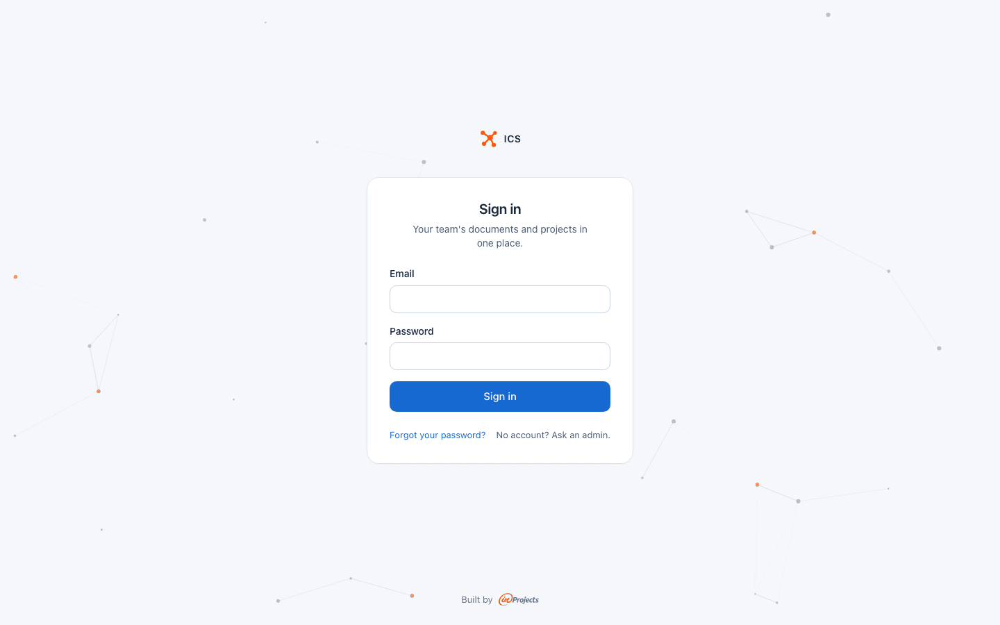
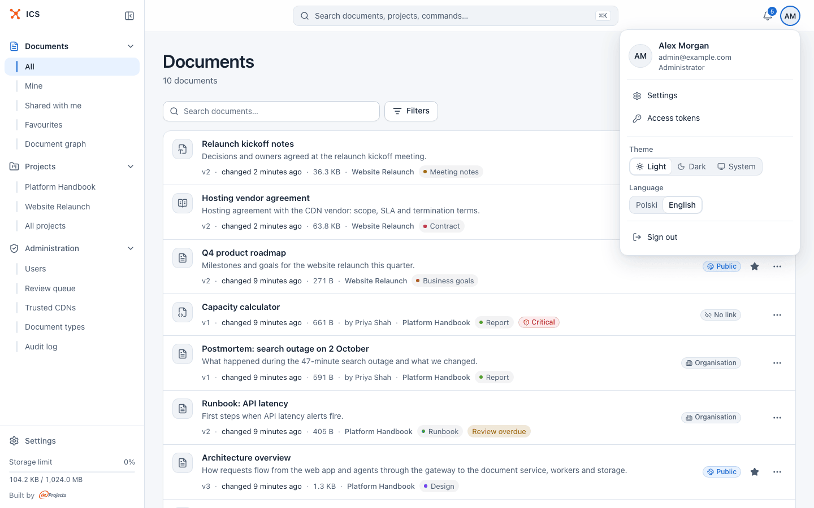
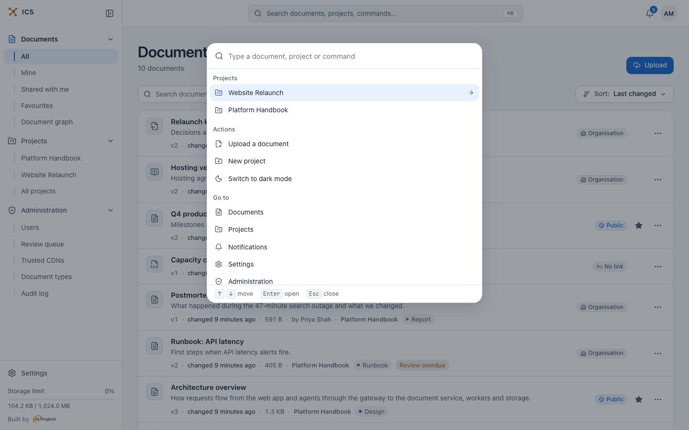
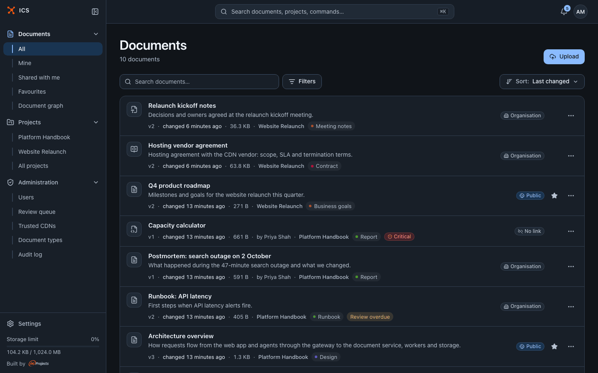
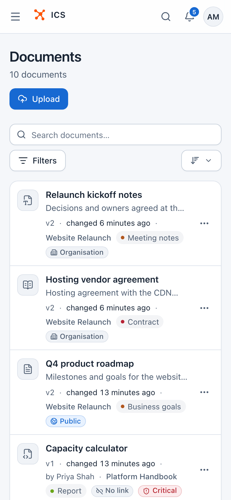
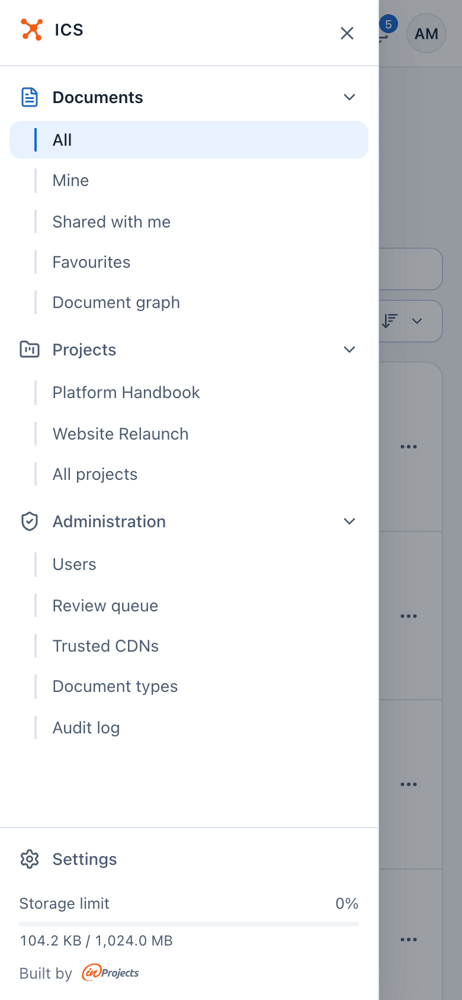
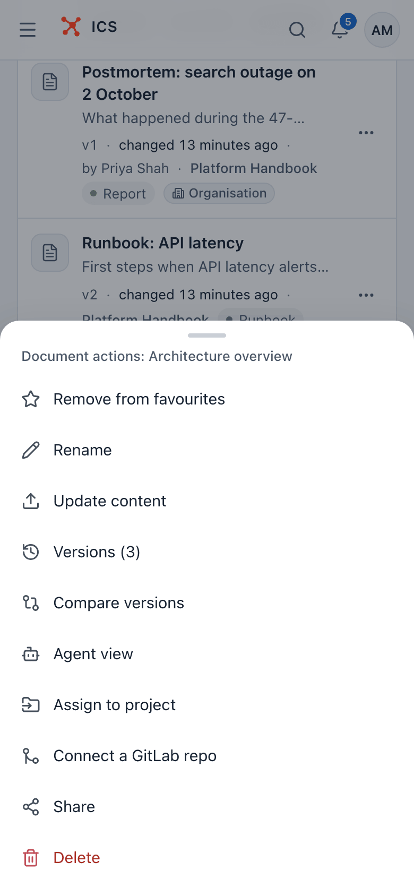
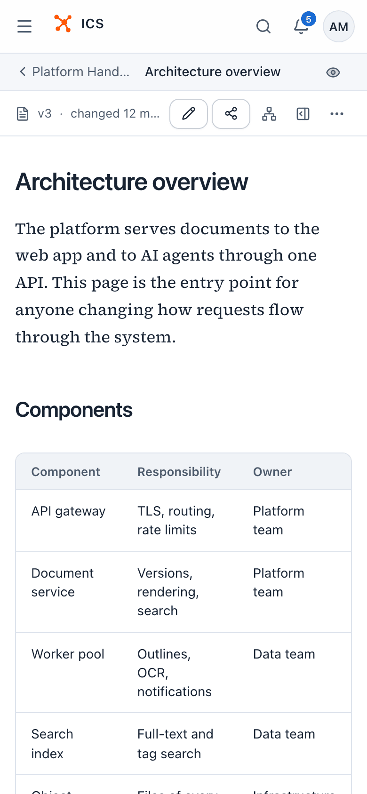

# Getting started

This page takes you from your first sign-in to finding your way around ICS: the sidebar, the top bar, the command palette, your language and theme, and how ICS looks on a phone.

## Sign in

Open your ICS address in the browser. The sign-in page asks for your **Email** and **Password**.

1. Enter your e-mail address and password.
2. Click **Sign in**.

If the address or password is wrong, the page says "Wrong email or password". After 10 failed attempts within an hour the account is locked for 15 minutes (these are the defaults; your administrator may have set other values). A lock also ends the account's open sessions, as a safety measure.

ICS accounts are created by an administrator, or when someone shares a document with your address or invites you to a project. The sign-in page says "No account? Ask an admin." If your server allows self-registration (it is off by default), you see **Create an account** there instead.

### Sign in with Google

If your organisation has connected Google sign-in, the page also shows **Sign in with Google**. Click it and pick your Google account.

Only addresses in your organisation's e-mail domains can sign in this way, and Google must have verified the address. On the first Google sign-in ICS creates your account. If an account with the same address already exists (for example one with a password), Google sign-in opens that account, and both ways keep working.

A lock set by an administrator also blocks Google sign-in. A lock after failed password attempts does not: a successful Google sign-in lifts it.

### Accept an invitation

When an administrator invites you, or someone shares a document with you or invites you to a project while your address has no account yet, you get an e-mail with a link to set your password.

1. Open the link. The page **Set a password** says "Set a password to activate your account."
2. Optionally fill in **Display name (optional)**: the name other people see.
3. Choose a password in **Password (at least 8 characters)**.
4. Click **Set a password**. When you see **Account created**, click **Go to sign in** and sign in.

The invitation link is valid for 7 days. If it has expired, ask the administrator to resend the invitation.

An invitation to a project adds you to a project. Its link asks you to sign in, if you are not signed in yet, and then shows "Welcome to the project". If you have no account yet, the same e-mail first asks you to set a password: after **Set a password**, **Go to sign in** and signing in, ICS takes you straight to the invitation. See [Projects](projects.md#invite-members).

### Reset a forgotten password

1. On the sign-in page, click **Forgot your password?**.
2. Enter your e-mail address and click **Send link**.
3. Open the e-mail. "If an account with this address exists, we have sent a password reset link. It expires in 1 hour."
4. On the page **Set a new password**, type the new password (**New password (at least 8 characters)**) and click **Change password**.

A reset also lifts a lock caused by failed sign-in attempts, but not a lock set by an administrator. It works only for accounts that have a password: if you sign in with Google, manage your password at Google.

## A tour of the interface

After signing in you land on the document list.

### The sidebar

The sidebar on the left has three groups. The arrow next to a group's name folds or unfolds it.

- **Documents**: **All**, **Mine**, **Shared with me** and **Favourites** choose which documents the list shows (see [Documents](documents.md#find-your-way-in-the-document-list)). **Document graph** opens the [graph explorer](graph.md).
- **Projects**: up to five of your projects (the ones you opened most recently in this browser, listed by name) and **All projects**. See [Projects](projects.md).
- **Administration**: only for administrators. **Users**, **Review queue**, **Trusted CDNs**, **Document types** and **Audit log**. See [Administration](administration.md).

At the bottom you find **Settings** (your notification settings and access tokens, see [Account settings](account.md)) and the **Storage limit** bar: how much of your storage you use, for example "104.2 KB / 1,024.0 MB".

The **Collapse menu** button next to the logo narrows the sidebar to a strip of icons, which leaves more room for reading. ICS remembers this choice.

### The top bar

- **Search documents, projects, commands…** opens the [command palette](#the-command-palette). The **⌘K** hint reminds you of the shortcut.
- The **bell** opens your latest notifications. A blue badge shows how many are unread. **Mark all as read** and **See all** are at the bottom. Everything about notifications is in [Notifications](notifications.md).
- Your **avatar** (your initials) opens the account menu.

### The account menu

Click your avatar. The menu shows your name, your e-mail address and your role (**Employee**, **External client** or **Administrator**), and holds:

- **Settings** and **Access tokens**: see [Account settings](account.md);
- **Theme** and **Language**: see [below](#language-and-theme);
- **Sign out**.

## The command palette

Press **Ctrl+K** (**Cmd+K** on a Mac) anywhere in ICS, or click the search field in the top bar. The palette lets you do most things from the keyboard:

- open a document by typing part of its title or content;
- open a project;
- run an action: **Upload a document**, **New project**, **Switch to dark mode**;
- go to a page: **Documents**, **Projects**, **Notifications**, **Settings**, and **Administration** for administrators.

Use ↑ and ↓ to move, Enter to open and Esc to close. How the palette finds documents is described in [Search](search.md#search-from-anywhere-the-command-palette).

## Language and theme

Both are in the account menu:

- **Theme**: **Light**, **Dark**, or **System**, which follows your operating system.
- **Language**: **Polski** or **English**.

On your first visit ICS picks the language from your browser's settings, and English when it offers neither. Your choice is remembered in the browser. The language is also saved to your account, so e-mails from ICS arrive in the same language.

People who open a shared link without signing in can change the theme and the language too, with the **Appearance and language** button in the top right corner.

## ICS on a phone

ICS works on a phone without an app. The layout adapts to the screen:

- The sidebar is hidden. Tap the menu button (**Open menu**) at the top left to open it as a drawer, and the × to close it.
- The top bar has a search icon, which opens the command palette, the bell and your avatar.
- Each document is a card. Tap **…** to get the document's actions as a sheet that slides up from the bottom.
- In the reader, **Edit** and **Share** are icon buttons, and the document panel opens as a drawer over the text.

| The document list | The navigation drawer |
|---|---|
|  |  |

| Document actions | Reading a document |
|---|---|
|  |  |

On a tablet the sidebar shows as a strip of icons, and the full menu opens over the page.

## Where to go next

- Upload your first document and look at the list: [Documents](documents.md).
- Share it with your team or a client: [Sharing](sharing.md).
- Join or create a project to work on documents with others: [Projects](projects.md).

## Related

- [User guide](README.md): all pages of the guide
- [Documents](documents.md): uploading, reading and organising documents
- [Search](search.md): the search field and the command palette
- [Account settings](account.md): notification settings and access tokens
- [Notifications](notifications.md): the bell and what you hear about
