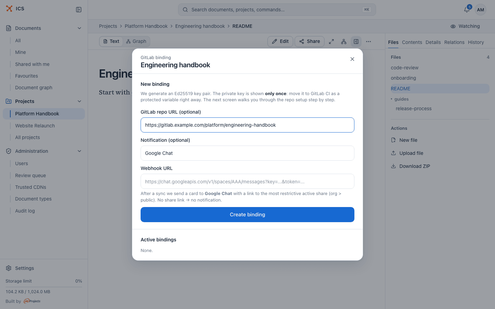
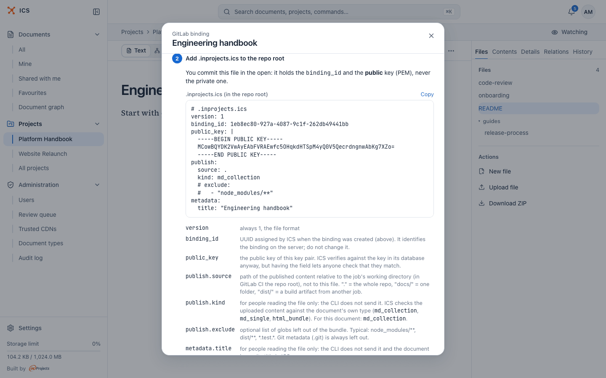
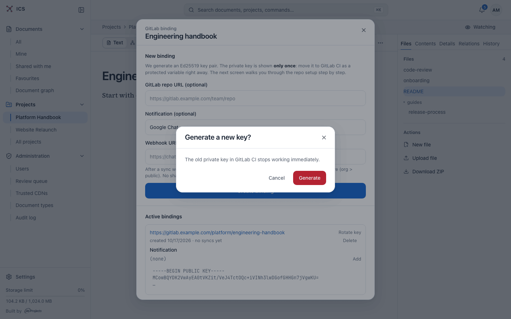

# Connect a GitLab repository

You can bind an ICS document to a GitLab repository, so that every push to the default branch publishes the repository content as a new version of the document. This page walks through the setup from the ICS side; the CLI that runs in CI is [ics-sync](https://github.com/inprojectspl/ics-sync).

## When to use a binding

A binding suits documentation that is written and reviewed in Git: a handbook kept next to the code, a static HTML report built by another CI job, a folder of Markdown notes. People who do not use GitLab read the current version in ICS, with history, comparison and sharing, while the authors keep their usual merge request workflow.

How it works, in short:

1. ICS generates a key pair for the binding. The private key goes into a GitLab CI variable; the public key stays in ICS.
2. You commit a small configuration file, `.inprojects.ics`, to the repository.
3. A CI job runs `ics-sync` after each push. It packs the content, signs it with the private key and sends it to ICS.
4. ICS checks the signature and creates a new version of the document.

Nobody signs in during a sync: the signature proves the push comes from your CI. Versions created this way appear in notifications as "GitLab sync", and in the documents list a bound document shows a "GitLab" marker.

> [!NOTE]
> **Connect a GitLab repo** is available to the document's owner, the owner of the project it belongs to, and administrators. Project editors and people the document is shared with do not see it, and ICS refuses them if they try to create, list, rotate or delete a binding another way. Create the document in ICS first (for example by uploading the current content), then bind it.

## Create the binding

1. Open the document and click **...** (Document actions) in the toolbar, or the **...** on its row in a list.
2. Pick **Connect a GitLab repo**. The dialog **GitLab binding** opens.
3. Under **New binding**, fill in the optional fields:
   - **GitLab repo URL (optional)**: the address of the repository, for example `https://gitlab.example.com/team/repo`. It is shown as a link in the list of bindings, for reference only.
   - **Notification (optional)**: the chat service for a card after each sync. The list offers Google Chat (picked by default) and **No notification**.
   - **Webhook URL**: the incoming webhook of the Google Chat space. After each sync ICS sends a card to that space with a link to the document's most restrictive active share link (organisation before public). If the document has no share link, no card is sent. Pick **No notification**, or leave **Webhook URL** empty, if you do not want a card.
4. Click **Create binding**.

The dialog switches to a setup screen in three steps. Keep it open until you have finished all three.

> [!WARNING]
> The private key is shown only now. If you close the window without copying it, you have to generate a new key with **Rotate key**. When you are done, click **Close and clear from memory** at the bottom.

## Step 1: put the private key into a GitLab CI/CD variable

In the GitLab project of the repository, go to **Settings → CI/CD → Variables → Add variable**. Click **Copy** next to "ICS_PRIVATE_KEY (variable value)" in ICS and create the variable with these settings, as listed in the dialog:

| Field | Value | Why |
|---|---|---|
| Key | `ICS_PRIVATE_KEY` | The job in step 3 uses exactly this name. |
| Value | the whole PEM block | From `BEGIN` to `END` inclusive. |
| Type | File | The CLI reads the key from a file (see below). |
| Environment scope | `*` (or your environment) | Narrow it if you use environments. |
| Visibility | not masked | GitLab cannot mask File variables, but a File variable never prints its value in logs. |
| Flags | Protect variable: ON | Only protected branches and tags (usually `main`) get the key. Mark the branch as protected in **Settings → Repository**. |

In CI, a File-type variable holds the path to a temporary file, not the key itself. That is why the job passes `@$ICS_PRIVATE_KEY`: the `@` prefix tells the CLI to read the PEM from that path. If you create a plain (text) variable instead, use `"$ICS_PRIVATE_KEY"` without the `@`.

## Step 2: add .inprojects.ics to the repository root

Click **Copy** next to ".inprojects.ics (in the repo root)", save it as `.inprojects.ics` in the root of the repository and commit it. The file is safe to commit in the open: it holds the binding id and the public key, never the private one.

| Field | What it means |
|---|---|
| `version` | Always `1`, the file format. |
| `binding_id` | The id ICS gave this binding. Do not change it. |
| `public_key` | The public key of the pair, so anyone can check it matches the binding. |
| `publish.source` | What to publish, relative to the job's working directory (in GitLab CI the repository root), not to the file: `.` for the whole repository, `docs/` for one folder, `dist/` for a build output of another job. |
| `publish.kind` | For people reading the file only: the CLI does not send it. ICS checks the uploaded content against the document's own type (`md_collection`, `md_single` or `html_bundle`). The dialog fills in the type of this document. |
| `publish.exclude` | Optional list of patterns to leave out, such as `node_modules/**`, `dist/**`, `*.test.*`. The `.git` folder is always left out. |
| `metadata.title` | For people reading the file only. It is not sent, and the document keeps its title in ICS. |

## Step 3: add the ics:sync job to .gitlab-ci.yml

Click **Copy** next to ".gitlab-ci.yml (snippet)" and add the job to your `.gitlab-ci.yml`.

| Part of the job | What it does |
|---|---|
| `image.name` | The ics-sync image. The dialog shows the image your administrator configured, for example `ghcr.io/inprojectspl/ics-sync:1`; when none is configured it shows the placeholder `<registry>/ics-sync:<tag>`, which you replace yourself. |
| `image.entrypoint: [""]` | Turns off the image's own entrypoint so GitLab Runner can run the script. |
| `image.pull_policy: always` | Pulls the image fresh each time, so the runner does not keep an old cached `:1`. If your runner allows only `if-not-present`, remove the line and pin a specific tag instead. |
| `tags: - docker` | The runner must support Docker. Use your instance's runner tags. |
| `rules` | Runs the sync only for pushes to the default branch. You can extend it, for example to tags. |
| `ICS_ENDPOINT` | The address of your ICS instance, filled in from the address you opened ICS at. You can also leave it out of the job and define `ICS_ENDPOINT` as a CI/CD variable (Text) instead. |
| `--private-key "@$ICS_PRIVATE_KEY"` | Reads the key from the File variable created in step 1. |

After the next push to the default branch, the job packs `publish.source`, signs it and sends it to ICS. ICS verifies the signature, checks that the commit is newer than the last accepted one and creates a new version of the document. The version counts against the storage limit of the document's owner. For every CLI option, see the [ics-sync README](https://github.com/inprojectspl/ics-sync).

## Check that it works

Open the dialog again (**...** > **Connect a GitLab repo**). Under **Active bindings**, each binding shows its repository link, the creation date and either "no syncs yet" or the date of the last sync.

From this list you can also set or change the Google Chat card: **Add** (or **Edit**) next to **Notification**, then **Save**.

## Rotate the key

Rotate the key when the private key may have leaked, when you lost it before saving it to GitLab, or to recover from a rejected out-of-order push (see below).

1. In **Active bindings**, click **Rotate key**.
2. Confirm **Generate** in "Generate a new key?". The old private key in GitLab CI stops working immediately.
3. The setup screen opens again with the new private key. Replace the value of `ICS_PRIVATE_KEY` in GitLab. The binding id stays the same, so `.inprojects.ics` and the CI job do not need changes.

Rotating also resets the record of the last accepted commit, so the next push is accepted whatever its commit date.

## Remove a binding

Click **Delete** next to the binding in **Active bindings** and confirm "Remove the GitLab binding?". Further syncs from that repository are rejected. The document and its versions stay in ICS. Remove the `ics:sync` job and the `ICS_PRIVATE_KEY` variable from GitLab as well.

## Troubleshooting

The bottom of the setup screen lists the most common errors of the CI job:

| Error in the job log | Cause and fix |
|---|---|
| `403 bad signature` | The private key in CI does not match the binding, usually because the key was rotated in ICS and the new one never made it into `ICS_PRIVATE_KEY`. Rotate again and replace the variable. |
| `404 Not Found` | The binding was deleted, or `binding_id` in `.inprojects.ics` has a typo. |
| `409 replay or out-of-order` | The commit is not newer than the last accepted one, usually after a force push or rebase. Rotate the key to reset it. |
| `400 manifest invalid` | The manifest failed the ICS schema check (`binding_id` must be a UUID, `commit_sha` 1 to 64 characters, `commit_timestamp` a date, `bundle_sha256` 64 hex characters). The response names the failing field; check the values from `--commit-sha` and `--commit-ts`, or `$CI_COMMIT_SHA`. |
| `private key: the value after @ is a PEM key, not a file path; pass it without @` | `ICS_PRIVATE_KEY` is a plain (text) variable, so after the `@` the CLI got the key itself instead of a path. Change the variable type to File, or remove the `@` before `$ICS_PRIVATE_KEY`. The CLI does not print the key. |
| `private key: cannot read the key file: no such file or directory` | The CLI got a path, but there is no file there. Usually `ICS_PRIVATE_KEY` is not passed to this job at all: a protected variable on an unprotected branch, or an environment scope that does not match the job. |
| `permission denied / 401 on image pull` | The runner tries to sign in to the registry although the image is public. Look for a custom `~/.docker/config.json` with a wrong password or forced authentication on the runner. |

## Related

- [Documents](documents.md): creating the document you bind
- [Versions](versions.md): the versions each sync creates
- [Sharing](sharing.md): the share link the Google Chat card points to
- [Notifications](notifications.md): how watchers hear about synced versions
- [Formats](formats.md): Markdown, collections and HTML bundles
- [ics-sync on GitHub](https://github.com/inprojectspl/ics-sync)
