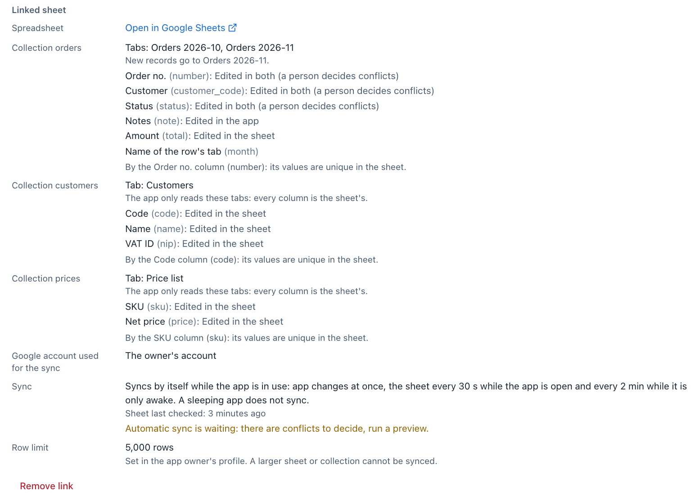
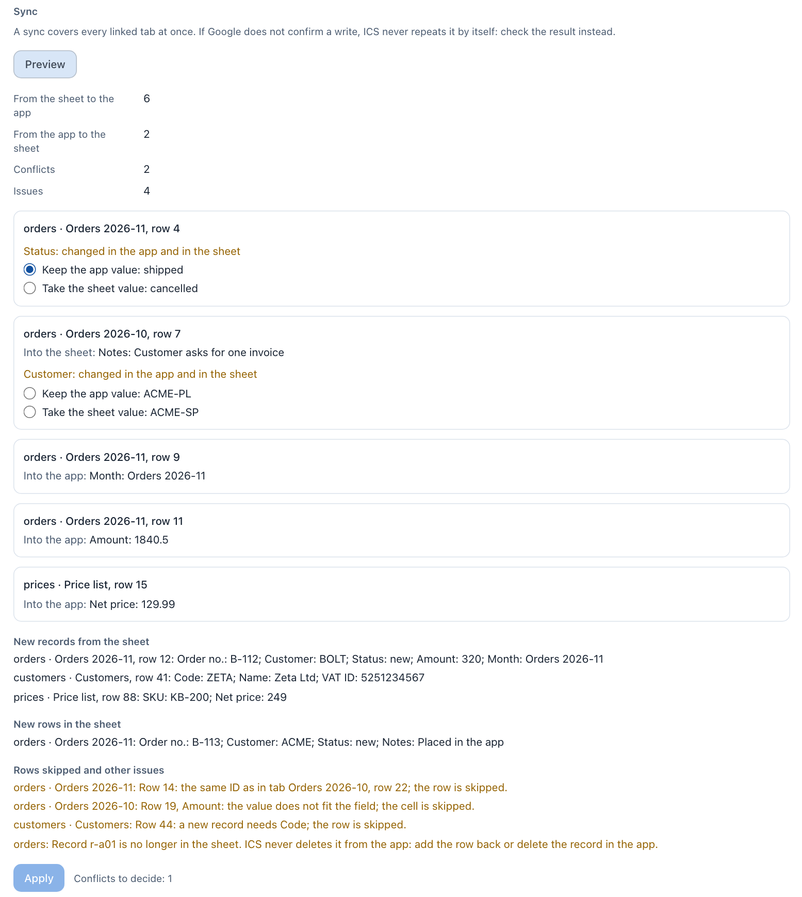

# Google Sheets

A [micro-application](micro-applications.md) can work on a Google spreadsheet your team already keeps. People go on typing in the sheet; the app adds its forms, roles and rules on top; ICS keeps both sides in step. The link is optional: an app works the same without one.

This page explains what can be linked, how to set it up, what a sync does and what it never does. The design behind it is in [ADR-0031](../decisions/0031-google-sheets-links.md) and [ADR-0033](../decisions/0033-google-sheets-file-links.md).

## What you can link

An app links one spreadsheet file. Inside it, each collection of the app (orders, customers, requests...) is linked to one tab, or to several tabs that hold the same kind of record. Tabs nobody links, such as a report, are never read.

| Your file has | What the app gets |
|---|---|
| One tab of records, e.g. "Requests" | One collection on that tab. |
| One kind of record split over tabs, e.g. "Orders 2026-10", "Orders 2026-11" | One collection over all those tabs. Rows are told apart by a column with unique values (an order number); new records from the app go to the tab you choose (usually the newest); the app can also keep the tab's name on each record, to filter by month. |
| Tabs of different things used together, e.g. orders and the customers they refer to | One collection per tab, all synced together: a change that touches both lands on both tabs in one write. |
| A list the app only reads, e.g. "Customers" kept by accounting, a price list | A collection whose columns all belong to the sheet. The app shows and uses it but never writes to those tabs, not even new rows. |
| A summary, a chart, a pivot table | Left unlinked. |
| A column computed by a formula | Read into the app as a value; the app never writes to it. |

What does not work: several tables in one tab, merged header cells, headers below the first row, or a calendar-style layout. The agent says which tabs it cannot link and why, and links the others.

Nothing in the file has to change for ICS: no id column, no renamed headers, no special tab, no script. A tab may hold the linked columns in any order and any number of other columns.

## Set it up

You do not configure the link by hand: you ask the AI agent that builds the app, through [ics-mcp](ai-agents.md#build-an-app-on-a-google-spreadsheet). For example:

> Build an app on this spreadsheet: https://docs.google.com/spreadsheets/d/.../edit. Staff take orders and change their status in the app; accounting keeps the Customers tab in the sheet.

The agent then:

1. **Reads the file** with your Google account: every tab, its headers, the kind of data in each column, which tabs look alike, which columns hold formulas. The first time, it gives you a link to Google's consent screen; you accept once and say so.
2. **Decides what each tab is** (records, a group of tabs, a list the app only reads, a report) and asks you about anything it cannot tell from the data, for example where new orders should go.
3. **Builds and publishes the app** with collections shaped like your tabs.
4. **Gives people roles** in the app, including the role a sync needs (see [Who can sync](#who-can-sync)).
5. **Links the file** and runs the first sync: a preview shows you what comes in before anything changes.

**Connect Google.** Each person who syncs with their own account connects it once, from the app's **Google Sheets** tab or from the link the agent gives. ICS keeps the access encrypted; **Disconnect** removes it.

## The Google Sheets tab

The app's page in ICS has a **Google Sheets** tab (`?tab=sheets`). It shows the link and runs syncs.

For each linked collection you see:

- its **tabs**, and with several tabs, where new records go;
- each column with the field it fills and **who edits it**: *in the sheet* (flows into the app), *in the app* (flows into the sheet) or *in both* (whichever side changed; when both did, a person decides);
- **Name of the row's tab**, when the app keeps it on each record;
- **how rows are matched to records**: by a column with unique values, or by content for a tab without one;
- *The app only reads these tabs* for a list the app never writes to.

Below: whose Google account the sync uses, whether it syncs by itself and when it last looked at the sheet, and the row limit.

## Run a sync

A sync always covers the whole file: every linked tab and collection at once.

1. **Preview.** ICS reads every linked tab and the app's records and lists what would change, nothing yet changed. Each change names its collection, tab and row, for example *orders · Orders 2026-11, row 4*:
   - values going into the app and into the sheet;
   - **New records from the sheet**: rows the app does not have yet;
   - **New rows in the sheet**: records made in the app, with the tab they go to;
   - **Rows skipped and other issues**: a value that does not fit its field, a number used twice (also across tabs), a row a new record cannot be made from, a record whose row was deleted.
2. **Decide conflicts.** When both the sheet and the app changed the same value since the last sync, choose **Keep the app value** or **Take the sheet value**. Nothing is decided by time. **Apply** stays off until every conflict has a choice.
3. **Apply.** The app's records change in one go, for every collection, under your roles in the app. Then every tab gets its cells in one write. If someone edited the sheet or the app after the preview, nothing is written: preview again.

**Check result.** If Google's answer to a write is lost, the write shows as **Sheet: unconfirmed**. **Check result** reads the cells back and says whether it landed; ICS never sends such a write again by itself. Until it is checked, no other sync of the file starts, so a record can never be added to the sheet twice.

## Automatic sync

The agent normally turns automatic sync on: ICS runs the sync itself, as the app owner, on the owner's Google account.

- A change saved in the app reaches the sheet within seconds.
- An edit typed into the sheet comes into the app within about 30 seconds while someone has the app open, and within two minutes while the app is awake. A sleeping app syncs as soon as it wakes up. Your administrator may set other intervals.
- When both sides changed the same value, or something needs a person (no access to the file, a renamed header, a missing tab), automatic syncing waits. The owner gets a notification; a preview in the tab shows what to decide, and after **Apply** automatic syncing goes on.

Without automatic sync, nothing changes until someone runs a sync.

## What ICS writes, and what it never does

ICS writes values into existing linked columns, and new rows under the last row of the tab chosen for new records. It never:

- adds, renames or reorders columns or tabs;
- deletes or moves rows: a record deleted in the app keeps its row, a row deleted in the sheet keeps its record, and both are reported;
- writes into a column that belongs to the sheet, so formulas stay; a new row leaves such a column empty;
- writes a formula: text from the app is written as text;
- reads tabs that are not linked.

A row someone moves by hand from one linked tab to another (an order moved from October to November) stays the same record; the app's tab field follows. Renaming a tab keeps the link.

## Good to know before the first sync

- **The first sync brings everything in.** Rows become records, records the sheet lacks get rows. You see it all in the preview first.
- **Columns edited in the app win at the first sync.** For a column that belongs to the app (for example a status only a reviewer sets in the app), records made from rows start with the app's default, and that value replaces what the sheet had in the column. The agent tells you before it happens.
- **New rows and formulas.** A row ICS adds gets no value in a formula column. The sheet fills it only when the formula covers the whole column (for example an `ARRAYFORMULA`); otherwise someone fills it in.
- **A new tab, for example a new month.** It is not picked up by itself: ask the agent to add it to the collection and to send new records there.
- **Unique numbers.** Over several tabs, the matching column must not repeat in any of them. A repeated value is shown in the preview and that row is skipped until someone fixes it in the sheet.
- **Row limit.** A sync handles at most the app owner's row limit, all linked tabs together (5000 by default). An administrator changes it in the user's settings, see [Administration](administration.md#change-storage-and-bundle-limits).

## Who can sync

A sync acts as the person who runs it, under the app's own rules: they need the app's `app.control` right and a role that may list, create and update every linked collection, the lists the app only reads included (the sync writes their records into the app). Automatic sync acts as the owner.

Which Google account reads and writes the file is chosen when linking. *The owner's account*: the owner's, for everyone who may sync, and the only choice for automatic sync. *Each person's own account*: everyone syncs with their own and needs access to the file; **Ask the owner for access** sends the owner a notification, and the owner shares the file in Google.

## When something stops

| You see | What it means | What to do |
|---|---|---|
| A linked tab's first row lacks some linked headers | A linked header is missing from the first row of the named tab (renamed or deleted). | Put the header back, or ask the agent to update the link to the new header. |
| No such tab | A linked tab was deleted, or the file was replaced. | Ask the agent to update the link; say what happened to the tab. |
| The same ID as in another row | A value of the matching column repeats, possibly in another tab. | Fix one of the rows in the sheet; the row is skipped until then. |
| The sheet write of an earlier sync is not confirmed | An earlier write was lost on the way. | Press **Check result** on that sync, then preview again. |
| The sheet changed since the preview | Someone edited a touched row after the preview. | Preview again. |
| The Google account cannot open the file | The account the sync uses has no access. | Share the file in Google with that account. |

## Related

- [Micro-applications](micro-applications.md): opening apps, their data, roles and sharing.
- [AI agents](ai-agents.md#build-an-app-on-a-google-spreadsheet): asking an agent to build an app on a spreadsheet.
- [Micro-applications API](../microapps-api.md#google-sheets-links): the endpoints behind this tab.
- [Deployment](../DEPLOY.md): enabling Google Sheets links on a server.
