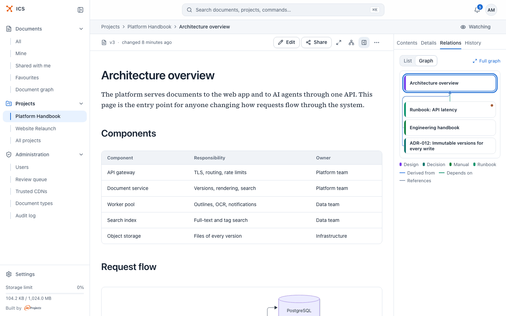
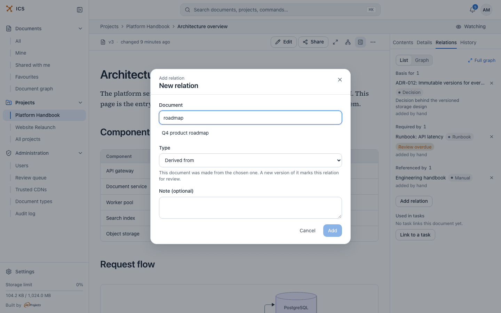
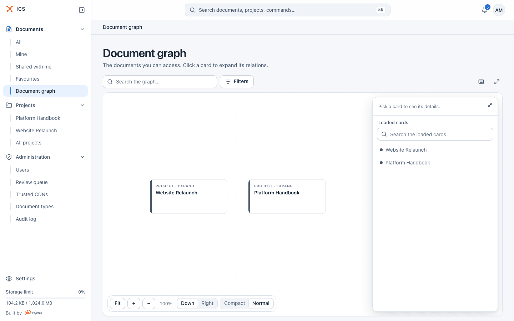
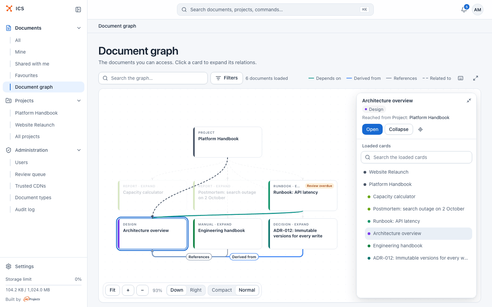
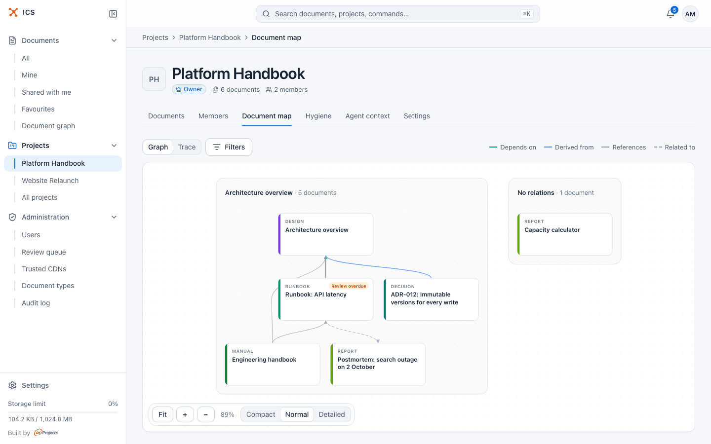

# Relations and the document graph

Relations record how documents depend on each other: a design derived from business goals, a runbook that needs the architecture overview, a new specification that replaces an old one. This page explains the relation types, how to add and review relations, and how to walk the whole graph in the graph explorer.

## Why relations are worth recording

A link inside a document is just text. A relation is something ICS understands and acts on:

- When a document you built on gets a new version, ICS tells you the basis changed.
- When a document is replaced by a newer one, readers who can see the newer one are told so, and the old one ranks lower in search.
- AI agents reading a document through [ics-mcp](ai-agents.md) get its related documents as neighbours, so they can find the specification behind a task without guessing.
- The [project document map](projects.md) and the graph explorer draw them, so you can see what belongs together.

A document does not need any relations. Add them where they say something a reader or an agent should know.

## Relation types

Every relation is stored once, from one document (the source) to another (the target). The other document shows the inverse label, so both ends always agree.

| Type (as seen from the source) | Shown on the target as | Meaning | What ICS does with it |
|---|---|---|---|
| **Derived from** | **Basis for** | This document was made from the chosen one. | A new version of the target marks the relation for review (basis changed). |
| **Supersedes** | **Superseded by** | This document replaces the chosen one. | The target is marked **Superseded** for readers who can see the replacement. |
| **Depends on** | **Required by** | This document is not understandable or valid without the chosen one. | An agent reading one gets the other. |
| **Part of** | **Has part** | This document is a part of the chosen one, like a chapter of a manual. | Groups documents. |
| **References** | **Referenced by** | This document mentions the chosen one. A weak link. | Usually created from links in the content. |
| **Related to** | **Related to** | The documents are related without a direction. | None. |
| **Duplicates** | **Duplicated by** | This document duplicates the chosen one. | Marks a candidate for merging. |
| **Contradicts** | **Contradicts** | The documents contradict each other. | An agent gets a warning. |

**Related to** and **Contradicts** have no direction: adding one from either document gives the same relation. **Supersedes** and **Part of** cannot form a cycle; ICS refuses a relation that would close one.

A document can have at most 200 relations, and a relation note can be up to 500 characters.

## Where relations come from

Each relation shows its origin under the document name:

| Label | Origin |
|---|---|
| added by hand | Someone added it in the **Add relation** dialog. |
| added by an agent | An AI agent added it through ics-mcp. |
| from a link in the content | ICS found a link to another ICS document in the content. |
| from an integration | An integration created it. |

The origin is information only. Every relation takes effect as soon as it exists, whoever created it.

### Links found in the content

Every time a document gets a new version, ICS reads its content and records a **References** relation to each ICS document it links to. This works for Markdown documents and collections, HTML bundles, and the text of PDF and Word documents. ICS recognises:

- an address of a document on your ICS, `https://<your ICS>/v/<slug>`;
- a share link, `https://<your ICS>/s/<token>`;
- `ics://asset/<slug>`, optionally with `/file/<path>` and `#heading`;
- a wikilink `[[ics:<slug>]]`, optionally with a file, a heading and an alias, for example `[[ics:abc123/setup.md#install|the install steps]]`. In the reader it becomes a normal link.

Links inside code blocks and inline code are ignored.

These relations follow the content. When you remove the link and save a new version, the relation goes away; if you remove such a relation in the panel while the link is still in the content, it comes back with the next version. To keep a relation regardless of the content, add the same relation by hand: it then counts as added by hand and the content no longer controls it.

## See the relations of a document

1. Open the document.
2. Click **Show the document panel** in the toolbar (or choose **Relations** in the "…" menu, which opens the relations on their own page).
3. Open the **Relations** tab.

The **List** view groups relations by type and direction ("Basis for 1", "Required by 1", "Referenced by 1"). Each row shows:

- the other document's title (click it to open the document), its document type and, when it applies, **Review overdue** or **Superseded**;
- the note, if one was written;
- the origin, such as "added by hand";
- for editors, an **×** button that removes the relation.

Under the relations, **Used in tasks** lists the tasks the document is linked to, with **Link to a task**. Task links are what the agent context pack is built from; see [AI agents](ai-agents.md).

> [!NOTE]
> You see the relations of a document when you can read it through a project (as a member of its project or of a project it is shared into), when you own it, or when you can edit it. If someone shared only this one document with you as a viewer, the Relations tab is not shown: you were given the document, not its surroundings. A relation also appears only when you can open the document at its other end, and nothing tells you that a relation was left out.

### The mini graph

Switch the tab to **Graph** to see the same document with its direct neighbours as cards, coloured by document type, with a legend of document types and relation types underneath. Click a card to open that document; Ctrl/⌘ click opens it in a new tab. If the document has more neighbours than fit, the panel says "Only part of the neighbourhood is shown."

**Full graph** in the top right corner of the tab opens the graph explorer starting from this document. The **Open document graph** icon in the reader toolbar does the same.

## Add a relation

You need to be an editor of the document you start from (owner, project owner or editor), and you must be able to see the document you point at.

1. Open the document and the **Relations** tab.
2. Click **Add relation**.
3. In **Document**, type at least 2 characters of the other document's title and pick it from the list.
4. Choose a **Type**. The text under the field explains what the type means and what ICS does with it.
5. If the other document is a collection, you can pick a **File in the collection** instead of **The whole document**. If it has headings, you can point at a **Heading**.
6. Optionally write a **Note (optional)** that says why the relation exists.
7. Click **Add**.

The relation is written from the open document to the chosen one. To record "this design was made from the business goals", start from the design and choose **Derived from**.

To remove a relation, click **×** on its row. You can remove a relation when you can see both documents and are an editor of at least one of them. Adding and removing relations is recorded in the audit log.

## React when a basis changes

When a relation is created, ICS remembers the version the other document had at that moment. For a **Derived from** relation, when the document it was derived from later gets a newer version, the relation row shows an amber box "Basis changed (v2 → v3)" with two links:

- **Show changes** opens the comparison of the two versions of the other document.
- **Still current** (editors only) confirms that your document is still valid for the new version. ICS records the current version and the warning disappears.

The box appears only on the derived document, the one the relation starts from. The document it was derived from lists the relation under **Basis for**, without the box. Other relation types never show it.

The derived document also gets a "basis changed" flag. It shows in the project's **Hygiene** tab under **Basis changed** ("Documents derived from a basis that has changed since. Check the changes and confirm the document still holds."), and agents receive it as a warning in the context pack. See [Projects](projects.md) for the Hygiene tab.

## Mark a document as superseded

Add a **Supersedes** relation from the new document to the old one. From then on, for every reader who can open the new document:

- the old document shows the **Superseded** badge (struck through) in lists and relation rows;
- the reader shows a notice on the old document, "This document was replaced on {date} by “{title}”.", with **Open the current document**;
- the old document ranks lower in search results;
- an agent's context pack lists the old document as one line and puts the new one in its place.

Readers who cannot see the new document see the old one as before, so the notice never reveals a document they have no access to. **Superseded** takes precedence over **Review overdue**. In a project's **Hygiene** tab, **Superseded, linked to tasks** lists superseded documents that tasks still point at, with **Repoint to successor** to move those task links.

## Explore the graph

The graph explorer is a full-page view in which you walk from document to document across projects. Open it from the sidebar (**Documents** > **Document graph**), from **Full graph** in the Relations tab, or with the **Open document graph** icon in the reader.

- From the sidebar it starts from the projects you are a member of: "The documents you can access. Click a card to expand its relations."
- From a document it starts from that document, one level deep: "The surroundings of a document. Click a card to expand its relations." An **Open document** button takes you back to it.

### Expand cards

Click a card to select it and expand it. Expanding a project shows its documents; expanding a document shows the documents related to it. Each card shows a small label above the title: the document type (or **Project**) and its state, **expand** when it can be expanded or **no further path** when it cannot (for example, a document shared with you directly, whose relations you cannot see).

The layout is a tree: a card stays under the card that found it first, and other relations between cards already on the canvas are drawn as extra edges. Cards you have seen keep their place when new ones appear. When a card has more than 12 related documents, the rest wait behind a "+N more" card; click it to show the next 12. The explorer keeps at most 500 cards. Past that, it collapses the branches you used least recently and says so above the canvas.

Hovering or selecting a card dims the cards that are not directly connected to it, so its relations stand out.

### The side panel

The panel on the right shows the selected card:

- its title, document type and freshness badge, and **Reached from** with the relation and the card it came from (click that card's name to select it);
- **Open**, which opens the document or project;
- **Expand** or **Collapse**;
- a locate icon, **Show the graph from here**, which starts a new graph from this document.

Below it, **Loaded cards** lists every card on the canvas as an indented tree, with **Search the loaded cards** to filter it. Click a row to select that card.

The panel can be minimised with the button in its top right corner. On a phone, it opens as a sheet from the **Details and list** button.

### Search and walk to a document

Type at least 2 characters into **Search the graph…**. The results come in two groups:

- **On the graph**: cards already loaded. Picking one selects it.
- **Walk to a document**: other documents in ICS. Picking one makes the explorer find the shortest path (at most 6 steps) from a card already on the canvas, expand every step in order and select the document, so it appears where it belongs instead of in a new graph.

The path only goes through documents whose relations you can see. When there is no path, the explorer says "“{title}” cannot be reached from the cards on the graph." and offers **Show the graph from here** to start a new graph from that document.

### Filter relation types

**Filters** opens **Relations shown**, a checkbox per relation type. Both expanding and walking follow only the types that are checked. The button shows how many types are switched off. The legend next to it lists the relation types drawn on the canvas.

### Layout and density

The controls at the bottom of the canvas:

| Control | What it does |
|---|---|
| **Fit** | Shows the whole graph. |
| **+** and **−** | Zoom in and out. The percentage is the current zoom. You can also zoom with the mouse wheel and pan by dragging. |
| **Down** / **Right** | Tree direction. **Down** puts related documents side by side below the one they came from; **Right** stacks them to the right of it. |
| **Compact** / **Normal** | Card density. |

The explorer remembers the direction, the density and whether the panel was open.

### Focus mode

The **Focus mode** icon at the right end of the toolbar hides the sidebar and the page heading, so the canvas takes the rest of the screen. Click **Leave focus mode**, press **F** again or press **Esc** to return.

### Keyboard shortcuts

The keyboard icon in the toolbar lists the shortcuts. They work when no text field has the focus.

| Key | Action |
|---|---|
| Ctrl/⌘ + click | Open in a new browser tab |
| Middle click | Open in a new browser tab |
| Enter | Open the selected document |
| Ctrl/⌘ + Enter | Open in a new browser tab |
| E | Expand or collapse the selected one |
| Space | Expand or collapse the selected one |
| / | Search the graph |
| F | Focus mode |
| P | Show or hide the panel |
| Esc | Close a list or leave focus mode |

## The project document map

Each project also has a **Document map** tab that draws all its documents and the relations between them at once, grouped into independent graphs, with documents without relations listed apart. It is the place to see the shape of one project; the explorer is the place to follow relations across projects. See [Projects](projects.md).

## Related

- [Projects](projects.md): the Document map and Hygiene tabs, key documents.
- [AI agents](ai-agents.md): how agents use relations and the context pack.
- [Documents](documents.md): the reader and the document panel.
- [Versions](versions.md): comparing versions, which **Show changes** opens.
- [Search](search.md): how superseded documents rank.
- [Sharing](sharing.md): how sharing affects what you can see in the graph.
