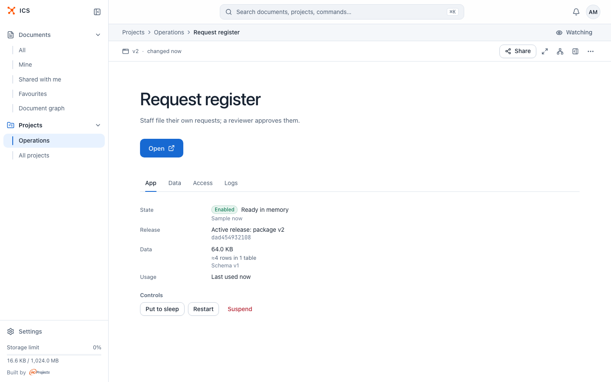
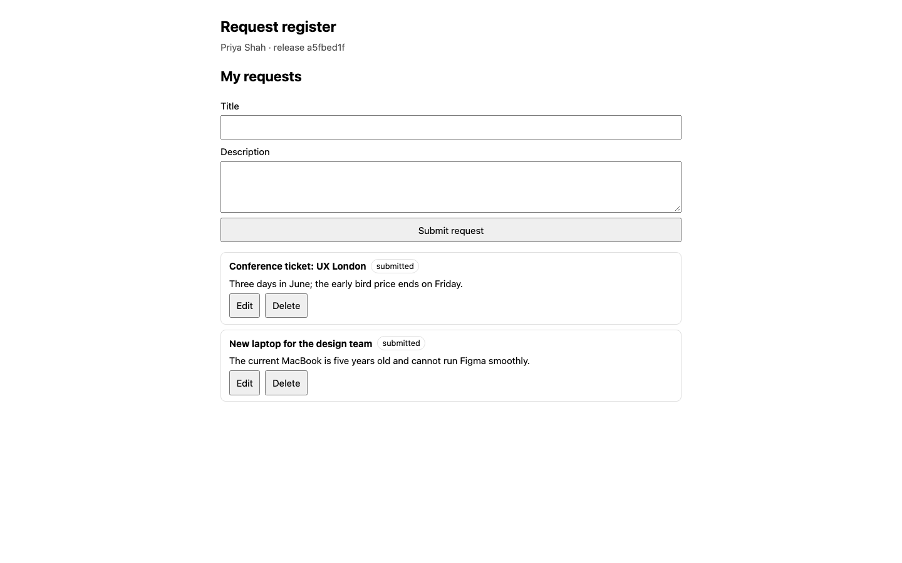
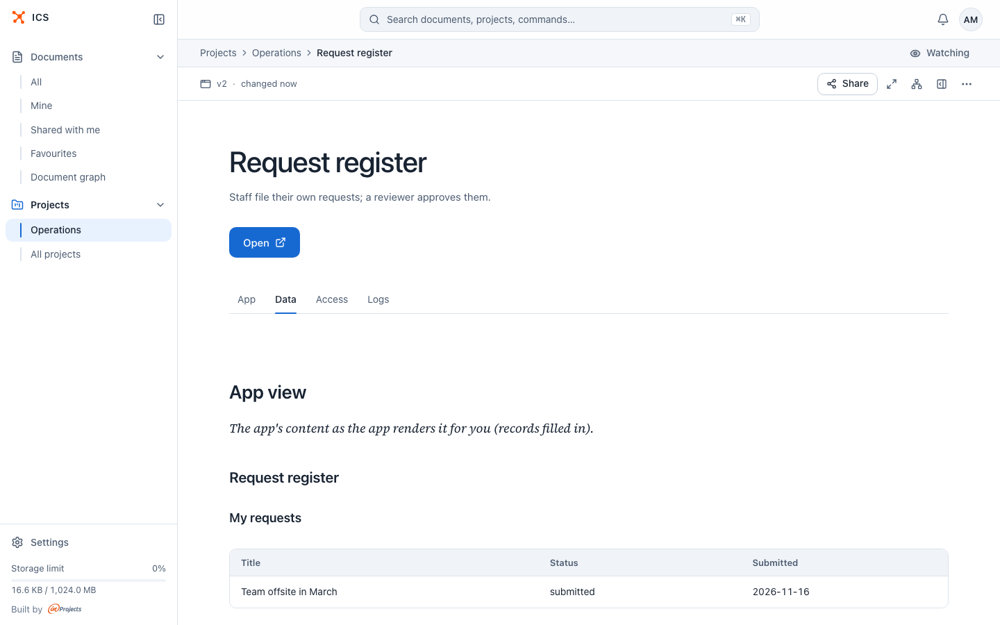
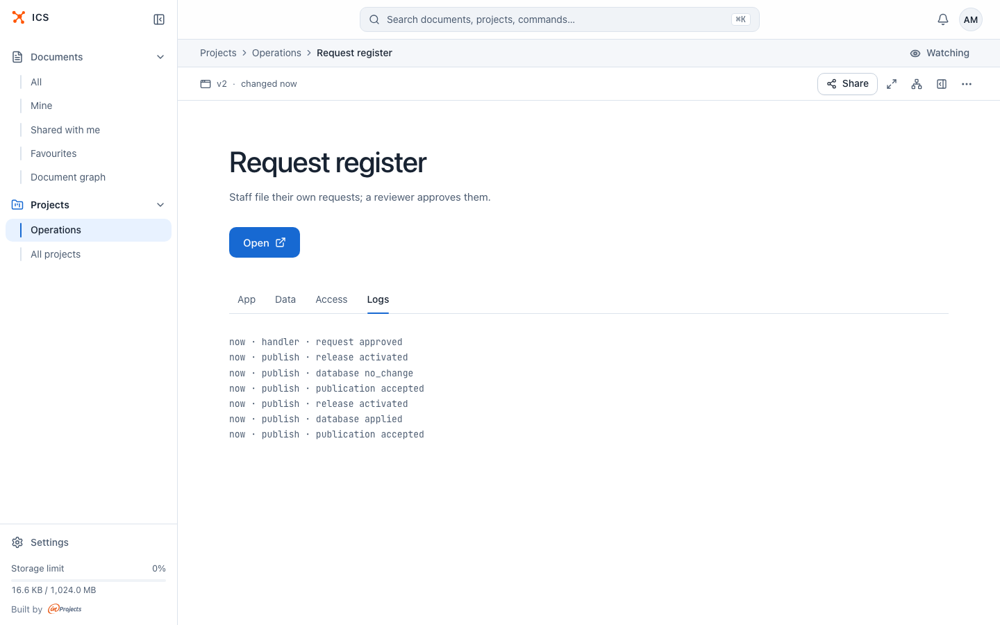
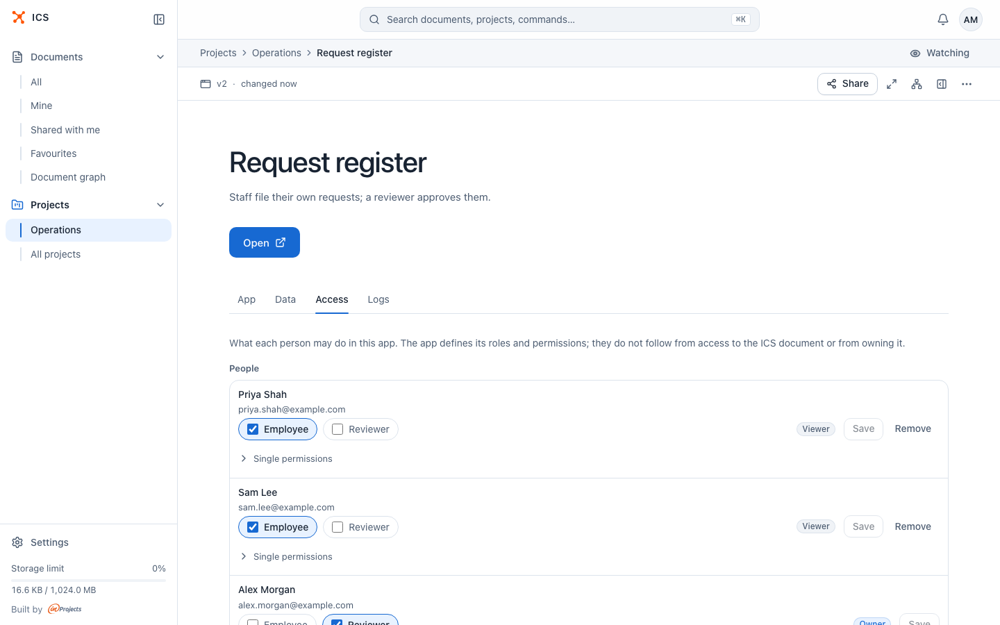
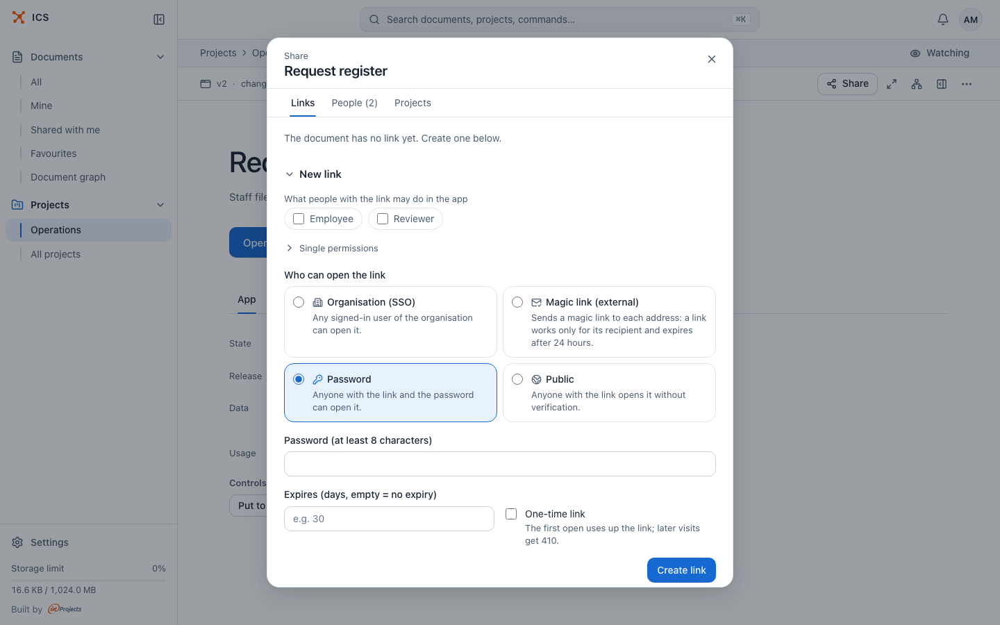
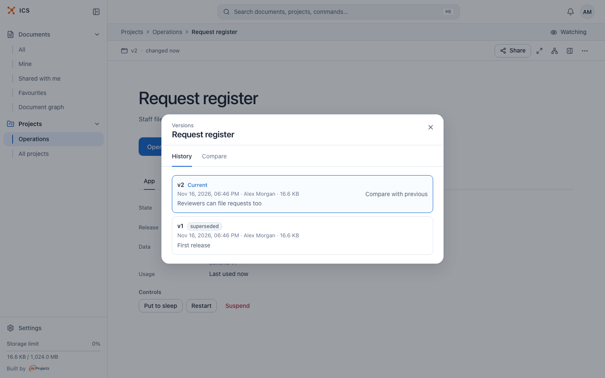
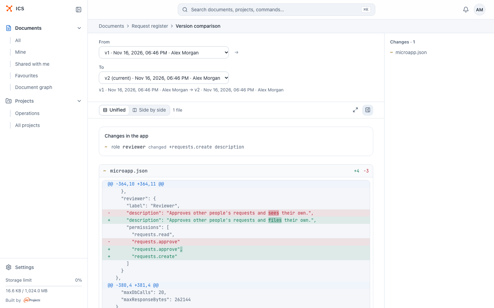

# Micro-applications

A micro-application is a small app with its own data that lives in ICS like any other document: a request register, a booking sheet, a poll, a checklist for a team. People open it from ICS and use it in the browser; ICS decides who may open it and what each person may do in it. This page is for the people who use, run and hand out such apps. Building one is done by an AI agent through [ics-mcp](ai-agents.md#build-and-publish-a-micro-application); there is no upload form for apps.

> [!NOTE]
> Micro-applications are an optional part of ICS. When your administrator has not enabled them, existing apps stay in the document list with their title and description, and opening one says that micro-applications are off.

## How an app differs from a document

- **It runs on its own address.** **Open** takes you to the app, on a domain separate from ICS. You are signed in to it automatically with your ICS account; the app never sees your ICS session.
- **It keeps its own data.** Records people add in the app are stored in the app's own database, not in document versions. Publishing a new release keeps the data.
- **It has its own roles.** The app declares roles such as Employee or Reviewer and the permissions behind them. Your role on the ICS document (viewer, editor, owner) decides what you can do with the document, never what you can do in the app: even the owner of the app has no app role until someone gives one.
- **Its sources are not content.** The app's code and files are visible only to its publishers, through ics-mcp. Search finds an app by its title and description, not by its code, and links in the code create no [relations](graph.md).

## Open an app

Open the app's page from the document list, a project or a link, and click **Open**. The app opens in a new tab.

What you see inside depends on the roles you have in the app. Without any role you can open it, but the app shows that you have no permissions yet; ask the person who manages the app's access (see [Give people roles](#give-people-roles)).

An app that has not been used for a while (its author sets how long, between one minute and an hour) is put to sleep and frees its resources. The next request wakes it up; you may notice a short delay on the first click.

## The app's page in ICS

The page of an app has up to four tabs. Each has its own address (`?tab=data`, `?tab=access`, `?tab=logs`), so you can send someone straight to one.

| Tab | Who sees it | What it shows |
|---|---|---|
| **App** | everyone who can open the document | state, active release, data size, last use; the controls for those who run the app |
| **Data** | everyone who can open the document | the app's content as the app renders it for you, with your records filled in |
| **Access** | the owner of the app or of its project | who has which roles in the app |
| **Logs** | the people who run or publish the app | recent log lines of the app and its publications |

### App

- **State.** **Enabled** or **Suspended** is what the app is set to; next to it is what it is doing now: **Ready in memory**, **Running a request**, **Sleeping: no resources**, **Finishing requests**, **Not accepting requests**. **Sample now** or **Sample 2 minutes ago** says how fresh this is.
- **Release.** The package version that runs, for example **Active release: package v2**. When a newer package failed to publish, **Newer package v3 is not active** says so, and the last publication shows its status and the step where it stopped.
- **Data.** The size of the app's data and an estimate of its records, for example **≈4 rows in 1 table**, and the schema version.
- **Usage.** When the app was last used.

### Data

The **Data** tab shows the app's own view of its content, the same one an AI agent reads: for Request register a table of your requests and, for a reviewer, the queue to approve. Below it are the records of each collection you may read, with **Show more of {name}** for long lists. You only ever see what your roles in the app allow.

### Logs

The **Logs** tab lists recent lines: publication steps (accepted, database applied, release activated), control actions and messages of the app's handlers. Secrets never reach the log.

## Run an app

The owner of the app, the owner of its project and people given the right to run it see the controls on the **App** tab:

- **Put to sleep** frees the app's resources now; the next request wakes it.
- **Restart** finishes running requests and starts the app's processes again; use it when the app misbehaves. It never lifts a suspension.
- **Suspend** refuses new requests at once and finishes running ones. Data stays. The app does not wake up on its own until someone clicks **Enable**.
- **Enable** brings a suspended app back.

None of these deletes data. Each action is recorded in the logs and in the audit log.

## Give people roles

The **Access** tab lists the people and projects that have roles in the app. It is shown to the owner of the app and to the owner of its project.

- **Add a person** takes an e-mail address and the roles to give. The person can then open the app (ICS shares the document with them as a viewer if they could not see it yet).
- Tick or untick roles and click **Save**. **Single permissions** gives one permission without a whole role; a permission that a ticked role already gives is shown as given.
- **Add a project** gives the same roles to every accepted member of a project, whatever their role in the project. Give different roles to people directly. Members can open the app only when the document is shared with that project.
- **Remove** takes away all of a person's permissions in the app and the viewer share given for it. If the person can still open the app another way, for example through a project, ICS says so.
- **What each permission unlocks** lists the app's roles, their permissions and what each permission allows.

A role is whatever the active release defines: when a new release adds a permission to a role, everyone holding the role gets it.

## Share an app

The **Share** dialog of an app works as for any document (see [Sharing](sharing.md)), with one addition: a link names what people who open it may do in the app.

- **What people with the link may do in the app** picks the roles (and, under **Single permissions**, single permissions) the link gives. A link needs at least one.
- A **Public** link opens the app without signing in; the other modes keep their gate (organisation sign-in, password or magic link) and then open the app.
- In **People**, a person you share the app with can only open it. **What this person can do in the app** gives them roles at the same time; without a role they only open it.

Revoking the link, or its expiry, ends access to the app through it.

## Versions of an app

Every publication of an app is a new version of its package, kept in the history like the versions of a document. Its publishers see **Versions (N)** and **Compare versions** in the **…** menu.

- Each version shows the change note its publisher wrote and the state of its release: **Current** for the one that runs, **superseded** for an earlier one, **publication failed** for a package that never became active.
- **Compare with previous** opens the comparison of a version with the one before it.
- There is no **View** or **Restore** for an app: going back means publishing the earlier package again, which an agent does through ics-mcp.

The comparison starts with **Changes in the app**: what changed for the people using it, such as a role added or changed, a new permission, endpoint or collection. Below it are the changed files.

## Data limit

The records of all apps a person owns count against that person's micro-application data limit, 100 MB unless an administrator changed it (see [Administration](administration.md#change-storage-and-bundle-limits)). When the limit is full, the owner's apps refuse new and changed records until some are deleted; reading and deleting keep working.

## Delete an app

**Delete** in the **…** menu moves the app to the trash like any document and takes away every role people hold in it. Its data is removed for good when the app is deleted from the trash. An app whose first publication failed goes to the trash on its own.

## Notifications

People watching a project hear of a new app once its first release runs, not when its first package is uploaded. Later releases notify the app's watchers like new versions of a document.

## Related

- [AI agents](ai-agents.md): building and publishing apps through ics-mcp
- [Sharing](sharing.md): share links and personal grants
- [Versions](versions.md): history and comparison of documents
- [Administration](administration.md): the data limit of a user
- [Deploying ICS: micro-applications](../DEPLOY.md#micro-applications-optional), for administrators
