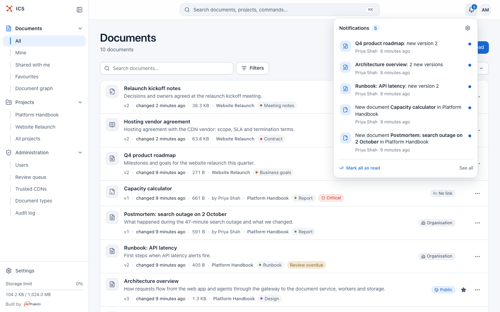
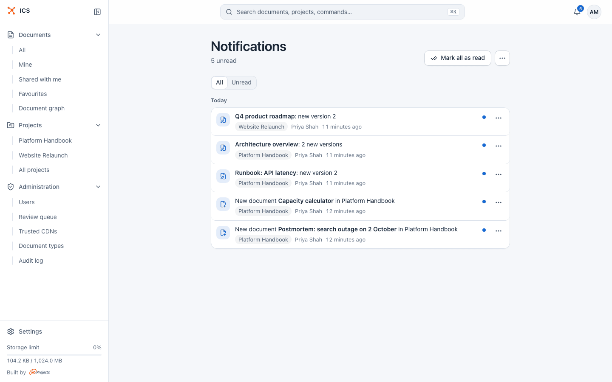
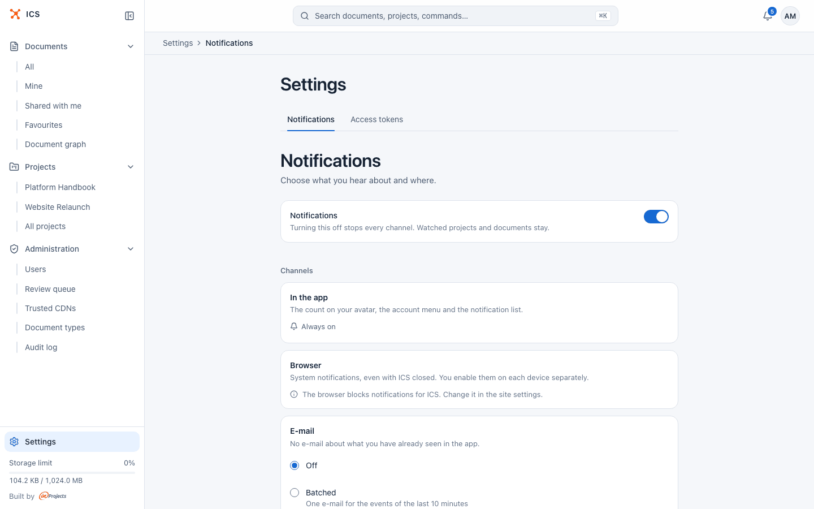
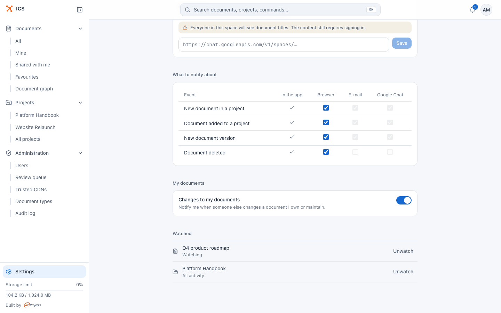

# Notifications

ICS tells you when documents you care about change: a new version, a new document in a project you follow, a deletion. You choose what to follow with the eye button, and where the news reaches you: in the app, in the browser, by e-mail or in a Google Chat space.

## Watch a document or a project

You follow things by watching them. Watching is a single toggle with an eye icon, shown at the right of the bar above the page.

**Watch a document**

1. Open the document.
2. Click **Watch** in the bar above the document. The button changes to **Watching**.
3. Click it again to stop.

Hover over the button to see why you are getting notifications. You may already be watching a document without clicking anything:

| You see | Why | What a click does |
|---|---|---|
| **Watching**, "You are watching this document. Click to stop" | You watch it yourself. | Stops watching. |
| **Watching**, "You are watching this document through the project ..." | You watch its project. | Mutes this one document. |
| **Watching**, "You get notifications because this is your document" | You own or maintain it. | Mutes this one document. |
| **Muted** | You muted it. | Unmutes it. |
| **Watch** | You get nothing about it. | Starts watching it. |

Muting is useful for one noisy document in a project you otherwise want to follow: you keep the project, but stop hearing about that document.

**Watch a project**

1. Open the project. You must be a member of it.
2. Click **Watch** in the bar above the project. You now get notified about new documents in the project and about every new version of its documents.
3. Click **Watching** to stop.

The project toggle always follows **All activity**. Documents shared into the project from elsewhere count as well (see [Projects](projects.md)).

> [!NOTE]
> You only hear about documents you can read. If you lose access to a document, older notifications about it stay in the list, dimmed and without a link, with the text "You no longer have access to this document".

## What generates a notification

There are four kinds of events. You never get a notification about your own action.

| Event (as named in the settings) | Who is notified |
|---|---|
| New document in a project | People who watch that project. |
| Document added to a project | People who watch the project it was moved or shared into. |
| New document version | People who watch the document or watch its project, plus the document's owner and maintainer. |
| Document deleted | People who watch the document, plus its owner and maintainer. |

The owner and the maintainer of a document get version and deletion notices without watching it, as long as **Changes to my documents** is on in the settings (it is on by default).

New versions written in quick succession are merged: versions saved within about 20 seconds of each other become one notification, such as "Architecture overview: 2 new versions", which opens a comparison of the whole range. An unread notification about the same document is also updated in place rather than repeated. When several people edit the same document in one such burst, the notification names all of them except you, most recent first, and each of them hears about the others' changes.

Versions published by a GitLab CI job (see [Connect a GitLab repository](gitlab.md)) show "GitLab sync" in place of a person's name.

## Read your notifications

The bell in the top bar shows the number of unread notifications (up to 99, then "99+"). The count updates live, and the browser tab title shows it too, for example "(3) ICS".

Click the bell to see the five newest items. Each shows what happened, who did it and when; a blue dot marks unread items. From here you can:

- click an item to open the document (or the version comparison) and mark the item as read;
- click **Mark all as read**;
- click **See all** to open the notifications page;
- click the gear icon to open the notification settings.

The **Notifications** page (also in the command palette under **Go to**) lists everything, grouped by day, with the project of each item.

- Switch between **All** and **Unread** at the top.
- Use the **...** menu on an item to **Mark as read**, **Mark as unread** or **Delete** it.
- Use **Mark all as read** at the top, or the **...** menu next to it for **Settings** and **Clear**. **Clear** removes every notification from the list and cannot be undone.
- Scroll down and click **Show older** to load earlier items.

The list is not kept forever. By default it holds the newest 150 notifications and drops those older than 30 days; your administrator can change both limits.

## Choose where notifications reach you

Open the settings from **Settings** at the bottom of the sidebar, from the account menu (click your avatar, then **Settings**) or from the gear in the bell popover. The **Notifications** tab has all the options.

The **Notifications** switch at the top stops every channel at once. Your watched projects and documents stay, so you can turn it back on later without setting them up again.

Under **Channels**:

| Channel | What it does | Notes |
|---|---|---|
| **In the app** | The bell, its popover and the notifications page. | **Always on** while the master switch is on. |
| **Browser** | System notifications from your browser, even when ICS is closed. | Enabled per device. Shown only if the server has browser notifications set up. |
| **E-mail** | Notification e-mails, one at a time or as a daily summary. | Needs e-mail configured on the server. |
| **Google Chat** | Cards posted to a Google Chat space through your own webhook. | Everyone in the space sees document titles. |

### Turn on browser notifications

1. On the device you want notified, open the settings and find **Browser**.
2. Click **Enable on this device** and allow notifications when the browser asks.
3. The device appears in the list with the date it was added and when the last notification was delivered. Use **Turn off on this device**, or **Delete** next to another device, to stop.

If an ICS tab is already in focus, you see the update there and no system notification pops up. A few browser-specific messages may appear in this card:

- "The browser blocks notifications for ICS. Change it in the site settings." You have refused permission before; allow it in the browser's site settings.
- On iPhone and iPad, notifications work only after you add ICS to the home screen (Share, Add to Home Screen) and open it from that icon.
- In Brave, turn on "Use Google services for push messaging" in the browser settings, otherwise notifications will not arrive.

### Get notifications by e-mail

Pick one of the modes under **E-mail**:

| Mode | What you get |
|---|---|
| **Off** | No e-mails. This is the default. |
| **Batched** | One e-mail for the events of the last 10 minutes. |
| **Daily** | One summary every morning (at 8:00 by default; the hour and time zone are set by your administrator). |

Before an e-mail goes out, ICS leaves out everything you have already read or deleted in the app, so you are not told twice. Every notification e-mail has an unsubscribe link: it opens a page with an **Unsubscribe** button that turns e-mail off without signing in. Your other channels stay as they are.

If the card says "The server has no e-mail configured, so e-mails are unavailable", the modes are disabled until an administrator sets up e-mail (see [DEPLOY.md](../DEPLOY.md)).

### Send notifications to Google Chat

1. In Google Chat, create an incoming webhook for the space you want (in the space's apps and integrations settings) and copy its URL. It starts with `https://chat.googleapis.com/`.
2. In the **Google Chat** card, paste the URL and click **Save**. The card then shows the space it posts to, and sending is on.
3. Click **Send test** to post a sample card.

The **Send to this space** switch pauses and resumes sending without removing the webhook.

Notifications are gathered for about a minute and posted as one card, with an "Open" button for each item. The links still require signing in to ICS, but everyone in the space sees the document titles, so pick the space with that in mind.

Use **Change URL** to point to another space, or **Remove webhook** to stop. If Google rejects the webhook (for example because it was deleted), ICS turns this channel off, shows "The webhook stopped working, so sending was turned off." in the card and leaves a notification in the app. Save a working URL and turn it on again to resume.

## Pick which events go to which channel

The table under **What to notify about** has a row per event and a column per channel. In-app notifications are always on and shown as a tick. Tick or untick a cell to send that event to the channel, or not.

A channel that cannot deliver right now keeps its cells visible but disabled. Hover over a cell for the reason, for example "Choose how e-mails are sent." (e-mail is **Off**) or "Add a Google Chat webhook first.".

By default every event goes to every channel, except **Document deleted**, which goes only to the app and the browser.

## Notifications about your own documents

**Changes to my documents** under **My documents** decides whether you hear about others' new versions and deletions of documents you own or maintain, without watching them. It is on by default. Turn it off if you only want notifications about what you watch explicitly. To set a document's maintainer, see [Documents](documents.md).

## See and change what you watch

The **Watched** list at the bottom of the settings shows every document and project you watch, with its level: **Watching** or **Muted** for documents, **All activity** or **New documents** for projects. Click **Unwatch** to remove an item. When the list is empty, start watching from the eye button above a project or a document.

## Related

- [Projects](projects.md): membership, which decides the projects you can watch
- [Documents](documents.md): owner, maintainer and document metadata
- [Versions](versions.md): the version comparison that notifications link to
- [Account settings](account.md): the settings pages and access tokens
- [Connect a GitLab repository](gitlab.md): versions published from CI
- [Getting started](getting-started.md)
