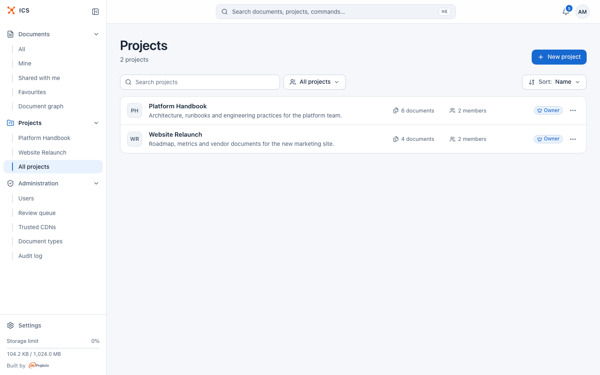
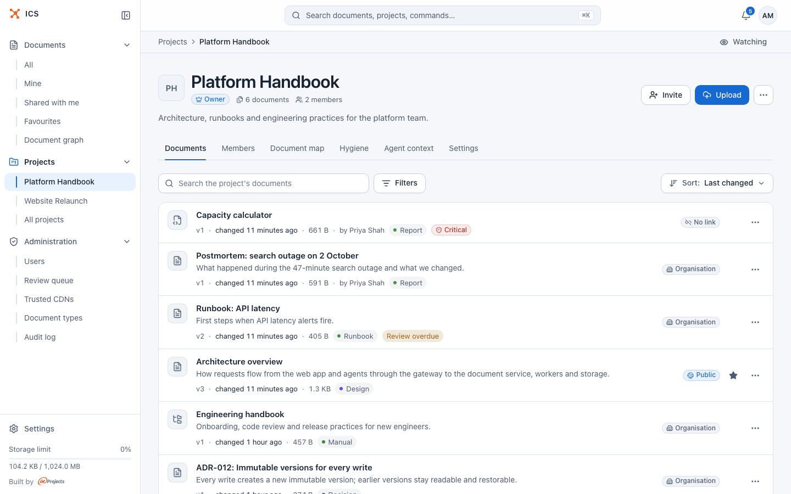
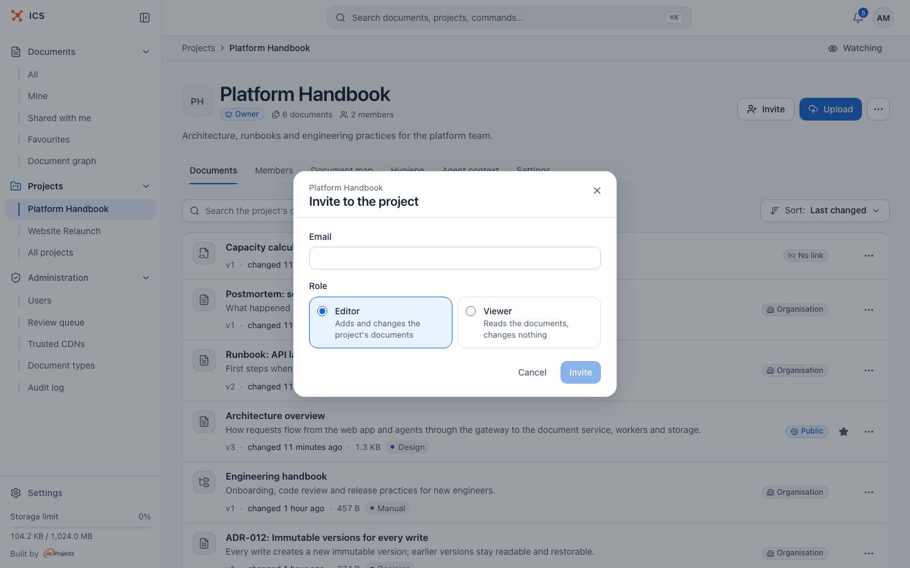
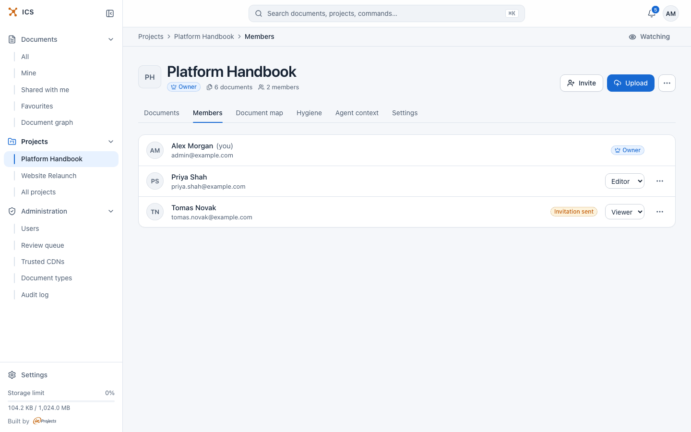
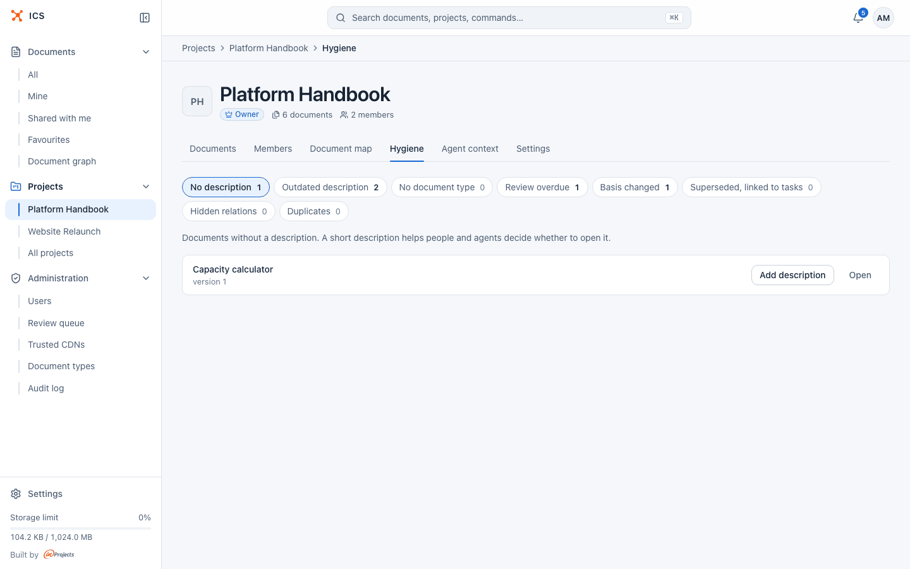
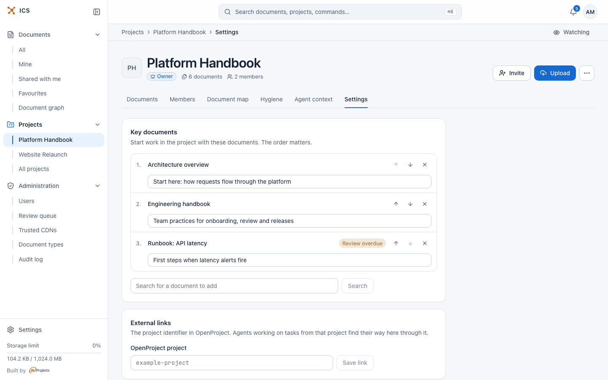

# Projects

A project brings documents and people together. Its members get access to every document in the project according to their role, so you do not have to share each document one by one.

## When to use a project

Use a project when a group of people works on the same set of documents: a team handbook, a product launch, a client engagement. Inside a project:

- every member sees the project's documents, without separate share links;
- editors can add and change documents, viewers can only read them;
- the project has a document map, a hygiene view for upkeep, a list of key documents to start with, and a context view for AI agents.

A document that is not in any project is visible only to its owner and to the people it was shared with (see [Sharing documents](sharing.md)).

Each document has exactly one **home project** (or none). You can also show a document in other projects without moving it: see [Show a document in several projects](#show-a-document-in-several-projects).

## Find your projects

Open **All projects** in the sidebar. The sidebar also lists your projects by name for quick access.

Each row shows the project's monogram, name, description, the number of documents and members, and your role. The toolbar has:

| Control | What it does |
| --- | --- |
| **Search projects** | Filters the list by name or description. |
| Role filter | **All projects**, **Mine (owner)** (projects you own) or **Member, not owner** (projects where you are an editor or a viewer). |
| Sort | **Name**, **Newest** or **Most documents**. |

The **…** menu of a row opens the project or goes straight to its **Document map**, **Hygiene** (owners and editors only) or **Agent context**.

Administrators see every project. In a project they are not a member of, their role badge reads **Not a member**; they still have the same rights as the owner (see [Roles](#roles-owner-editor-viewer)). Such projects are listed only under **All projects**.

## Create a project

Any signed-in user can create a project.

1. Open **All projects** and click **New project**.
2. Enter a **Name** (up to 255 characters).
3. Optionally fill in **Description (optional)**: one sentence on what the project is for (up to 4000 characters).
4. Click **Create**.

ICS opens the new project. You are its owner and its only member. Next, [invite people](#invite-members) and [upload documents](documents.md).

To rename the project or change its description later, the owner opens the **…** menu in the project header and picks **Edit name and description**.

## The project page

The header shows the project name, your role badge, the number of documents and members, and the project's actions:

- **Invite** (owner) opens the invitation dialog.
- **Upload** (owner and editor) adds documents straight into this project. You can also drag files onto the page.
- **…** holds **Edit name and description** and **Delete project** (owner), or **Leave project** (any member who is not the owner).

On the right of the breadcrumb bar, **Watch** / **Watching** turns notifications about the project on or off. See [Notifications](notifications.md).

Below the header are the project tabs. Which tabs you see depends on your role:

| Tab | Who sees it | What it is for |
| --- | --- | --- |
| **Documents** | every member | Key documents and the list of all documents in the project. |
| **Members** | every member | Who is in the project and with which role. |
| **Document map** | every member | The project's documents and their relations as a map. |
| **Hygiene** | owner, editor | Lists of documents that need upkeep. |
| **Agent context** | every member | What an AI agent reads for a given task. |
| **Settings** | owner | Key documents and the link to OpenProject. |

## Roles: owner, editor, viewer

A project has exactly one **Owner**. Everyone else is an **Editor** or a **Viewer**. The role is set when you invite someone and the owner can change it later.

| What you can do | Owner | Editor | Viewer |
| --- | :---: | :---: | :---: |
| Read the project's documents, see the members, the document map and the agent context | yes | yes | yes |
| Watch the project | yes | yes | yes |
| Upload documents into the project | yes | yes | no |
| Change documents: new versions, rename, metadata, relations, restore a version | yes | yes | no |
| Use the **Hygiene** tab | yes | yes | no |
| Create share links and share documents with people | yes | no | no |
| Delete a document of the project | yes | no | no |
| Move a document to another project, or show it in other projects | yes | no | no |
| Invite members, change their role, remove them | yes | no | no |
| Edit the key documents and the OpenProject link (**Settings**) | yes | no | no |
| Rename, describe or delete the project | yes | no | no |
| Hand over ownership | yes | no | no |
| Leave the project | no (hand over ownership first) | yes | yes |

A few rules to keep in mind:

- **Your strongest role wins.** If you are a viewer in the project but someone shared one of its documents with you as an editor, you can edit that document.
- **The owner of a document keeps full control of it**, whatever the project roles. An editor who uploaded a document can still share or delete that document, because it is theirs.
- **Administrators act as owners** of every project and every document.
- An invitation gives access only after it is **accepted**. Until then, the person appears on the **Members** tab with the badge **Invitation sent** and has no access.

## Invite members

Only the owner can invite people.

1. On the project page, click **Invite**.
2. Enter the person's **Email**.
3. Pick a **Role**: **Editor** ("Adds and changes the project's documents") or **Viewer** ("Reads the documents, changes nothing").
4. Click **Invite**.

ICS sends the person an e-mail with an **Open invitation** link. The link is valid for 7 days. When the person opens it while signed in, they join the project and see "Welcome to the project" with an **Open project** button. When they are not signed in, ICS asks them to sign in first and then finishes accepting.

The invitation link works only for the account it was sent to. Someone signed in with a different account gets an error.

### Invite someone who has no account

You can invite any e-mail address. If there is no account for it yet, ICS creates one and sends a single e-mail with two links: **Set password** first, then the invitation link. After the person sets a password and signs in, ICS takes them straight to the invitation and they join the project. Both links are valid for 7 days.

The new account gets the **Employee** role when the address belongs to one of the organisation's allowed domains, and the **External client** role otherwise (see [Administration](administration.md#user-roles)). Until the person sets a password, the account shows **Invitation pending** under **Administration > Users**.

## Manage members

Open the **Members** tab.

Every member sees the list. The owner also gets, for every other member:

- a role menu to switch between **Editor** and **Viewer** (the change applies right away);
- a **…** menu with **Hand over ownership** (only for members who accepted the invitation) and **Remove from project**.

Removing someone asks for confirmation ("They will lose access to the project and all its files.") and takes effect immediately. To cancel a pending invitation, remove the person the same way.

The owner cannot be removed or demoted. To change the owner, hand over ownership.

## Hand over ownership

1. On the **Members** tab, open the **…** menu of the member who should become the owner.
2. Click **Hand over ownership**.
3. Confirm with **Transfer**.

The new owner must have accepted their invitation. You become an **Editor**, and the new owner can change your role or remove you. Administrators can hand over ownership of any project.

## Leave a project

1. Open the **…** menu in the project header.
2. Click **Leave project** and confirm with **Leave**.

You lose access to the project's documents, except the ones you own or that were shared with you directly. The owner cannot leave: hand over ownership first.

## Delete a project

The owner opens the **…** menu in the header, picks **Delete project** and confirms.

Deleting a project does not delete its documents: "Files are not deleted: they stay with their owners, without a project." Members lose the access they had through the project, and documents shown in this project from other projects are no longer shown here.

## Documents tab

The **Documents** tab lists every document in the project: the ones whose home is this project and the ones shown here from other projects. It works like the main document list, with a search field (**Search the project's documents**), **Filters** and a sort menu. See [Documents](documents.md) and [Search](search.md).

If the project has [key documents](#choose-key-documents), they appear above the list under **Key documents** ("start here"), numbered in reading order and with the reason for each.

The project page loads at most the first 200 documents in the chosen sort order. A larger project shows the note "Showing the first 200 files."

## Document map tab

The **Document map** draws the project's documents as cards and their relations as lines. Related documents form groups; documents without relations are collected in a separate **No relations** group.

- **Graph** shows groups of related documents, origins above derived documents. **Trace** shows only the "derived from" relation, origins on the left and derived documents on the right.
- **Filters** narrows the map, for example by document type, relation type or freshness.
- The legend explains the line styles (**Depends on**, **Derived from**, **References**, **Related to**).
- The coloured stripe on the left of a card shows the document type. A badge such as **Review overdue** shows its freshness.
- The controls at the bottom fit the map to the screen, zoom in and out, and switch the card density between **Compact**, **Normal** and **Detailed**.

Relations, and how to add them, are explained in [Relations and the document graph](graph.md).

## Hygiene tab

The **Hygiene** tab collects documents that need upkeep, so owners and editors can fix them in one place. Each chip is a list with the number of documents on it.

| List | What is on it | What you can do |
| --- | --- | --- |
| **No description** | Documents without a description. | **Add description** inline. |
| **Outdated description** | The description was written for an older version of the content. | **Edit description** inline. |
| **No document type** | Documents without a type. | Pick a type from the menu. |
| **Review overdue** | Documents whose review date has passed. | **Still current** confirms the content and moves the review date. |
| **Basis changed** | Documents derived from a document that has changed since. | **Show changes**, then **Still current** for each changed basis. |
| **Superseded, linked to tasks** | Superseded documents that tasks still point to. | **Repoint to successor** moves the task links to the document that replaced it. |
| **Hidden relations** | Documents with relations to documents you cannot open. | Ask the owners for access or remove the relation. |
| **Duplicates** | Pairs of documents that look like duplicates. | **Mark as duplicate** or **Not a duplicate** (the pair is not suggested again). |

Every row also has **Open**. The **Duplicates** list appears only when ICS reports a count for it.

The document type sets the colour on the map and the default review cycle; administrators manage the types (see [Administration](administration.md#manage-document-types)). Superseded and changed-basis signals come from relations: see [Relations and the document graph](graph.md).

## Agent context tab

The **Agent context** tab shows which documents an AI agent gets for a task, in the order it reads them, with the reason for each. Use it to find out why an agent skipped a document.

Enter a task (an OpenProject work package number or a Project Standard node id) and click **Show the pack**. The form and its options are described in [AI agents](ai-agents.md).

## Settings tab

Only the owner (and administrators) see **Settings**. It has two cards.

### Choose key documents

**Key documents** are the project's reading list: "Start work in the project with these documents. The order matters." Members see the list at the top of the **Documents** tab, and AI agents use it too when they gather context for a task.

1. In **Search for a document to add**, type at least two characters and click **Search**.
2. Click **Add** next to a result. The document joins the end of the list.
3. Use the up and down arrows to change the order, and **×** to remove a document from the list.
4. In the field under a document, write why it matters (optional, up to 300 characters). It is saved when you leave the field.

A project can have up to 20 key documents. You can add documents of this project, documents shown in it from other projects, and other documents you can see. Members who cannot open a key document do not see it in the list.

### Link the project to OpenProject

**External links** holds "The project identifier in OpenProject. Agents working on tasks from that project find their way here through it."

1. Enter the identifier in **OpenProject project**. It starts with a letter or digit and contains only letters, digits, dots, underscores and hyphens (up to 100 characters).
2. Click **Save link**.

To remove the link, clear the field and save.

## Show a document in several projects

A document has one home project, but you can show it in other projects too. Members of those projects get access with the role you choose, without the document moving. The home project keeps ownership of the document, counts it against its owner's storage, and decides about deleting it.

1. Open the document and click **Share**.
2. Open the **Projects** tab.
3. Pick a project and a **Role** (**Viewer** or **Editor**), then click **Add**.

To stop showing the document in a project, click **Remove** next to it. On the document's **Details** panel, the other projects are listed under "Also in projects:". In the other project's document list the document is marked as coming from another project.

Who can do this: the owner of the document or the owner of its home project, and only into projects where they are an owner or editor.

The role a member of the other project gets is capped by their own role there:

| Role chosen for the project | Member is an owner or editor there | Member is a viewer there |
| --- | --- | --- |
| **Viewer** | viewer | viewer |
| **Editor** | editor | viewer |

A document shown in another project never gives its members more than editor rights: they cannot delete it or create share links for it.

## Move a document to another project

Moving changes the document's home project. Use **Assign to project** in the document's **…** menu, or **Change project** on the **Details** panel, pick the project (or **No project**) and click **Save**.

You can move a document if you own it or own its current home project, and only into a project where you are an owner or editor. Members of the old project lose the access they had through it.

## Related

- [Getting started](getting-started.md)
- [Documents](documents.md)
- [Sharing documents](sharing.md)
- [Relations and the document graph](graph.md)
- [Notifications](notifications.md)
- [AI agents](ai-agents.md)
- [Administration](administration.md)
