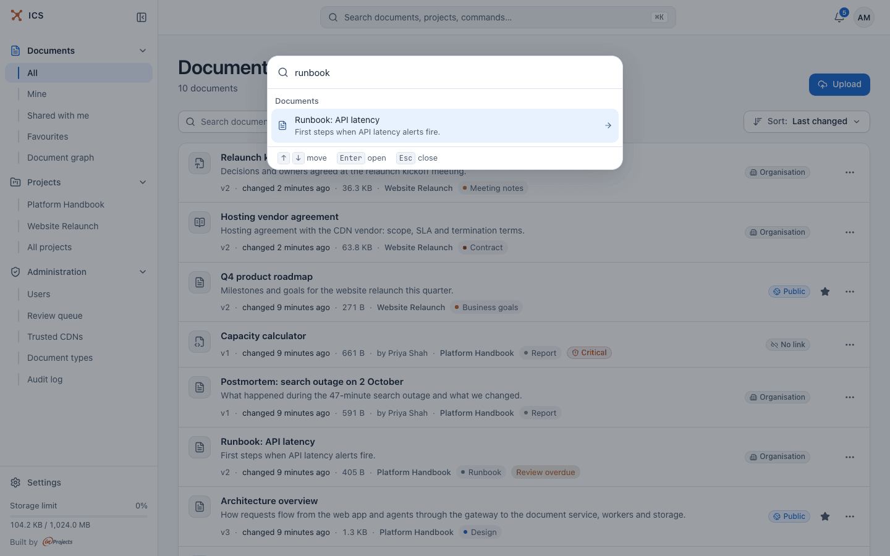

# Search

ICS has one search for all your documents. You use it in two places: the search field above the document list, which filters the list, and the command palette, which jumps straight to a document, a project or a page. Both search the same documents in the same way.

## Search the document list

Type in **Search documents…** above the document list.

- The search runs over every document you can open, not only the page you see, and the results replace the list.
- It respects the sidebar scope (**All**, **Mine**, **Shared with me**, **Favourites**) and the active [filters](documents.md#filter-the-list), so you can, for example, search only PDFs in one project.
- The count under the heading changes to "N matching out of M documents".
- Results are sorted by **Relevance**. You can pick another order in the sort menu while searching; clearing the search returns to your usual sort.

Clear the field (or click its clear button) to see the whole list again.

When nothing matches, the list shows **No results for "*query*"** with the note "We searched titles, summaries, tags and the text of Markdown, PDF and Word documents. Try another query or clear the search."

## What is searched

| Searched | Notes |
|---|---|
| Title and the document's short address (slug) | A document whose title matches the query exactly comes first. |
| Description and tags | |
| Text of Markdown documents | Every `.md` file of a collection. |
| Text of PDFs | The text layer of the file; for scanned pages, the text recognized by [OCR](formats.md#scanned-pages-and-ocr) once it finishes. |
| Text of Word and OpenDocument files | The converted text. |
| HTML bundles | Only the title, address, description and tags, not the page content. |

Only the current version of each document is searched. Documents you cannot open never appear in results, and neither do deleted ones.

## How matching works

- **Every word must match.** `release process` finds documents that contain both words, in any place.
- **Words match from the start.** `deploy` also finds "deployment" and "deployed". There is no stemming beyond that, and typing mistakes are not corrected.
- **Quotes find an exact phrase.** `"architecture decision"` finds the two words next to each other, in that order.
- **Accents do not matter.** `cafe` finds "café", and the other way round.
- **Identifiers stay whole.** Version numbers, file names and similar terms such as `v1.3` or `release-process.md` are matched as one term.
- Single letters are ignored. A single digit is searched as an exact number.

Type at least two characters (or one digit). With less, the list says "Enter at least two characters or a digit to search." A query can be up to 200 characters long.

> [!TIP]
> If a search finds too much, add a word or put a phrase in quotes. If it finds nothing, remove words: every one of them has to appear.

## Search from anywhere: the command palette

Press **Ctrl+K** (**Cmd+K** on a Mac), or click **Search documents, projects, commands…** in the top bar. On a phone, tap the search icon.

Before you type, the palette shows your projects, a few **Actions** and the **Go to** list. As you type, it narrows everything down:

- **Documents**: up to six matching documents, found with the full search described above, each with its description;
- **Projects**: projects whose name contains what you typed;
- **Actions**: **Upload a document**, **New project**, **Switch to dark mode** or **Switch to light mode**;
- **Go to**: **Documents**, **Projects**, **Notifications**, **Settings**, and **Administration** for administrators.

Move with the arrow keys, open with Enter, close with Esc. If nothing matches, the palette says "Nothing matches. Try another word."

The palette is the quickest way to open a document you know by name. To browse many results, use the document list instead: it has no limit, shows filters and pages through all matches.

## Other places with search

- A project's **Documents** tab has its own search field, "Search the project's documents", limited to that project. See [Projects](projects.md).
- The document graph can search for a document and walk to it on the canvas. See [Relations and the document graph](graph.md#search-and-walk-to-a-document).
- The PDF reader searches inside the open PDF. See [Document formats](formats.md#read-a-pdf).
- AI agents connected through ics-mcp use the same search. See [AI agents](ai-agents.md).

## Related

- [Documents](documents.md): the document list, filters and sorting
- [Getting started](getting-started.md): the interface and the command palette
- [Document formats](formats.md): which text each format makes searchable
- [Relations and the document graph](graph.md): finding documents through their relations
