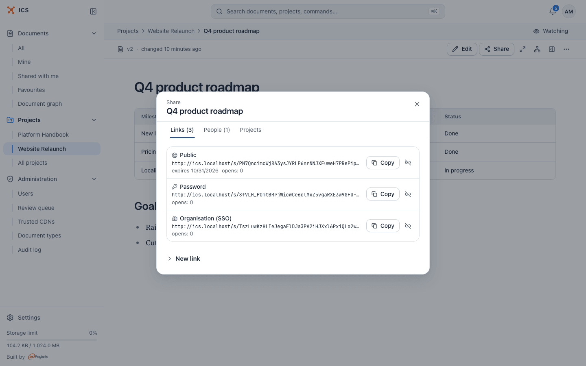
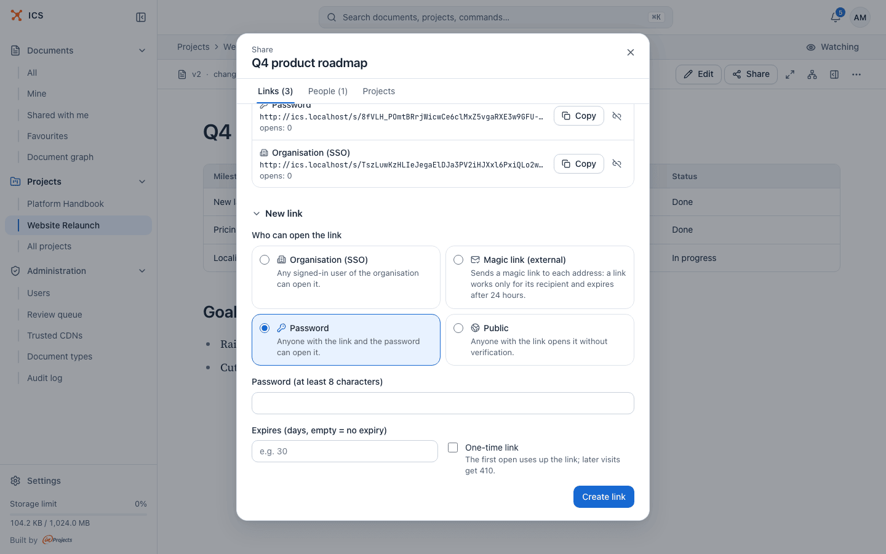
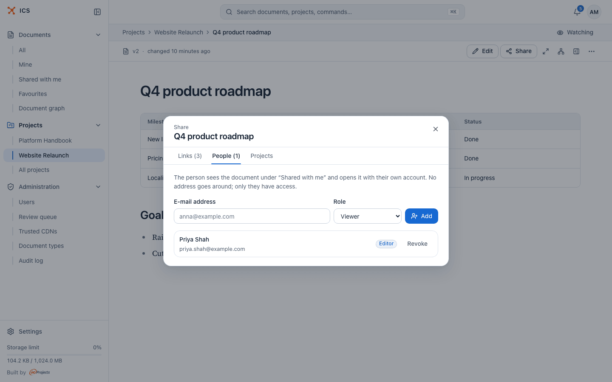
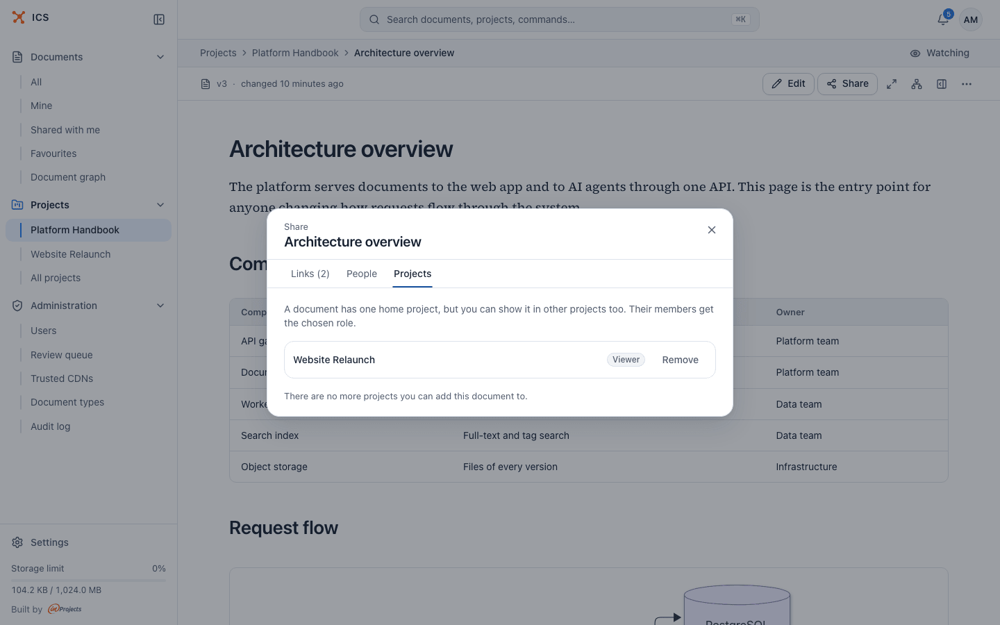
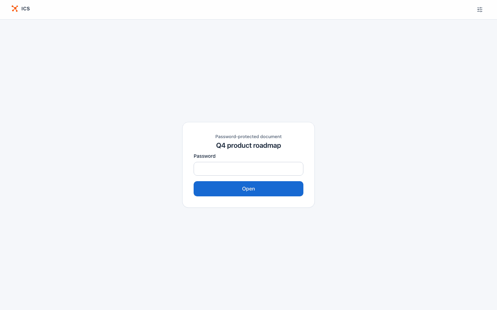
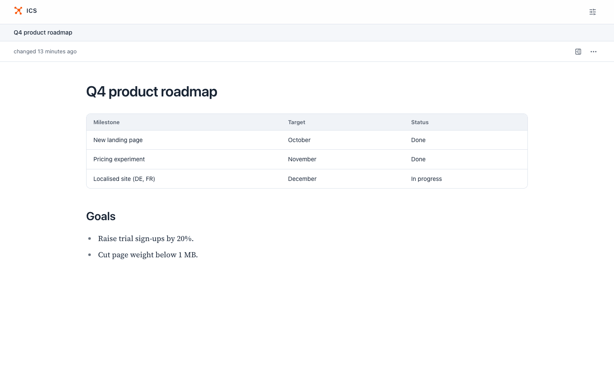

# Sharing

Every document in ICS can be opened by exactly the people you choose. You share through **links** (one document can have several, each with its own audience), through **personal grants** to named people, and through **projects**. This page explains each option, when it fits, and what the person on the other end sees.

## Who can share

Sharing is managed by the document's owner, by the owner of the project the document belongs to, and by administrators. Editors and viewers can read and (editors) change the document, but cannot hand out access: for them the **Share** button is not shown, and the share dialog says "Only the file owner (or the owner of the project the file belongs to) can manage its sharing."

A document can also be blocked from sharing for a while. When the security scan marks an HTML bundle or a document as **Critical**, sharing stays off until an administrator approves it, and the menu shows the reason "Needs administrator approval (security review)". See [Document formats](formats.md#security-scan-and-review).

## Open the share dialog

- In the reader, click **Share** in the toolbar.
- In the document list, click **…** on a row and pick **Share**.

The dialog has three tabs: **Links**, **People** and **Projects**. The numbers next to the first two count the active links and the people with a grant.

## Links that already exist

When you upload a document, ICS creates its first link straight away, with the audience you picked in the upload dialog (**Organisation** or **Public**, see [Documents](documents.md#upload-documents)). So most documents start with one link, which you will find on the **Links** tab.

Each link card shows:

- the mode (**Organisation (SSO)**, **Magic link (external)**, **Password** or **Public**);
- the link address and a **Copy** button;
- "expires *date*", when the link has an expiry date;
- for a magic link, the number of recipients;
- the number of opens ("opens: 3"), or for a one-time link "0/1", which turns into "1/1 · used up" after the first open;
- an icon button **Revoke link**.

Revoked links stay in the list, greyed out and marked "revoked", so you can see what existed.

## Choose a link mode

Open **New link** at the bottom of the **Links** tab. Under **Who can open the link** pick one of four modes. They are listed from the narrowest audience to the widest.

| Mode | Who gets in | Use it when |
|---|---|---|
| **Organisation (SSO)** | "Any signed-in user of the organisation can open it." The visitor must be signed in to ICS with an e-mail address in one of your organisation's domains. | The default for internal documents. Everyone in the company can open it, nobody outside can, and the audit log records who opened it. |
| **Magic link (external)** | Only the e-mail addresses you list. Each address gets its own e-mail with a personal link. | Sharing with a few named people outside the organisation, such as a client, without asking them to create an account. |
| **Password** | "Anyone with the link and the password can open it." | You need to send the document to people outside the organisation and cannot name them in advance, but you do not want the link alone to be enough. |
| **Public** | "Anyone with the link opens it without verification." | The content is meant to be public, or it is harmless if the link is forwarded. |

> [!NOTE]
> Which e-mail domains count as "the organisation" is set by your administrator (`ICS_ALLOWED_DOMAINS`). People whose address is outside those domains cannot open an **Organisation (SSO)** link. The check looks at the e-mail domain, not at the role, so this covers most accounts with the **External client** role.

### Share with the whole organisation

1. Open **New link**, pick **Organisation (SSO)**.
2. Optionally set an expiry or make it one-time (see [Limit a link](#limit-a-link-expiry-and-one-time-links)).
3. Click **Create link**, then **Copy** on the new card.

A visitor who is not signed in sees "Sign-in required" and "This link is only available to signed-in members of the organisation.", with a **Sign in** button. After signing in they land on the document.

### Share with named people outside the organisation

1. Open **New link**, pick **Magic link (external)**.
2. In **E-mail addresses (comma or newline separated)** enter the recipients, for example `anna@client.com, jan@partner.com`.
3. Click **Create link**.

ICS sends each address an e-mail with its own link. "A link works only for its recipient and expires after 24 hours." The personal link opens the document in that browser. Someone who opens the plain link without the personal part sees "Access by email" and "This link requires an invitation. Open the message we sent to your address: it contains a personal link that grants access."

A recipient who has an ICS account under the same address and is signed in opens the document directly.

> [!TIP]
> The 24 hours apply to the personal link in the e-mail, which unlocks the document in the browser where it is opened. If a recipient misses the window, create a new magic link for them.

### Share with a password

1. Open **New link**, pick **Password**.
2. Type the password in **Password (at least 8 characters)**. A strength meter under the field tells you how easy it is to guess.
3. Click **Create link**.

Send the link and the password through different channels, for example the link by e-mail and the password by phone. ICS stores only a hash of the password, so you cannot look it up later: if you forget it, revoke the link and create a new one. ICS limits how many wrong passwords one address can try in a row.

### Share publicly

1. Open **New link**, pick **Public**.
2. Click **Create link**.

Anyone who has the address can open the document, with no sign-in and no password. Treat a public link as published: it can be forwarded, posted or indexed.

## Limit a link: expiry and one-time links

Two optional fields sit under the mode choice:

- **Expires (days, empty = no expiry)**: the number of days from now after which the link stops working. Leave it empty for a link that never expires.
- **One-time link**: "The first open uses up the link; later visits get 410." Use it for a document you send to one person once, such as a contract draft.

A visitor who opens an expired, used-up or revoked link sees "This link does not work" with the reason: "The link has expired.", "The link has reached its open limit." or "The link has been revoked."

People who already have access to the document (its owner, project members, people with a grant) do not use up a one-time link and are not counted in "opens", so you can check the link yourself without spending it.

> [!NOTE]
> The web app offers a one-time limit only. The ICS API and the MCP server for AI assistants accept any open limit (for example 5 opens), see [AI agents](ai-agents.md).

## Revoke a link

1. On the **Links** tab, click the **Revoke link** icon on the card.
2. Confirm **Revoke link**. "Once revoked, the link stops working immediately."

Revoking cannot be undone. To share again, create a new link: it gets a new address.

Deleting a document revokes all its links at once (see [Documents](documents.md#delete-a-document)).

## Give a named person access

A personal grant is the right choice when the person has, or will get, an ICS account and should see the document as part of their own work.

1. Open the **People** tab.
2. Enter the **E-mail address**.
3. Pick the **Role**: **Viewer** or **Editor**.
4. Click **Add**.

"The person sees the document under "Shared with me" and opens it with their own account. No address goes around; only they have access." If the address has no ICS account yet, ICS creates one and sends an invitation e-mail with a link to set a password; the message after **Add** says "Invitation sent to *address* (new account)". The invitation link is valid for 7 days.

The two roles:

| Role | Can do |
|---|---|
| **Viewer** | Read the document, see its versions and compare them, download it, add it to favourites. |
| **Editor** | Everything a viewer can, plus rename, edit and upload new content, restore older versions, change the description, metadata and tags, add relations, request OCR and open the agent view. |

Neither role can share the document further, move it to another project or delete it. Those stay with the owner and the project owner.

To remove access, click **Revoke** next to the person and confirm **Revoke access**. "They will no longer be able to open this file."

## Show a document in other projects

The **Projects** tab is shown only to the document's owner and the owner of its project. "A document has one home project, but you can show it in other projects too. Their members get the chosen role."

1. Pick a project. Only projects where you are an owner or an editor are offered.
2. Pick the role, **Viewer** or **Editor**.
3. Click **Add**.

A project share gives at most the role you pick, and **Editor** only to members who are editors or owners of that project; viewers of the project still only read. Click **Remove** to take the document out of a project again. More on how projects give access is in [Projects](projects.md#show-a-document-in-several-projects).

## What a visitor sees

A visitor who opens a link without being signed in gets a reduced page: the ICS logo, an **Appearance and language** button for the theme and language, and the document itself. There is no sidebar and no **Edit** or **Share** button.

The visitor can:

- read the document, including the files of a collection;
- open the document panel (contents and version history) with the panel icon;
- download the document from the **…** menu, unless it is held for review.

A password link first shows a password gate. After the right password the document opens, and the browser is not asked again for that link during its session.

| Password gate | After entering the password |
|---|---|
|  |  |

If a team member who already has access opens a link, ICS shows them the full reader instead, with all the actions their role allows, and does not ask for the password.

A signed-in person whose account does not match the link (for example an organisation link opened with an account from another domain) sees "No access" and "This link does not open the document for your account. Ask the person who sent it for access or for a link that works outside the organisation."

## Copy the address from the browser

You can paste the address from the browser's address bar into a chat. When the document has an active **Organisation (SSO)** or **Public** link without an open limit, the reader shows that link's address in the address bar for the document's owner and the project owner, so the copied address works for the recipient. Otherwise the address is the internal `/v/...` one.

Someone who opens an internal `/v/...` address without access is sent to a link they can use, when there is one: an organisation link if they are signed in with an organisation account, otherwise a public link, then a password link. One-time links are never used for this, so nobody else spends them.

## Find documents shared with you

Click **Shared with me** in the sidebar. The list shows documents other people gave you access to, directly or through a project you are a member of. It is the regular document list, so search, filters and sorting work as described in [Documents](documents.md#find-your-way-in-the-document-list).

## Related

- [Documents](documents.md): uploading, the document list and the reader
- [Projects](projects.md): members, roles and showing a document in several projects
- [Document formats](formats.md): the security scan and the review of risky content
- [Notifications](notifications.md): hear about changes to shared documents
- [Administration](administration.md): the review queue and organisation domains
