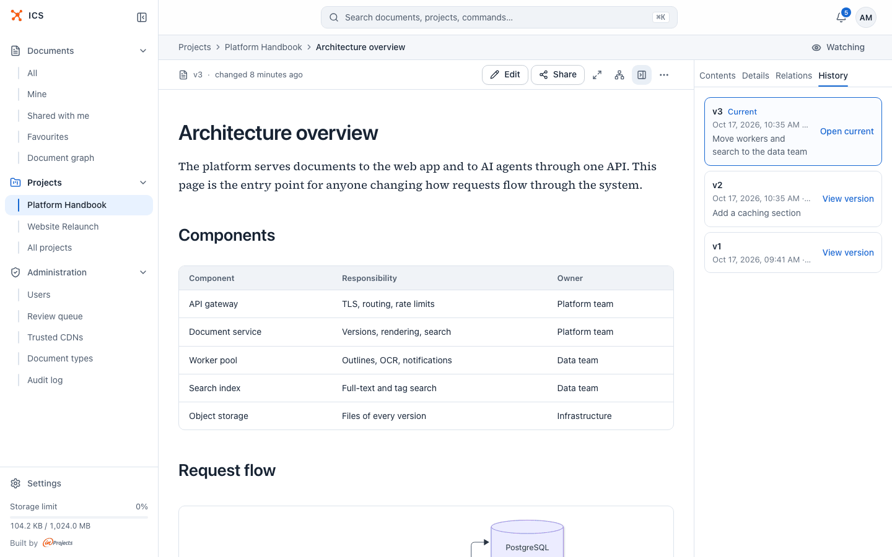
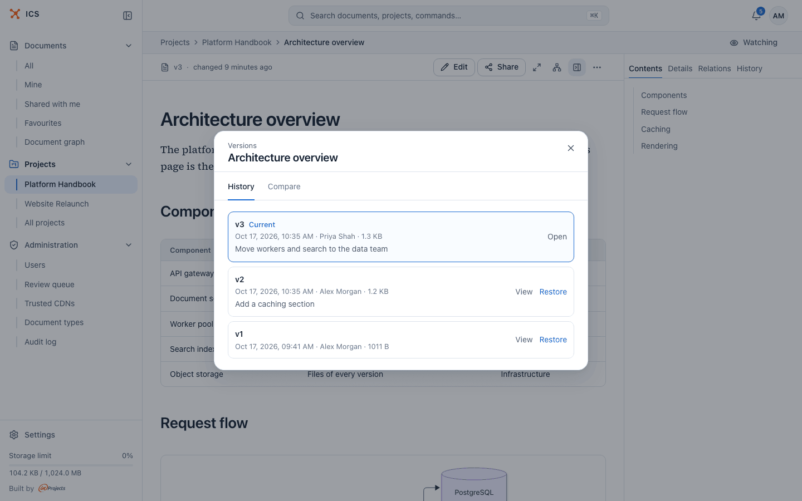
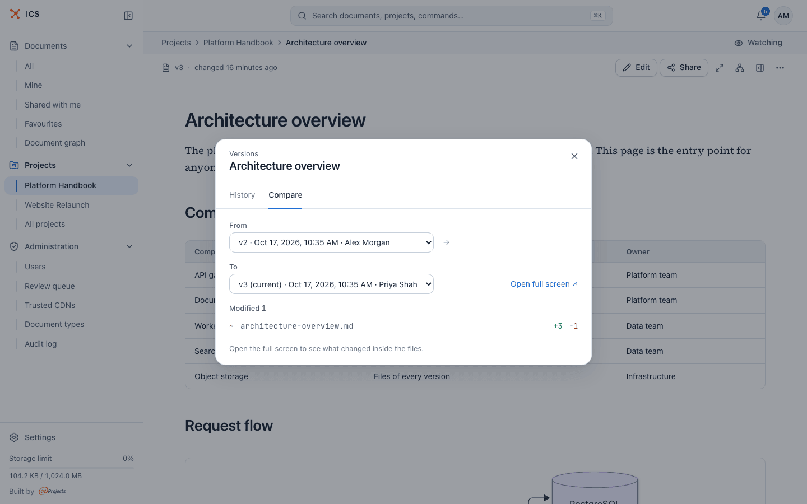
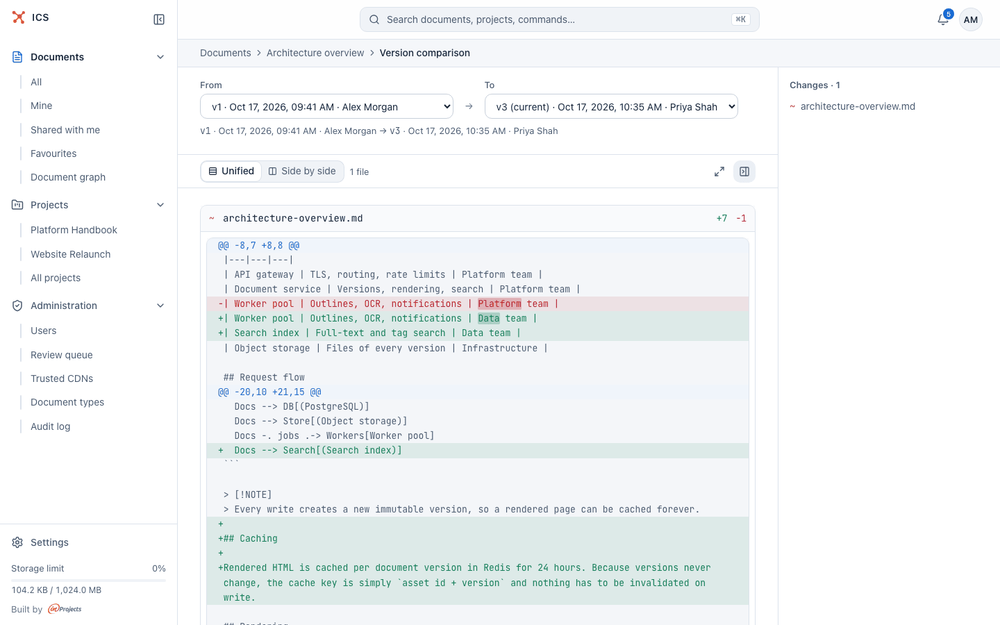
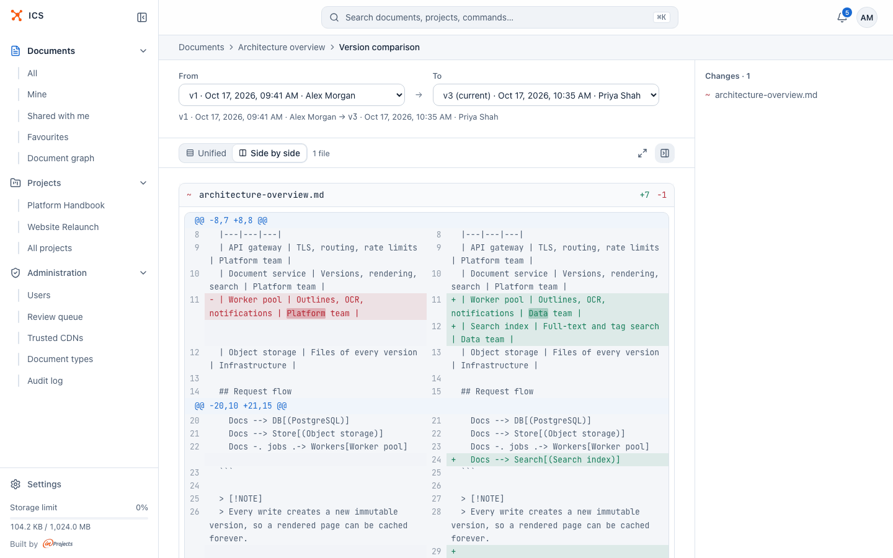
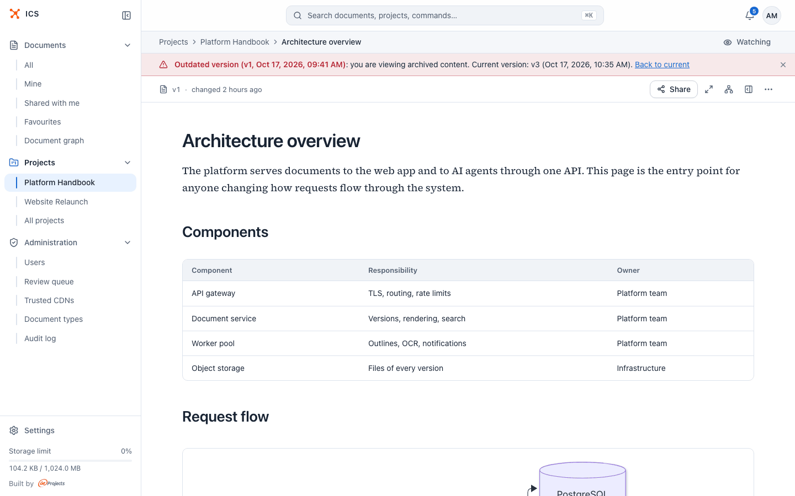

# Versions

ICS never overwrites a document. Every change of content (an edit in the browser, an uploaded file, a sync from GitLab, a restore) creates a new numbered version, and the earlier ones stay available. This page shows how to read the history, compare versions, look at an old one and bring it back.

## What creates a new version

- saving in the Markdown editor;
- **Update content** with a new file or folder;
- adding, moving or deleting a file in a collection;
- a push to a connected GitLab repository (see [GitLab](gitlab.md));
- restoring an older version.

Renaming a document, changing its description, metadata or tags, and sharing it do not create versions.

Share links always show the current version. When you publish a new version, everyone who opens an existing link sees the new content; there is nothing to re-send.

## Write a change note

The Markdown editor and **Update content** have a **Change note** field ("What changed? (optional)"). A short note, up to 1000 characters, such as "Move workers and search to the data team", makes the history readable for the next person. It is optional, but worth the few seconds.

## See the version history

There are two places:

- the **History** tab of the document panel in the reader, for everyone who can open the document, including visitors of a share link;
- **Versions (N)** in the **…** menu, a dialog with more detail and the **Restore** button. It appears once a document has more than one version.

Each entry shows the version number, the date and time, and the change note. The current version is marked **Current**. **View version** opens an older version; **Open current** goes back.

The **Versions** dialog adds the author and the size of each version.

## Compare two versions

### Quick summary

Open **Versions (N)** and switch to the **Compare** tab. Pick the versions in **From** and **To**. The dialog lists the changed files under **Added**, **Removed** and **Modified**, with the number of added and removed lines, for example `architecture-overview.md +3 -1`.

Click **Open full screen ↗** to see what changed inside the files.

### Full comparison

**Compare versions** in the **…** menu opens the comparison page with the last two versions. Pick other versions with **From** and **To** at the top.

- **Unified** shows the old and the new lines in one column, with the changed words highlighted inside a line.
- **Side by side** shows the earlier version on the left and the newer one on the right.

Long lines wrap in both modes, so nothing is cut off at the right edge. ICS remembers the mode you chose. The panel on the right, **Changes · N**, lists the changed files; click one to jump to it.

What the comparison can show depends on the format:

- **Markdown and collections**: line by line, for every `.md` file.
- **HTML bundles**: line by line for text files (HTML, CSS, JavaScript, JSON and so on); images and fonts are listed as binary.
- **PDF and Word files**: the comparison only tells you that the file changed ("Binary file: a line diff would show nothing here."). Compare the two versions by opening them.

## Look at an older version

Click **View version** in the **History** tab (or **View** in the **Versions** dialog). The reader opens the old version read-only, under a red banner:

> Outdated version (v1, *date*): you are viewing archived content. Current version: v3 (*date*). **Back to current**

Both dates are the times the versions were created, the same as in the version history.

While you look at an archived version:

- **Edit** and **Update content** are not offered, because they would write to the current version;
- the **Contents** tab shows the headings of that version;
- an HTML bundle opens with a red warning bar at its top ("Open preview of v1");
- the address carries `?ver=1`, so you can send a colleague a link to exactly that version.

## Restore an older version

1. Open **Versions (N)** in the **…** menu.
2. Click **Restore** next to the version you want.
3. Confirm. "This creates a new current version as a copy of v2. Older versions stay in the history."

Restoring does not delete anything. If you restore v2 of a document that has three versions, you get v4 with the content of v2, and v3 stays in the history in case you need it again.

Restoring needs the editor role or higher. Viewers see the history and can compare versions, but get no **Restore** button.

## Related

- [Documents](documents.md): editing and updating content
- [Document formats](formats.md): what each format stores
- [Sharing](sharing.md): links always point to the current version
- [Notifications](notifications.md): hear about new versions of documents you watch
- [GitLab](gitlab.md): versions published from a repository
